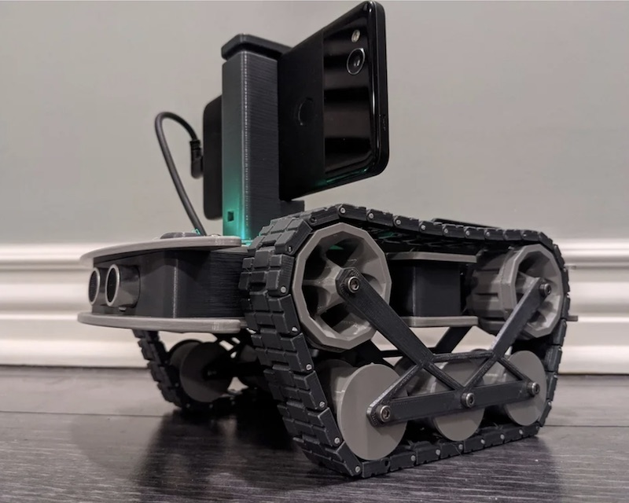
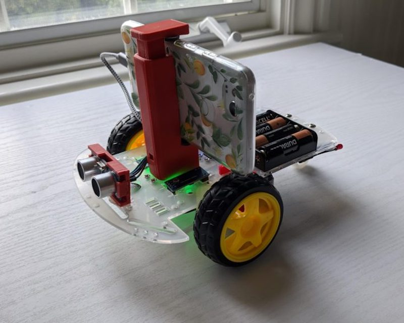

<a href="https://www.openbot.org/" target="_blank">
  
</a>

<h1 align="center"><a>Превращаем смартфоны в роботов</a></h1>

<p align="center">
   </a>
   </a>
   </a>
   </a>
   </a>
   </a>
   </a>
   </a>
</p>

<p align="center">
  <a href="README.md">English</a> |
  <a href="README.zh-CN.md">简体中文</a> |
  <a href="README.de-DE.md">Deutsch</a> |
  <a href="README.fr-FR.md">Français</a> |
  <a href="README.es-ES.md">Español</a> |
  <a href="README.ko-KR.md">한국어</a> |
  <span>Русский</span>
</p>

OpenBot использует смартфоны в качестве «мозга» для недорогих роботов. Мы спроектировали небольшой электрический транспорт, который стоит около 50 долларов и служит корпусом робота. Наш программный стек для Android-смартфонов поддерживает сложные робототехнические задачи, такие как следование за человеком и автономная навигация в реальном времени.

## Начало работы с OpenBot

- Прочитайте [Дисклеймер](DISCLAIMER.ru_RU.md)
- Соберите собственный [Корпус робота](body/README.ru_RU.md)
- Прошейте [прошивку Arduino](firmware/README.ru_RU.md)
- Установите [Приложение робота](robot/README.ru_RU.md)
- Управляйте роботом через [Контроллер](controller/README.ru_RU.md)
- Программируйте вашего робота в [Playground](open-code/README.ru_RU.md)
- Обучите собственную [Политику вождения](policy/README.ru_RU.md)

## Получите исходный код

- Вы можете скачать репозиторий в виде [zip-архива](https://github.com/ob-f/OpenBot/archive/master.zip) и распаковать его в выбранную папку.
- Вы можете клонировать репозиторий OpenBot с GitHub с помощью следующей команды:
    ```bash
    git clone https://github.com/ob-f/OpenBot.git
    ```
- Вы можете сделать форк репозитория OpenBot, а затем клонировать свою локальную копию. Это рекомендуется, особенно если вы хотите [внести вклад](CONTRIBUTING.ru_RU.md).

## Видео

<a href="https://www.youtube.com/watch?v=RbzPXywJifA" >
  
</a>

<a href="https://www.youtube.com/watch?v=qc8hFLyWDOM" >
  
</a>

## Классные проекты с OpenBot

Уже существует много интересных проектов на базе OpenBot. Ниже приведена небольшая подборка. Нажмите на изображения, чтобы перейти к соответствующим проектам.

<p float="left">
  <a href="https://www.thingiverse.com/thing:4670884" target="_blank">
    
  </a>
  <a href="https://diyrobocars.com/2020-12-14/an-improved-version-of-the-intel-openbot" target="_blank">
    
  </a>
  <a href="https://custom-build-robots.com/raspberry-pi-robot-cars/openbot-your-smartphone-controls-a-robot-car-introduction/13860?lang=en" target="_blank">
    
  </a>
  <a href="https://www.youtube.com/watch?v=PEj8jWapGt4" target="_blank">
    
  </a>
</p>

## Контакты

- Присоединяйтесь к нашему каналу [Slack](https://join.slack.com/t/openbot-community/shared_invite/zt-jl8ygxqt-WNRNi9yzh7Lu60qui6Nh6w), чтобы общаться с сообществом OpenBot.
- Свяжитесь с нами по [электронной почте](mailto:openbot.team@gmail.com)

## Внесение вклада

Пожалуйста, ознакомьтесь с [руководством по внесению вклада](CONTRIBUTING.ru_RU.md). Если вы не знаете, с чего начать, посмотрите [открытые задачи](https://github.com/ob-f/OpenBot/issues).

## Цитирование

Пожалуйста, цитируйте нашу [статью](https://arxiv.org/abs/2008.10631), если вы используете OpenBot.

```bib
@inproceedings{mueller2021openbot,
    title     = {OpenBot: Turning Smartphones into Robots},
    author    = {M{\"u}ller, Matthias and Koltun, Vladlen},
    booktitle = {Proceedings of the International Conference on Robotics and Automation (ICRA)},
    year = {2021},
}
```

<a href="https://www.openbot.org//" target="_blank">
  
</a>
