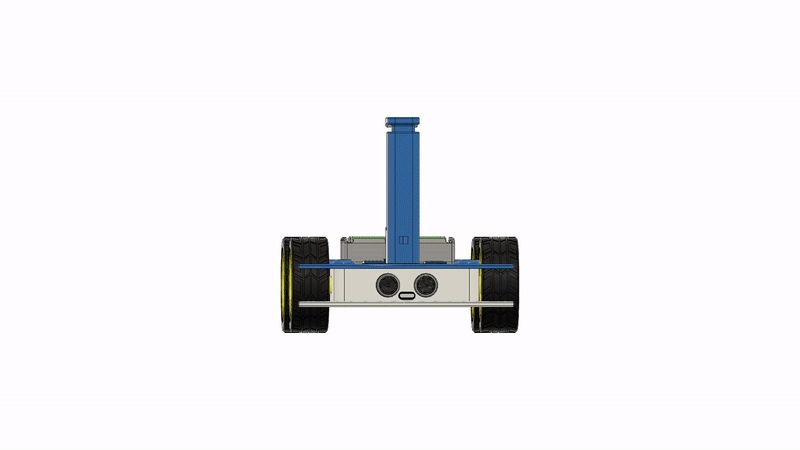
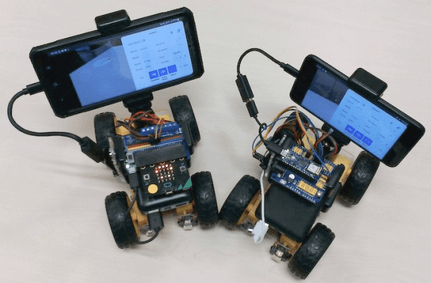
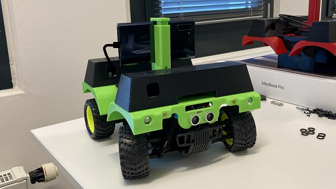
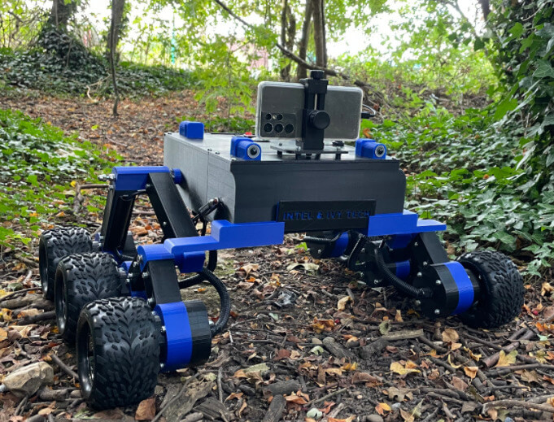

# OpenBot: Корпус робота

  <a href="README.md">English</a> |
  <a href="README.zh-CN.md">简体中文</a> |
  <a href="README.de-DE.md">Deutsch</a> |
  <a href="README.fr-FR.md">Français</a> |
  <a href="README.es-ES.md">Español</a> |
  <a href="README.ko-KR.md">한국어</a> |
  Русский

Вы можете купить готовый к использованию [ready-to-run (RTR)](rtr) OpenBot на Amazon:
- [RTR-TT](https://buy.openbot.org/rtr-tt)
- [RTR-520](https://buy.openbot.org/rtr-520)

По запросам на крупные заказы, пожалуйста, свяжитесь с нами по электронной почте.

## Сборка собственными силами

Вы можете собрать любой колёсный корпус робота вокруг микроконтроллера, такого как Arduino Nano, для работы с программным стеком OpenBot. Мы спроектировали [напечатанный на 3D-принтере корпус](diy) для колёсного робота, основанный на недорогих, легкодоступных хобби-компонентах. [OpenBot Lite](lite) — это меньшая и упрощённая версия самодельного OpenBot, разработанная для образовательных целей. Даже если вы не хотите его собирать, вам могут быть полезны [пошаговые видеоинструкции](lite/#step-by-step-video-guides). Мы также спроектировали [напечатанный на 3D-принтере корпус](rc_truck) для коммерчески доступных RC-грузовиков масштаба 1:16 (например, [этого](https://www.amazon.de/dp/B00M3J7DJW)). Кроме того, мы предоставляем чертежи для сборки [вездехода](mtv) — универсальной платформы для проектов на открытом воздухе с использованием фреймворка OpenBot.

Ниже приведено несколько примеров с инструкциями по сборке и дополнительными подробностями:

<table style="width:100%;border:none;text-align:center">
  <tr>
  <td>  
  </td>
  <td>
  
  </td>
  <td>
  
  </td>
  <td>
  
  </td>
  <td>
  
  </td>
  </tr>
  <tr>
    <td><a href="diy"> DIY </a></td>
    <td><a href="lite"> Lite </a></td>
    <td><a href="rc_truck"> RC Truck </a></td>
    <td><a href="mtv"> Вездеход </a></td>
    <td><a href="rtr"> RTR </a></td>
  </tr>
</table>

## Далее

Прошейте [прошивку Arduino](../firmware/README.ru_RU.md)
