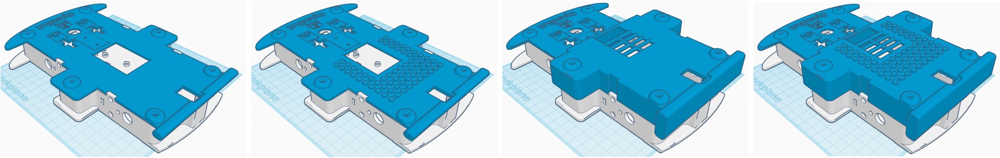
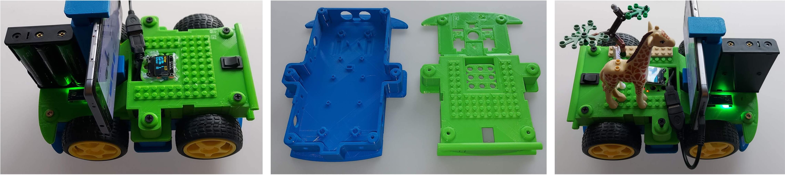

# Blocky Body с дополнительным пространством и поддержкой Lego

  <a href="README.md">English</a> |
  <a href="README.zh-CN.md">简体中文</a> |
  <a href="README.de-DE.md">Deutsch</a> |
  <a href="README.fr-FR.md">Français</a> |
  <a href="README.es-ES.md">Español</a> |
  <a href="README.ko-KR.md">한국어</a> |
  Русский

Это шасси робота обеспечивает дополнительную высоту, чтобы легче размещать всю электронику, а также имеет совместимую с Lego верхнюю часть. Эта версия предлагает те же прочностные характеристики, что и [стандартный корпус](../regular_body/), с дополнительными возможностями, такими как дополнительное пространство внутри корпуса OpenBot, совместимая с Lego верхняя часть для игр и обучения, а также габариты, подходящие для меньших печатных платформ, при сохранении бамперов.

## Детали

Вам нужно напечатать нижнюю часть и одну из верхних частей:

- `block_body_bottom`([STL](block_body_bottom.stl), [STEP](block_body_bottom.step)): нижняя часть корпуса
- `block_body_top`([STL](block_body_top.stl), [STEP](block_body_top.step)): базовая верхняя часть корпуса
- `block_body_top_lego`([STL](block_body_top_lego.stl), [STEP](block_body_top_lego.step)): базовая верхняя часть корпуса с поверхностью, совместимой с Lego
- `block_body_top_big`([STL](block_body_top_big.stl), [STEP](block_body_top_big.step)): большая верхняя часть корпуса с дополнительным объёмом для электроники
- `block_body_top_lego`([STL](block_body_top_big_lego.stl), [STEP](block_body_top_big_lego.step)): большая верхняя часть корпуса с поверхностью, совместимой с Lego

Для приведённых выше деталей печатная платформа должна быть не менее 221x150mm.

## Настройки печати

Для лучших результатов мы рекомендуем использовать следующие настройки печати:

- Высота слоя: 0.2mm
- Количество линий стенки: 3 (больше стенок для лучшей прочности больших поверхностей)
- Верхние слои: 5
- Нижние слои: 4
- Заполнение: 25%
- Рисунок заполнения: концентрический (Concentric) — по нашим наблюдениям, этот режим экономит время и пластик
- Скорость печати: 50mm/сек
- Генерация поддержек: Да
- Рисунок поддержек: концентрический (Concentric)
- Плотность поддержек: 15%
- Включить ободок поддержек (Support Brim): Да
- Тип адгезии к платформе (Build Plate Adhesion Type): None

Удачной сборки робота!

