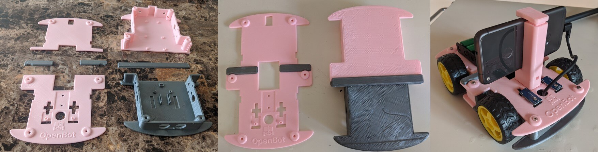

# Корпус на склейке

  <a href="README.md">English</a> |
  <a href="README.zh-CN.md">简体中文</a> |
  <a href="README.de-DE.md">Deutsch</a> |
  <a href="README.fr-FR.md">Français</a> |
  <a href="README.es-ES.md">Español</a> |
  <a href="README.ko-KR.md">한국어</a> |
  Русский

У некоторых 3D-принтеров область печати слишком мала для печати полноразмерного корпуса OpenBot.
В этой папке находится корпус OpenBot, разделённый на 4 части.
Его можно напечатать на печатной платформе размером всего 150mmx140mm, а затем склеить.

## Детали

Необходимые детали:

1) `glue_body_bottom_A` ([STL](glue_body_bottom_A.stl), [STEP](glue_body_bottom_A.step))
2) `glue_body_bottom_B` ([STL](glue_body_bottom_B.stl), [STEP](glue_body_bottom_B.step))
3) `glue_body_top_A` ([STL](glue_body_top_A.stl), [STEP](glue_body_top_A.step))
4) `glue_body_top_B` ([STL](glue_body_top_B.stl), [STEP](glue_body_top_B.step))

Дополнительные детали:

Эти элементы дают дополнительную площадь поверхности для склейки, что может помочь, если ваша печать подвержена короблению (warping).

* `glue_connector_bottom` ([STL](glue_connector_bottom.stl), [STEP](glue_connector_bottom.step))
* `glue_connector_top_A` ([STL](glue_connector_top_A.stl), [STEP](glue_connector_top_A.step))
* `glue_connector_top_B` ([STL](glue_connector_top_B.stl), [STEP](glue_connector_top_B.step))
