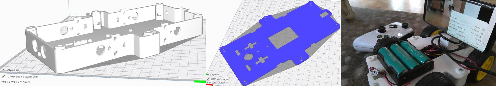

# Slim Body / Утончённый корпус

  <a href="README.md">English</a> |
  <a href="README.zh-CN.md">简体中文</a> |
  <a href="README.de-DE.md">Deutsch</a> |
  <a href="README.fr-FR.md">Français</a> |
  <a href="README.es-ES.md">Español</a> |
  <a href="README.ko-KR.md">한국어</a> |
  Русский

У некоторых 3D-принтеров область печати слишком мала для печати полноразмерного корпуса OpenBot.
В этой папке находится утончённая версия корпуса OpenBot.
Её можно напечатать на печатной платформе 220mmx220mm, если повернуть детали на 45 градусов.

## Детали

1) `slim_body_bottom` ([STL](slim_body_bottom.stl), [STEP](slim_body_bottom.step))
2) `slim_body_top` ([STL](slim_body_top.stl), [STEP](slim_body_top.step))

Чтобы детали поместились, возможно, вам придётся настроить следующие параметры, чтобы получить максимальную область печати.

- Установите *Build Plate Adhesion Type* в значение "None" (Brim, Skirt и Raft увеличивают общий размер вашей печати)
- Отключите prime blob (в разделе *Build Plate*)
- Отключите второй экструдер (если он есть у вашего принтера)

Если у вас есть немного дополнительного места (223mmx223mm), вы также можете напечатать `slim_body_top_rim` ([STL](slim_body_top_rim.stl), [STEP](slim_body_top_rim.step)). У него слегка больший обод, что делает снятие крышки проще.
