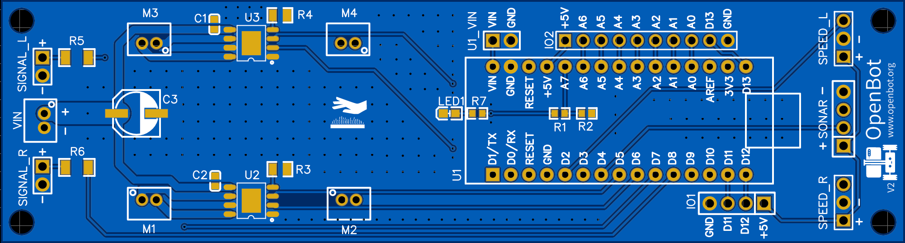
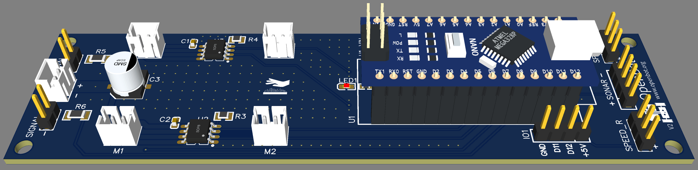
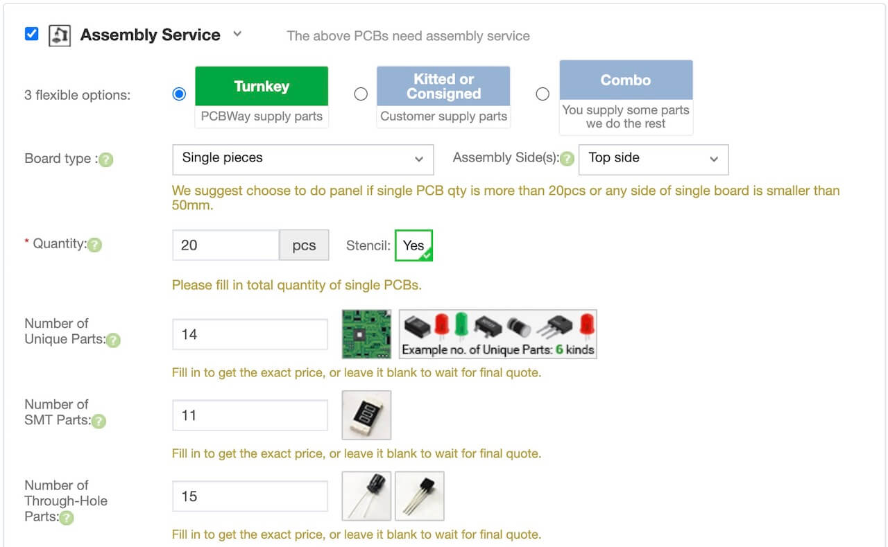

# Пользовательская печатная плата (Custom PCB)

  <a href="README.md">English</a> |
  <a href="README.zh-CN.md">简体中文</a> |
  <a href="README.de-DE.md">Deutsch</a> |
  <a href="README.fr-FR.md">Français</a> |
  <a href="README.es-ES.md">Español</a> |
  <a href="README.ko-KR.md">한국어</a> |
  Русский

Пользовательская печатная плата служит несущей платой для Arduino Nano и интегрирует современные драйверы двигателей, схему делителя напряжения и резисторы для светодиодов. Arduino просто вставляется в штырьковый разъём, а все датчики и светодиоды подключаются через провода Dupont к соответствующим разъёмам.

Актуальная версия платы — [версия 2](v2). Вот изменения по сравнению с [версией 1](v1):

- Перенос правого датчика скорости на вывод D3 для включения функциональности прерываний
- Добавлен светодиод питания основной батареи
- Обновлены некоторые компоненты на более распространённые и доступные
- Делитель напряжения обновлён до 20k/10k для лучшей точности
- Разъёмы двигателей заменены на вертикальную версию для более удобного доступа

Если вы уже заказали [версию 1](v1) платы ([2D вид](../../../docs/images/pcb_2d_v1.png), [3D вид](../../../docs/images/pcb_3d_v1.png)), не переживайте — она будет работать нормально. Просто убедитесь, что установлен правильный флаг в прошивке.

Изготовление пользовательской печатной платы включает следующие шаги:

1) **Заказ платы**: скачайте файлы [Gerber](v2/gerber_v2.zip) и закажите плату у поставщика на ваш выбор. Вы также можете заказать плату напрямую на [PCBWay](https://www.pcbway.com/project/shareproject/OpenBot__Turning_Smartphones_into_Robots.html), где мы опубликовали проект для OpenBot.
2) **Заказ компонентов**: скачайте [BOM](v2/BOM_v2.csv) и закажите компоненты у поставщика на ваш выбор, например [LCSC](https://lcsc.com).
3) **Сборка платы**: вы можете собрать плату самостоятельно или поручить сборку поставщику. Для автоматизированной сборки вам понадобится [файл центроидов](v2/centroid_file_v2.csv). Если вы заказываете плату на [JLCPCB](https://jlcpcb.com/), вы можете воспользоваться их услугой SMT-сборки. Тогда вам останется только заказать и припаять выводные компоненты самостоятельно. Мы сочли это самым удобным, дешёвым и быстрым вариантом. В [версии 2](v2) платы мы обновили компоненты так, чтобы все они были доступны непосредственно у [JLCPCB](https://jlcpcb.com/).

Вы также можете найти поставщиков, которые предложат готовое решение «под ключ», охватывающее все 3 шага. Они изготовят плату, закупят компоненты и соберут её. Это очень удобно и к тому же недорого. Однако сроки доставки часто очень длинные (1–3 месяца).

При запросе коммерческого предложения на [PCBWay](https://www.pcbway.com/orderonline.aspx) вы можете выбрать услугу сборки после загрузки файла Gerber.

На следующем шаге вам нужно будет загрузить [BOM](v2/BOM_v2.csv) и [файл центроидов](v2/centroid_file_v2.csv). Ваше предложение будет проверено и обновлено в течение нескольких дней. После проверки стоимости и сроков доставки вы сможете перейти к оплате.
