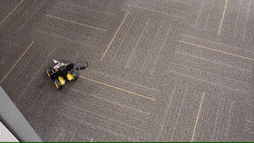
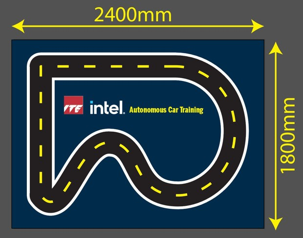
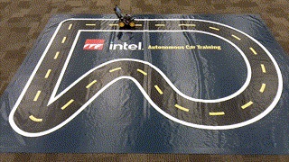

# OpenBot для образования

  <a href="README.md">English</a> |
  <a href="README.zh-CN.md">简体中文</a> |
  <a href="README.de-DE.md">Deutsch</a> |
  <a href="README.fr-FR.md">Français</a> |
  <a href="README.es-ES.md">Español</a> |
  <a href="README.ko-KR.md">한국어</a> |
  Русский

Подразделение eSpace института ITE разработало [учебную программу](#учебная-программа) для экономичного и масштабируемого обучения ИИ и робототехнике на основе программного стека OpenBot. Она представлена в виде [пошаговых видеоинструкций на YouTube](#пошаговые-видеоинструкции), которые проводят вас через сборку [OpenBot Lite](#openbot-lite), установку необходимого программного обеспечения, использование следования за человеком, а также обучение и развёртывание собственной политики автономного вождения.

## OpenBot Lite

OpenBot Lite — это меньшая и упрощённая версия самодельной сборки OpenBot. Эта минималистичная версия была разработана eSpace института ITE, чтобы раскрыть большой потенциал программного стека OpenBot для экономичного и масштабируемого обучения ИИ и робототехнике. OpenBot Lite поддерживает либо [micro:bit](https://microbit.org/) (+ проприетарная плата ввода/вывода), либо Arduino Nano. На изображении ниже слева показан вариант с micro:bit, справа — вариант с Arduino.

  

## Учебная программа

Учебная программа была опробована преподавателями в Южной Корее и Германии, более 100 студентов уже изучили с её помощью ИИ и робототехнику. Вот некоторые результаты наших онлайн-обучений:

* [Южная Корея](https://fb.watch/bDK2Vjgm3g/)
* [Германия](https://www.facebook.com/EspaceCW/posts/5087394677946975)

Следование за человеком в действии:

  

Обучение политики основано на игровой площадке размером 2.4m x 1.8m с разметкой улиц. Робот учится автономно езжать по этим улицам и объезжать препятствия. Это делает учебную программу пригодной для обучения дома.

  

Обученный автопилот в действии:

  

## Пошаговые видеоинструкции

Ниже приведены плейлисты YouTube в последовательном порядке:

Версия с Arduino:
1. [Сборка OpenBot Lite (Arduino)](https://youtube.com/playlist?list=PLNKFHX5MRn52za5VeteCmvLNcL1Kowtw2)
2. [Следование за человеком](https://youtube.com/playlist?list=PLNKFHX5MRn501oWvPbKzP1zkcqhLU5TOh)
3. [Обучение политики](https://youtube.com/playlist?list=PLNKFHX5MRn5233AyCWhcn71JdB9qIEa-E)

Версия с micro:bit:
1. [Сборка OpenBot Lite (micro:bit)](https://youtube.com/playlist?list=PLNKFHX5MRn51xVKHo2VCY-KbOFQrkOm2R)
2. [Следование за человеком](https://youtube.com/playlist?list=PLNKFHX5MRn51crWis1lwFJXj69DN9evG1)
3. [Разбор кода micro:bit](https://youtube.com/playlist?list=PLNKFHX5MRn51DfspxVo16BkfXz8y9uR7N)
4. [Обучение политики](https://youtube.com/playlist?list=PLNKFHX5MRn5233AyCWhcn71JdB9qIEa-E)

## Благодарность

Если вы нашли эти материалы полезными, пожалуйста, ставьте лайки видео и подпишитесь на канал eSpace. Если вам удалось собрать собственный OpenBot Lite и добиться работы следования за человеком и/или автопилота, делитесь историями своего успеха и видео об OpenBot в социальных сетях и в [Slack](https://join.slack.com/t/openbot-community/shared_invite/zt-jl8ygxqt-WNRNi9yzh7Lu60qui6Nh6w). Вы также можете поддерживать и следить за Уиллом Таном (Willam Tan) и командой eSpace, которые разрабатывают образовательные материалы в социальных сетях.

* [Канал OpenBot в Slack](https://join.slack.com/t/openbot-community/shared_invite/zt-jl8ygxqt-WNRNi9yzh7Lu60qui6Nh6w)
* [Facebook eSpace](https://www.facebook.com/EspaceCW)
* [Instagram eSpace](https://www.instagram.com/EspaceCW/)

Мы с нетерпением ждём ваши истории успеха и видео. Наслаждайтесь!

## Далее

Прошейте [прошивку Arduino](../../firmware/README.ru_RU.md)
