# OpenBot: корпус вездехода Multi-Terrain Vehicle (MTV)

  <a href="README.md">English</a> |
  Русский |
  <a href="README.zh-CN.md">简体中文</a> |
  <a href="README.de-DE.md">Deutsch</a> |
  <a href="README.fr-FR.md">Français</a> |
  <a href="README.es-ES.md">Español</a> |
  <a href="README.ko-KR.md">한국어</a>

Здесь мы предлагаем альтернативу оригинальному транспортному средству [OpenBot](https://www.openbot.org/), пригодную для движения по любой местности. Вездеход Multi-Terrain Vehicle (MTV), разработанный совместно с компанией **Ivy Tech LTD**, тоже основан на недорогих и легко печатаемых компонентах. MTV вдохновлён несколькими концепциями исследовательских аппаратов, разработанными за последние десятилетия для лунных и марсианских миссий. MTV построен вокруг набора из 6 приводных колёс, организованных в конфигурации Rocker-Bogie. В отличие от большинства лунных или марсианских роверов, колёса не могут поворачиваться радиально. Поэтому аппарат работает так же, как танк, что делает ручное управление довольно интуитивным.

  

## I. 3D-печать

Для сборки вашего OpenBot MTV нужно напечатать следующие детали.

  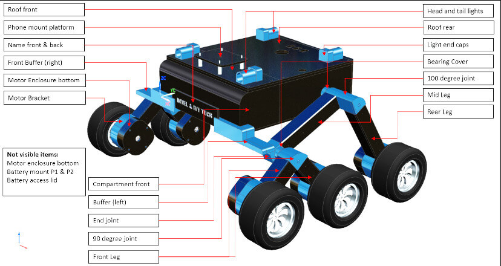

<table>
    <thead>
        <tr>
            <th>ID </th>
            <th>Группа</th>
            <th>Название детали</th>
            <th>Количество</th>
            <th>Изображение (не в масштабе)</th>
            <th>Материал</th>
            <th>Время печати</th>
            <th>Стоимость</th>
        </tr>
    </thead>
    <tbody>
        <tr>
            <td>A1</td>
            <td rowspan=3>Моторный модуль</td>
            <td>Верхняя крышка корпуса мотора   (<a href="cad/MotorAssembly/MotorEnclosure_Top.stl">STL</a>, <a href="cad/MotorAssembly/MotorEnclosure_Top.step">STEP</a>) </td>
            <td>6</td>
            <td>
 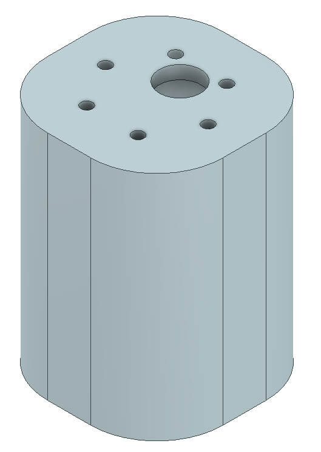
</td>
            <td rowspan=2>498g</td>
            <td rowspan=2>36h</td>
            <td rowspan=2>€23.51</td>
        </tr>
        <tr>
            <td>A2</td>
            <td>Нижняя крышка корпуса мотора   (<a href="cad/MotorAssembly/MotorEnclosure_Bottom.stl">STL</a>, <a href="cad/MotorAssembly/MotorEnclosure_Bottom.step">STEP</a>) </td>
            <td>6</td>
            <td>
 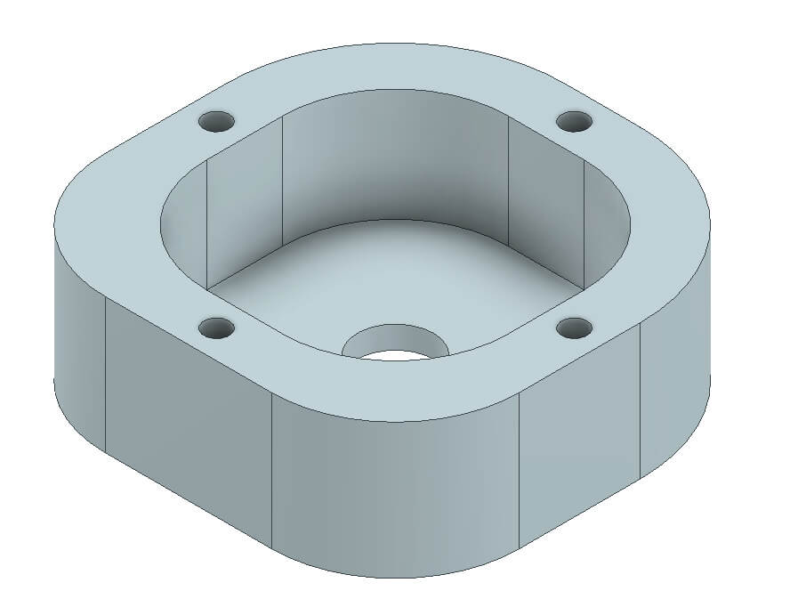
</td>
        </tr>
        <tr>
            <td>A3</td>
            <td>Кронштейн мотора   (<a href="cad/MotorAssembly/Motor_Bracket.stl">STL</a>, <a href="cad/MotorAssembly/Motor_Bracket.step">STEP</a>) </td>
            <td>6</td>
            <td>
 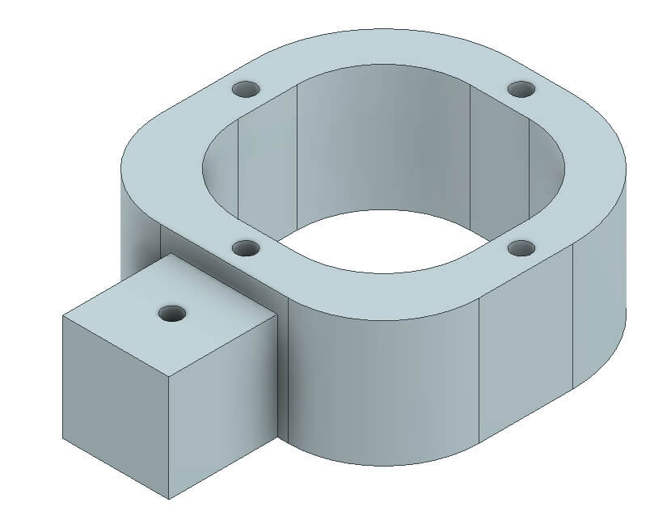
</td>
            <td>251g</td>
            <td>17.5h</td>
            <td>€11.98</td>
        </tr>
        <tr>
            <td>A4</td>
            <td rowspan=4>Шарниры</td>
            <td>Шарнир 90°   (<a href="cad/Joints/90deg_Joint.stl">STL</a>, <a href="cad/Joints/90deg_Joint.step">STEP</a>) </td>
            <td>2</td>
            <td>
 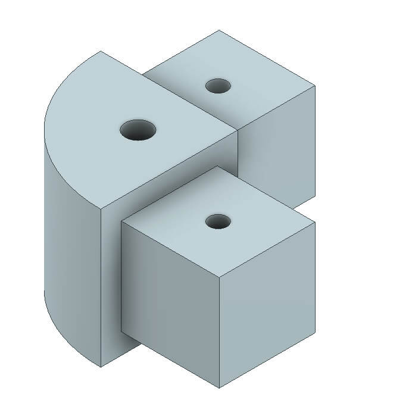
</td>
            <td rowspan=4>228g</td>
            <td rowspan=4>20.5h</td>
            <td rowspan=4>€15.05</td>
        </tr>
        <tr>
            <td>A5</td>
            <td>Шарнир 100°   (<a href="cad/Joints/100deg_Joint.stl">STL</a>, <a href="cad/Joints/100deg_Joint.step">STEP</a>) </td>
            <td>1</td>
            <td>
 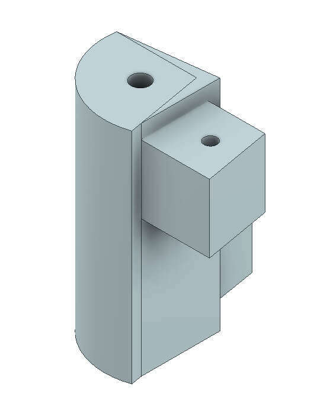
</td>
        </tr>
        <tr>
            <td>A6</td>
            <td>Зеркальный шарнир 100°   (<a href="cad/Joints/100deg_Joint_Mirror.stl">STL</a>, <a href="cad/Joints/100deg_Joint_Mirror.step">STEP</a>) </td>
            <td>1</td>
            <td>
 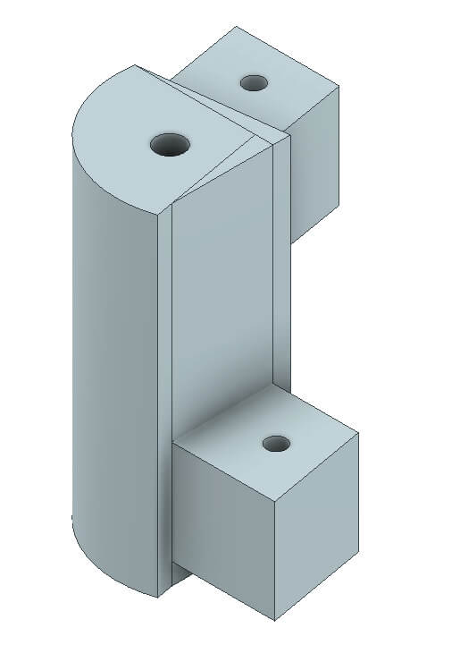
</td>
        </tr>
        <tr>
            <td>A7</td>
            <td>Концевой шарнир   (<a href="cad/Joints/End_Joint.stl">STL</a>, <a href="cad/Joints/End_Joint.step">STEP</a>) </td>
            <td>2</td>
            <td>
 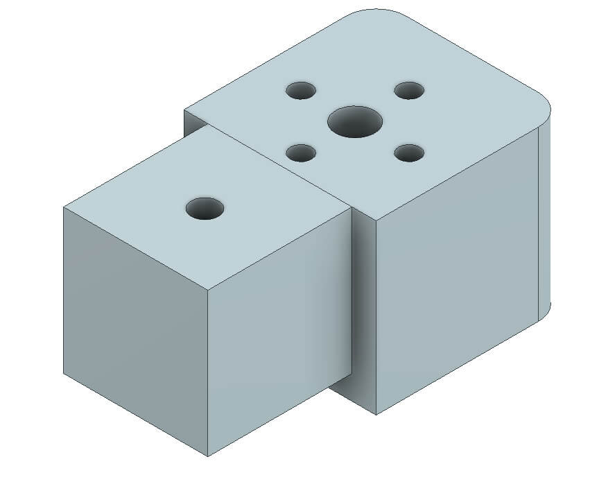
</td>
        </tr>
        <tr>
            <td>A8</td>
            <td rowspan=3>Ноги</td>
            <td>Передняя нога   (<a href="cad/Legs/Front_Leg.stl">STL</a>, <a href="cad/Legs/Front_Leg.step">STEP</a>) </td>
            <td>4</td>
            <td>
 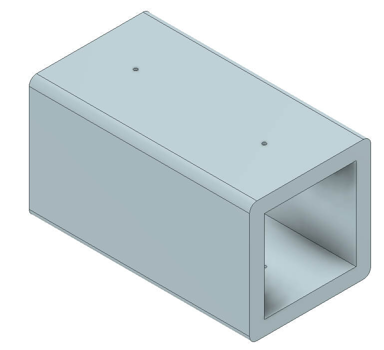
</td>
            <td rowspan=3>317g</td>
            <td rowspan=3>22.5h</td>
            <td rowspan=3>€14.97</td>
        </tr>
        <tr>
            <td>A9</td>
            <td>Средняя нога   (<a href="cad/Legs/Mid_Leg.stl">STL</a>, <a href="cad/Legs/Mid_Leg.step">STEP</a>) </td>
            <td>2</td>
            <td>
 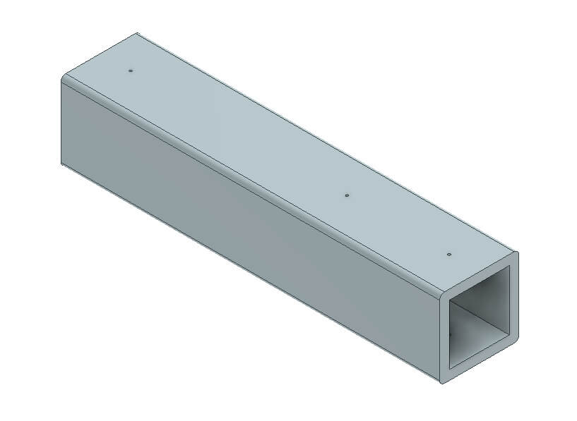
</td>
        </tr>
        <tr>
            <td>A10</td>
            <td>Задняя нога   (<a href="cad/Legs/Rear_Leg.stl">STL</a>, <a href="cad/Legs/Rear_Leg.step">STEP</a>) </td>
            <td>2</td>
            <td>
 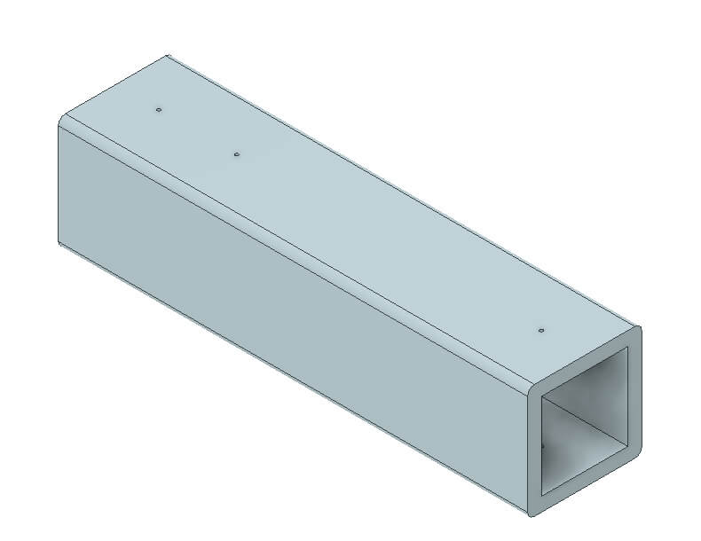
</td>
        </tr>
        <tr>
            <td>A11</td>
            <td>Крышка подшипника</td>
            <td>Крышка подшипника   (<a href="cad/BearingCover/BearingCover.stl">STL</a>, <a href="cad/BearingCover/BearingCover.step">STEP</a>) </td>
            <td>4</td>
            <td>
 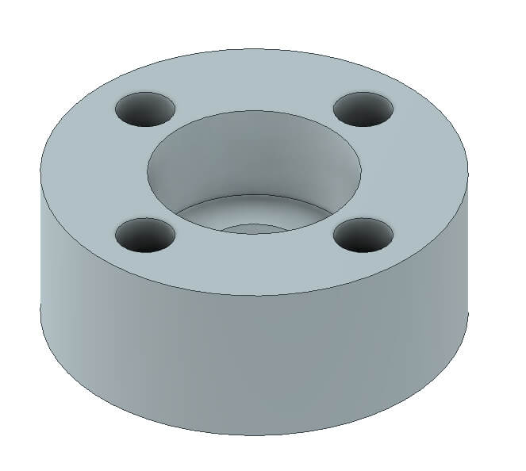
</td>
            <td>13g</td>
            <td>1.5h</td>
            <td>€0.60</td>
        </tr>
        <tr>
            <td>A12</td>
            <td>Площадка крепления телефона</td>
            <td>Платформа крепления телефона   (<a href="cad/PhoneMount/Phone_Mount.stl">STL</a>, <a href="cad/PhoneMount/Phone_Mount.step">STEP</a>) </td>
            <td>1</td>
            <td>
 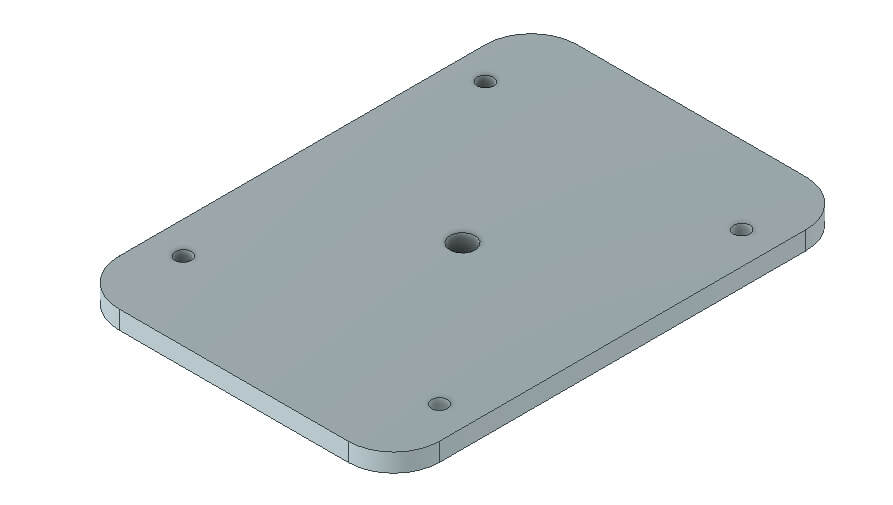
</td>
            <td>19g</td>
            <td>2h</td>
            <td>€0.91</td>
        </tr>
        <tr>
            <td>A13</td>
            <td rowspan=4>Передний бампер</td>
            <td>Надпись, передняя   (<a href="cad/Buffer/Name_Front.stl">STL</a>, <a href="cad/Buffer/Name_Front.step">STEP</a>) </td>
            <td>1</td>
            <td>
 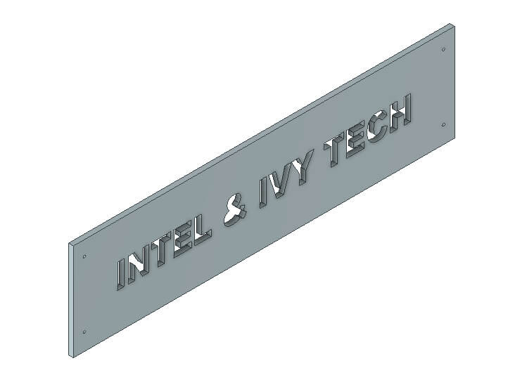
</td>
            <td rowspan=4>228g</td>
            <td rowspan=4>20.5h</td>
            <td rowspan=4>€15.04</td>
        </tr>
        <tr>
            <td>A14</td>
            <td>Надпись, задняя   (<a href="cad/Buffer/Name_Back.stl">STL</a>, <a href="cad/Buffer/Name_Back.step">STEP</a>) </td>
            <td>1</td>
            <td>
 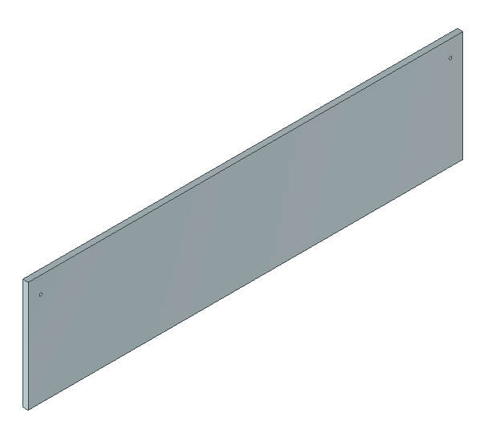
</td>
        </tr>
        <tr>
            <td>A15</td>
            <td>Бампер левый   (<a href="cad/Buffer/Buffer_Left.stl">STL</a>, <a href="cad/Buffer/Buffer_Left.step">STEP</a>) </td>
            <td>1</td>
            <td>
 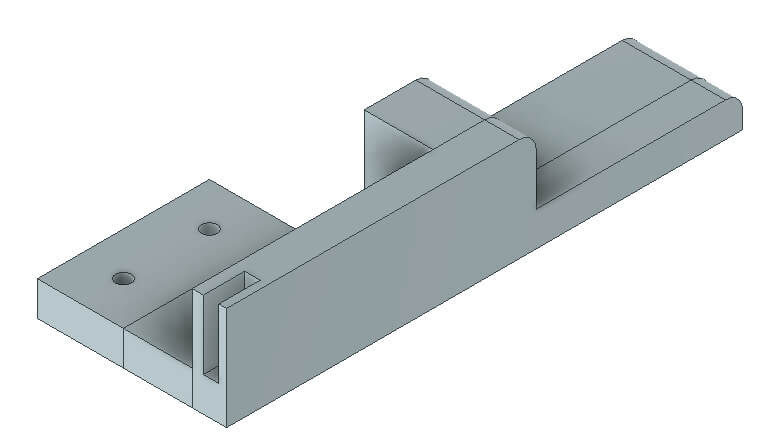
</td>
        </tr>
        <tr>
            <td>A16</td>
            <td>Бампер правый   (<a href="cad/Buffer/Buffer_Right.stl">STL</a>, <a href="cad/Buffer/Buffer_Right.step">STEP</a>) </td>
            <td>1</td>
            <td>
 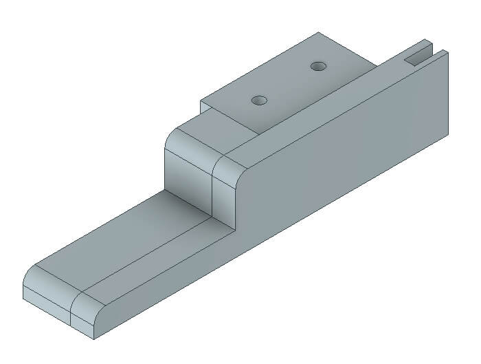
</td>
        </tr>
        <tr>
            <td>A17</td>
            <td rowspan=8>Отсек</td>
            <td>Задняя часть отсека   (<a href="cad/Compartment/Compartment_Rear.stl">STL</a>, <a href="cad/Compartment/Compartment_Rear.step">STEP</a>) </td>
            <td>1</td>
            <td>
 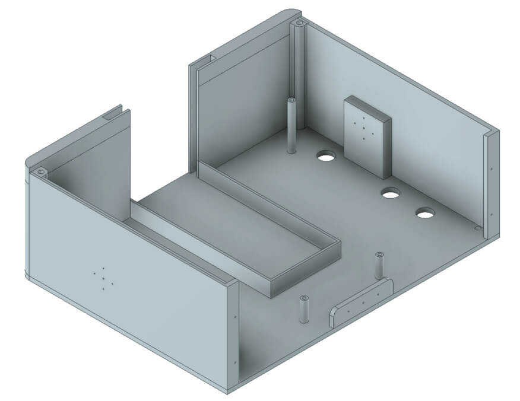
</td>
            <td>413g</td>
            <td>32h</td>
            <td>€22.75</td>
        </tr>
        <tr>
            <td>A18</td>
            <td>Передняя часть отсека   (<a href="cad/Compartment/Compartment_Front.stl">STL</a>, <a href="cad/Compartment/Compartment_Front.step">STEP</a>) </td>
            <td>1</td>
            <td>
 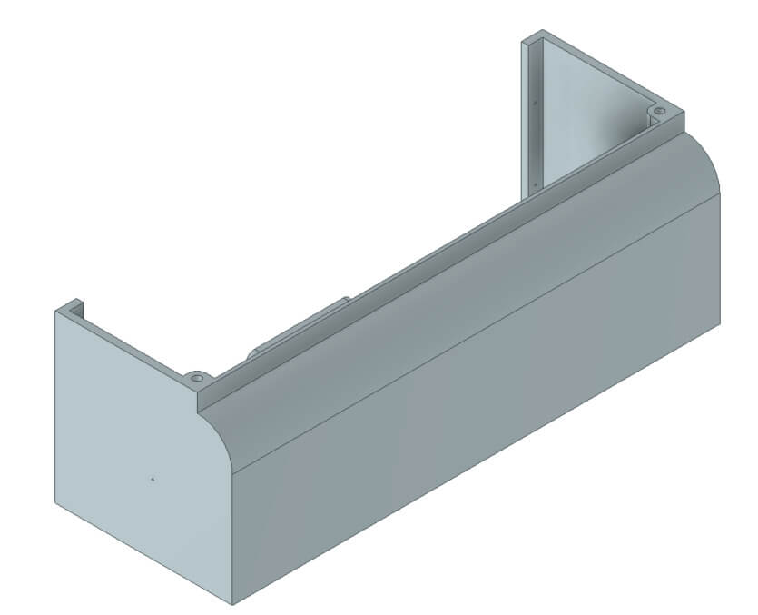
</td>
            <td>316g</td>
            <td>22h</td>
            <td>€17.42</td>
        </tr>
        <tr>
            <td>A19</td>
            <td>Передняя часть крыши   (<a href="cad/Compartment/Roof_Front.stl">STL</a>, <a href="cad/Compartment/Roof_Front.step">STEP</a>) </td>
            <td>1</td>
            <td>
 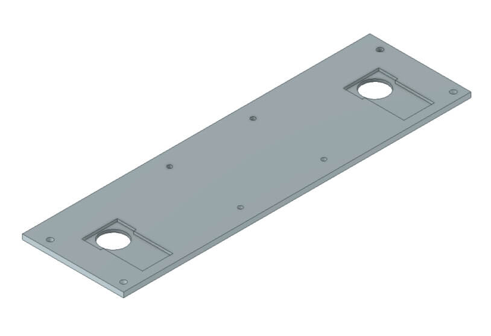
</td>
            <td>58g</td>
            <td>5.5h</td>
            <td>€3.19</td>
        </tr>
        <tr>
            <td>A20</td>
            <td>Задняя часть крыши   (<a href="cad/Compartment/Roof_Rear.stl">STL</a>, <a href="cad/Compartment/Roof_Rear.step">STEP</a>) </td>
            <td>1</td>
            <td>
 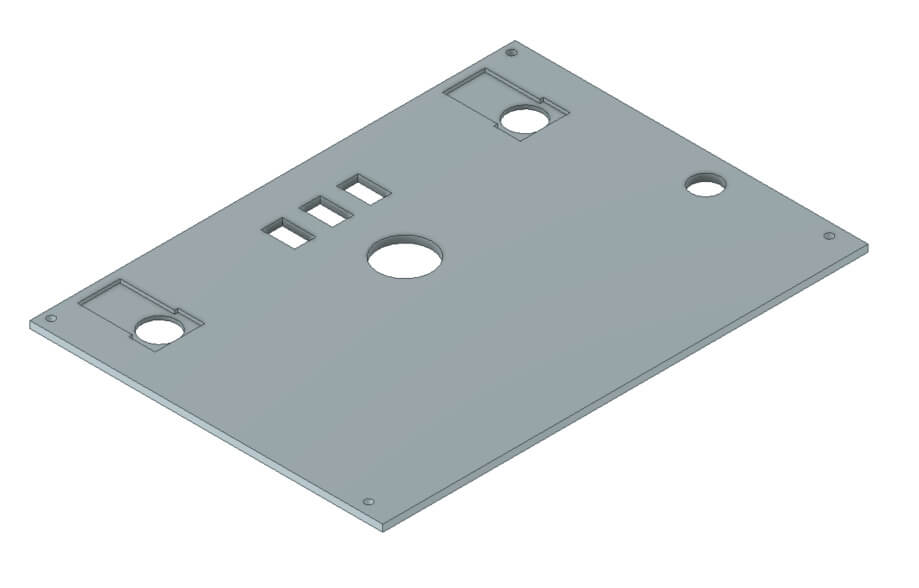
</td>
            <td>140g</td>
            <td>13.5h</td>
            <td>€7.73</td>
        </tr>
        <tr>
            <td>A21ab</td>
            <td>Крепление батареи P1 и P2   (<a href="cad/Compartment/Compartment_Battery_Mount-P1.stl">STL</a>, <a href="cad/Compartment/Compartment_Battery_Mount-P1.step">STEP</a>)
              (<a href="cad/Compartment/Compartment_Battery_Mount-P2.stl">STL</a>, <a href="cad/Compartment/Compartment_Battery_Mount-P2.step">STEP</a>) </td>
            <td>1</td>
            <td>
 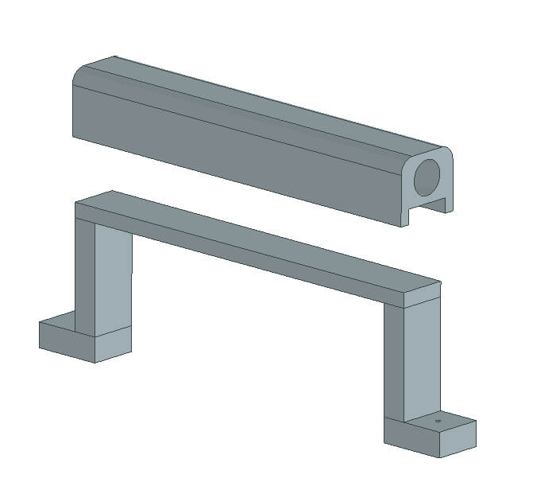
</td>
            <td>15g</td>
            <td>1.5h</td>
            <td>€0.80</td>
        </tr>
        <tr>
            <td>A22</td>
            <td>Торцевые крышки фонарей   (<a href="cad/Compartment/Headlight_Rear.stl">STL</a>, <a href="cad/Compartment/Headlight_Rear.step">STEP</a>)</td>
            <td>4</td>
            <td>
 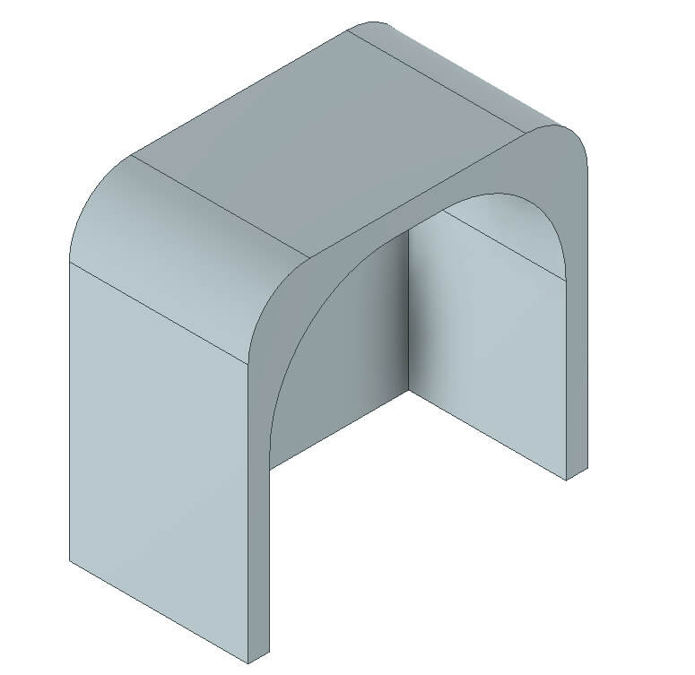
</td>
            <td rowspan=3>47g</td>
            <td rowspan=3>4h</td>
            <td rowspan=3>€2.58</td>
        </tr>
        <tr>
            <td>A23</td>
            <td>Фара   (<a href="cad/Compartment/Headlight_Front.stl">STL</a>, <a href="cad/Compartment/Headlight_Front.step">STEP</a>)</td>
            <td>4</td>
            <td>
 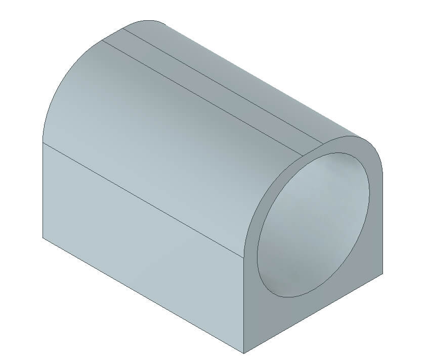
</td>
        </tr>
        <tr>
            <td>A24</td>
            <td>Крышка доступа к батарее   (<a href="cad/Compartment/Compartment_Door.stl">STL</a>, <a href="cad/Compartment/Compartment_Door.step">STEP</a>)</td>
            <td>1</td>
            <td>
 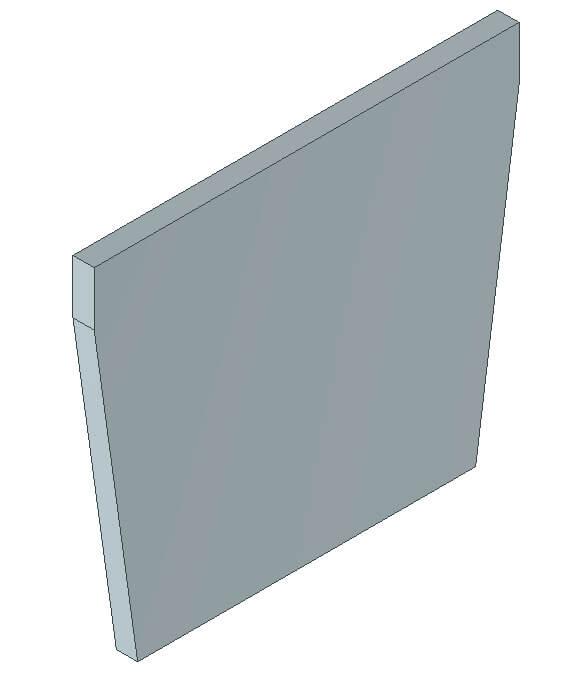
</td>
        </tr>
    </tbody>
</table>

Для перечисленных выше деталей печатная платформа должна быть не менее 240×150 мм.

На Ultimaker S5 мы получили хорошие результаты со следующими настройками:

- высота слоя: 0,2 мм
- толщина стенок: 1,5 мм
- плотность заполнения: 20%
- рисунок заполнения: сетка
- скорость печати 80 мм/с
- без поддержек

## II. Электромеханическая сборка

### II.1. Ведомость материалов

Наш корпус робота основан на легкодоступной hobby-электронике. Мы приводим ссылки для Германии (EU) и США (US) с быстрой доставкой. Если у вас есть терпение подождать подольше, компоненты можно значительно дешевле купить на AliExpress (AE). Вам понадобятся следующие компоненты.

<table>
    <thead>
        <tr>
            <th>ID </th>
            <th>Описание</th>
            <th>Изображение</th>
            <th>Поставщик</th>
            <th>Цена за единицу</th>
            <th>Количество</th>
            <th>Стоимость</th>
        </tr>
    </thead>
    <tbody>
        <tr>
            <td>O1</td>
            <td>DC-мотор JGB37-520 с энкодерами — 12 В | 178 об/мин</td>
            <td>
 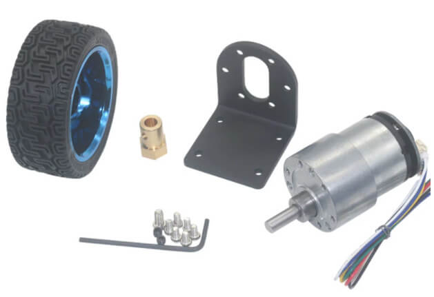
</td>
            <td>  <a href="https://de.aliexpress.com/item/4001339371886.html?gatewayAdapt=glo2deu&spm=a2g0s.9042311.0.0.1fe54c4dR1WTdj/">AE</a></td>
            <td>$8.93 | €8.12</td>
            <td>6</td>
            <td>$53.58 | €48.72</td>
        </tr>
        <tr>
            <td>O2</td>
            <td>Шины Talon 2,8" (2 шт.)</td>
            <td>
 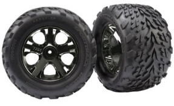
</td>
            <td> <a href="https://www.robotshop.com/en/28-talon-tires-pair.html">US</a> | <a href="https://www.robotshop.com/eu/en/28-talon-tires-pair.html">EU</a></td>
            <td>$26.95 | €23.06</td>
            <td>6</td>
            <td>$161.7 | €138.36</td>
        </tr>
        <tr>
            <td>O3</td>
            <td>7-жильный кабель 0,5 мм² (5 м)</td>
            <td>
 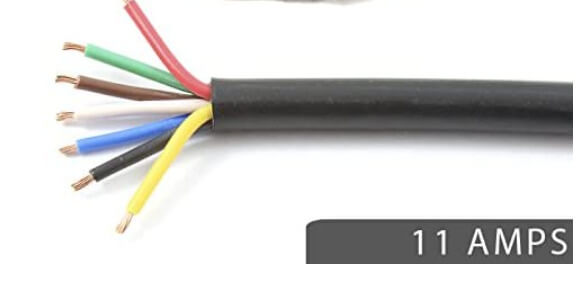
</td>
          <td>  <a href="https://www.amazon.com/Heavy-Gauge-Conductor-Trailer-Cable/dp/B01N3Q0YGS/ref=sr_1_16?crid=3SK9Y7DSOR0OL&keywords=caravan+cable+7+wire&qid=1649847035&sprefix=carava+cable+7+wire%2Caps%2C190&sr=8-16">US</a> | <a href="https://www.amazon.de/-/en/1119757-Classic-Control-Protective-Conductor/dp/B08CY2WPM4/ref=sr_1_5?crid=1QGOB5LF0GZYO&keywords=7+adriges+kabel+0%2C5mm%C2%B2&qid=1644173962&sprefix=7+core+cable+0.5mm+%2Caps%2C289&sr=8-5">EU</a></td>
            <td> $25.53 | €20.61</td>
            <td>0.25</td>
            <td>$6.38 | €5.15</td>
        </tr>
        <tr>
            <td>O4</td>
            <td>Кабель-канал D-Line. 20×10 мм × 1 м (2 шт.)</td>
            <td>
 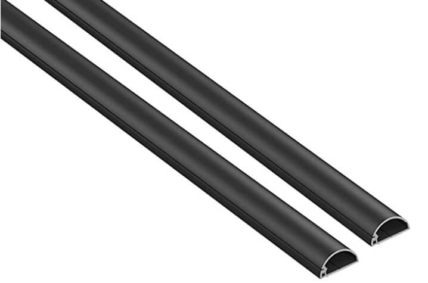
</td>
            <td>  <a href="https://www.amazon.com/D-Line-Raceway-1D3015W-Electrical-Paintable/dp/B07KFNYR7G/ref=sr_1_10?crid=137L39X59R8AQ&keywords=D-Line%2Bcable%2Bduct&qid=1649851731&refinements=p_36%3A1253503011&rnid=386442011&s=electronics&sprefix=d-line%2Bcable%2Bduct%2Caps%2C409&sr=1-10&th=1">US</a> | <a href="https://www.amazon.de/-/en/D-Line-Micro-Cable-Management-Strip-White/dp/B082WVQXT5/ref=sr_1_fkmr0_1?crid=3CBV1RRPR6K9B&keywords=d-line%2Bmicro%2B%2Bkabelkanal%2B(2%2Bmeter)%2C%2Bselbstklebende%2Bkabelabdeckungen%2C%2Belektrische%2Bkabelf%C3%BChrung%2C%2Bbeliebte%2Bkabelmanagementl%C3%B6sung%2C%2B20%2Bmm%2B(b)%2Bx%2B10%2Bmm%2B(h)%2B-%2B2%2Bx%2B1%2Bm%2Bl%C3%A4nge%2B-%2Bschwarz&qid=1644149200&sprefix=d-line%2Bmicro%2B%2Bcable%2Btrunking%2B2-meter%2Bself-adhesive%2Bcable%2Bcovers%2Belectrical%2Bcable%2Btidy%2Bpopular%2Bcable%2Bmanagement%2Bsolution%2B20mm%2Bw%2Bx%2B10mm%2Bh%2B-%2B2%2Bx%2B1%2Bmeter%2Blengths%2B-%2Bblack%2B%2Caps%2C381&sr=8-1-fkmr0&th=1">EU</a></td>
            <td>$12.00 | €9.99</td>
            <td>1</td>
            <td>$12.00 | €9.99</td>
        </tr>
        <tr>
            <td>O5</td>
            <td>Ввод PG7 для кабеля 3–6,5 мм (50 шт.)</td>
            <td>
 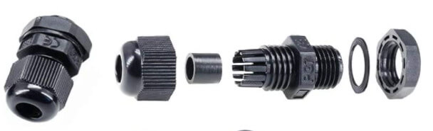
</td>
          <td>  <a href="https://www.amazon.com/ARTGEAR-Waterproof-Adjustable-Connector-Protector/dp/B07JH2LPZF/ref=sr_1_11?crid=1UH8URDCXAHJJ&keywords=Cable+Gland+Set+Plastic+Cable+Glands+Adjustable+PG7+Waterproof+Closure+Cable+Screw+Connection+for+Diameter+3.5+mm+-+6.5+mm+Black+Pack+of+50&qid=1649852081&sprefix=cable+gland+set+plastic+cable+glands+adjustable+pg7+waterproof+closure+cable+screw+connection+for+diameter+3.5+mm+-+6.5+mm+black+pack+of+50+%2Caps%2C243&sr=8-11"> US </a> | <a href="https://www.amazon.de/-/en/Plastic-Adjustable-Waterproof-Connection-Diameter/dp/B08Q458H3N/ref=sr_1_fkmr0_1?crid=1H5VCAQKXD2XZ&keywords=pg7+kabelverschraubung%2C+50+st%C3%BCck%2C+3-6%2C5+mm%2C+verstellbar%2C+wasserdicht%2C+kabelverschraubungen%2C+verbindungsst%C3%BCck+mit+dichtungen&qid=1644149525&sprefix=pg7+cable+gland+50+pack+3+6.5mm+adjustable+waterproof+cable+glands+joints+connector+with+gaskets+%2Caps%2C80&sr=8-1-fkmr0">EU</a></td>
            <td>$8.99 | €9.99</td>
            <td>0.5</td>
            <td>$4.49 | €4.99</td>
        </tr>
        <tr>
            <td>O6</td>
            <td>Шарикоподшипники MR126ZZ 6×12×4 мм (4 шт.)</td>
            <td>
 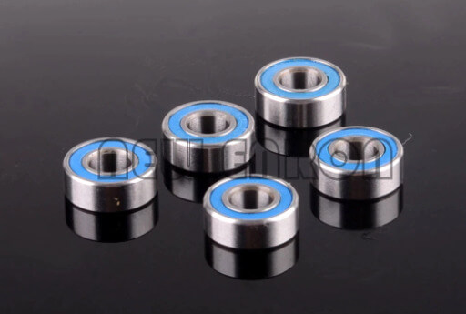
</td>
            <td>  <a href="https://de.aliexpress.com/item/1005001697683913.html?gatewayAdapt=glo2deu&spm=a2g0s.9042311.0.0.1fe54c4dR1WTdj">AE</a></td>
            <td>$5.52 | €3.45</td>
            <td>1</td>
            <td>$5.52 | €3.45</td>
        </tr>
        <tr>
            <td>O7</td>
            <td>Амортизатор с пружиной INJORA 90 мм для RC-машины (2 шт.)</td>
            <td>
 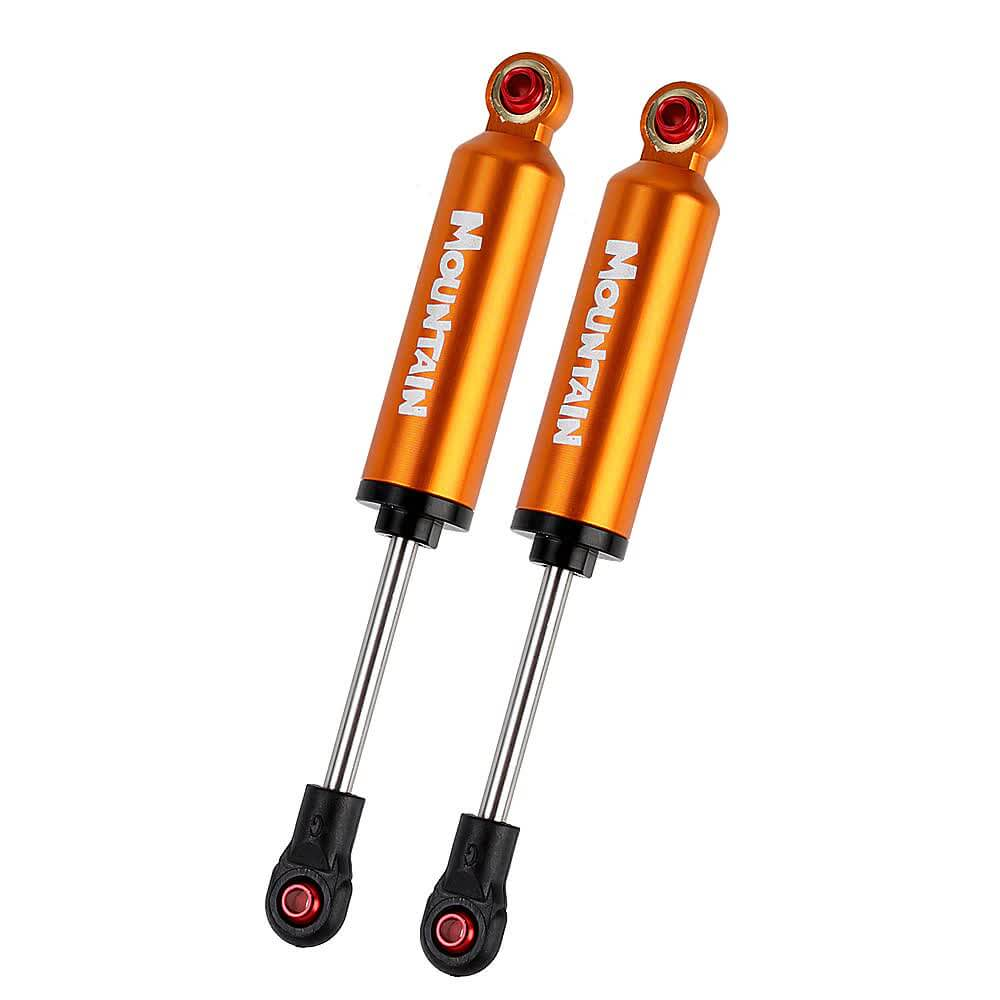
</td>
            <td>  <a href="https://de.aliexpress.com/item/4000309686709.html?gatewayAdapt=glo2deu&spm=a2g0o.productlist.0.0.17b17ca7oMXyhJ&algo_pvid=c7d8ba55-28b2-4d27-97e4-f338994958f7&algo_exp_id=c7d8ba55-28b2-4d27-97e4-f338994958f7-14&pdp_ext_f=%7B%22sku_id%22%3A%2210000001286270094%22%7D&pdp_pi=-1%3B8.3%3B-1%3B-1%40salePrice%3BUSD%3Bsearch-mainSearch">AE</a></td>
            <td>$8.30 | €7.99</td>
            <td>1</td>
            <td>$8.30 | €7.99</td>
        </tr>
        <tr>
            <td>O8</td>
            <td>Светодиодная лампа AXSPEED для RC-машины, 4,2–6 В, белая, 17 мм (2 шт.)</td>
            <td>
 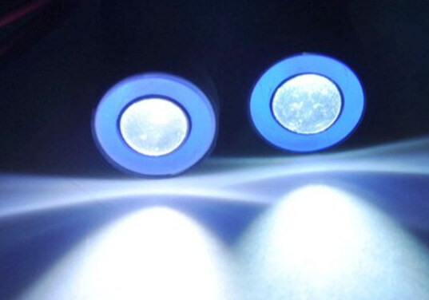
</td>
            <td>  <a href="https://www.aliexpress.com/item/1005003306484898.html?spm=a2g0s.9042311.0.0.d4954c4dpsjiiC">AE</a></td>
            <td>$7.43 | €6.87</td>
            <td>1</td>
            <td>$7.43 | €6.87</td>
        </tr>
        <tr>
            <td>O9</td>
            <td>Светодиодная лампа AXSPEED для RC-машины, 4,2–6 В, красная, 17 мм (2 шт.)</td>
            <td>
 
</td>
            <td>  <a href="https://www.aliexpress.com/item/1005003306484898.html?spm=a2g0s.9042311.0.0.d4954c4dpsjiiC">AE</a></td>
            <td>$7.43 | €6.87</td>
            <td>1</td>
            <td>$7.43 | €6.87</td>
        </tr>
        <tr>
            <td>O10</td>
            <td>Виброизоляторы с шпильками M3 × 8 мм (4 шт.)</td>
            <td>
 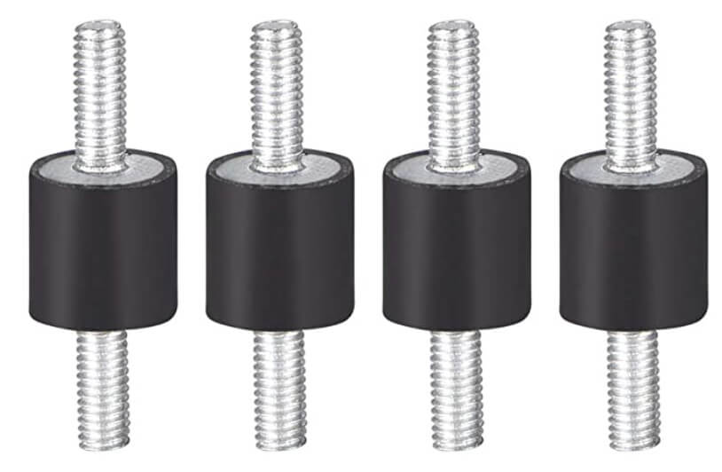
</td>
            <td>  <a href="https://www.amazon.com/MroMax-Rubber-Vibration-Isolator-Absorber/dp/B07Z76J5N5/ref=sr_1_5?crid=2LSR8ZMHRIL2O&keywords=m3+rubber+mount+shock+absorbers&qid=1649862366&sprefix=keesin+m3+rubber+mounts+shock+absorbers+%2Caps%2C362&sr=8-5">US</a> | <a href="https://www.amazon.de/-/en/gp/product/B076SSPHP6/ref=ppx_yo_dt_b_asin_title_o03_s01?ie=UTF8&psc=1">EU</a></td>
            <td>$8.09 | €9.49</td>
            <td>1</td>
            <td>$8.09 | €9.49</td>
        </tr>
        <tr>
            <td>O11</td>
            <td>Универсальное крепление для смартфона Zeadio</td>
            <td>
 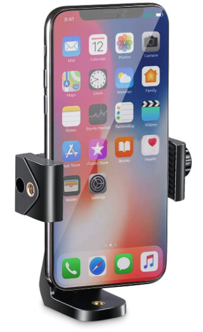
</td>
            <td> <a href="https://www.amazon.com/SharingMoment-Smartphone-Horizontal-Rotatable-Adjustable/dp/B07S8TTH34/ref=sr_1_4?crid=X7XQ9LC110JJ&keywords=Zeadio+Smartphone+Tripod+Adapter%2C+Mobile+Phone+Holder&qid=1649862548&refinements=p_36%3A2491155011&rnid=2491154011&s=wireless&sprefix=zeadio+smartphone+tripod+adapter%2C+mobile+phone+holder+%2Caps%2C577&sr=1-4">US</a> | <a href="https://www.amazon.de/-/en/Zeadio-Smartphone-Tripod-Adapter-Mobile/dp/B06XDYJNSR/ref=sr_1_8?crid=2ZH6V545D45E3&keywords=zeadio%2Buniversal%2Bsmartphone%2Bhalterung&qid=1644150427&sprefix=zeadio%2Buniversal%2Bsmartphone%2Bholder%2Caps%2C104&sr=8-8&th=1">EU</a></td>
            <td>$11.99 | €10.99</td>
            <td>1</td>
            <td>$11.99 | €10.99</td>
        </tr>
        <tr>
            <td>O12</td>
            <td>Автомобильный вольтметр постоянного тока 12–24 В</td>
            <td>
 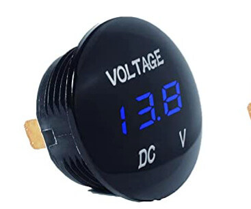
</td>
            <td>  <a href="https://www.amazon.com/Nilight-Voltmeter-Waterproof-VoltVolt-Motorcycle/dp/B06ZZJ48VQ/ref=sr_1_fkmr1_2?crid=376857DCCJICB&keywords=mini+led+digital+voltmeter+batterietester+12+volt+%2F+24+volt+voltmeter&qid=1649862763&sprefix=mini+led+digital+voltmeter+batterietester+12+volt+%2F+24+volt+voltmeter%2Caps%2C404&sr=8-2-fkmr1">US</a> | <a href="https://www.amazon.de/-/en/Intckwan-Digital-Voltmeter-Waterproof-Motorcycle/dp/B09T5XRYM9/ref=sr_1_5?crid=1GPFOX9O2VX85&keywords=mini+led+digital+voltmeter+batterietester+12+volt+%2F+24+volt+voltmeter&qid=1649862700&sprefix=mini+led+digital+voltmeter+battery+tester+12+volt+%2F+24+volt+voltmeter%2Caps%2C91&sr=8-5">EU</a></td>
            <td>$10.99 | €11.88</td>
            <td>1</td>
            <td>$10.99 | €11.88</td>
        </tr>
        <tr>
            <td>O13</td>
            <td>Миниатюрный рокерный переключатель (20 шт.)</td>
            <td>
 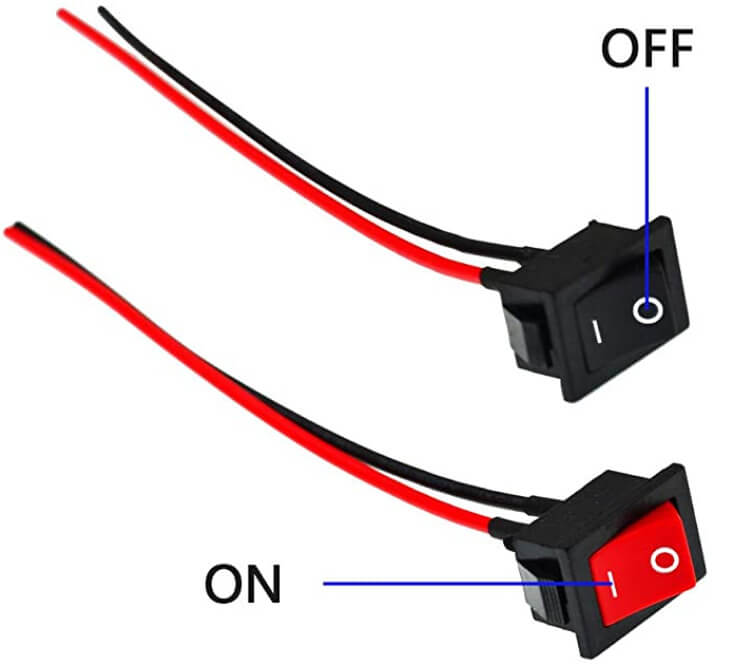
</td>
            <td>  <a href="https://www.amazon.com/DaierTek-250VAC-Rocker-KCD1-101-Plastic/dp/B07S2QJKTX/ref=sr_1_4?keywords=RUNCCI-YUN+20Pcs+Mini+Rocker+Switch&qid=1650638471&sr=8-4">US</a> | <a href="https://www.amazon.de/-/en/RUNCCI-Rocker-Switches-Household-Appliances/dp/B07MW92CW8/ref=sr_1_2?keywords=RUNCCI-YUN+20+St%C3%BCck+Mini-Wippschalter&qid=1650638352&sr=8-2">EU</a></td>
            <td>$15.98 | €9.44</td>
            <td>0.15</td>
            <td>$2.4 | €1.42</td>
        </tr>
        <tr>
            <td>O14</td>
            <td>Кабель Duttek Micro USB с панельным креплением</td>
            <td>
 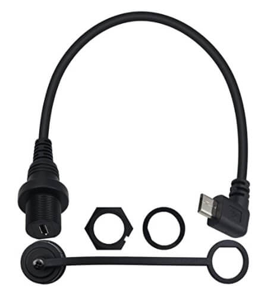
</td>
            <td>  <a href="https://www.amazon.com/Duttek-Angled-Extension-Motorcycle-Dashboard/dp/B08RSGYV1S/ref=sr_1_1?keywords=Duttek+90+Degree+Micro+USB+Panel+Mount+Cable+Micro+USB+Mount+Extension+Cable+Male+to+Female+for+Car+Boat+Motorcycle+Truck+Dashboard+30cm&qid=1650638585&sr=8-1">US</a> | <a href="https://www.amazon.de/-/en/Duttek-Degree-Extension-Motorcycle-Dashboard/dp/B08RSGYV1S/ref=psdc_1365661031_t1_B07ZCZ8NL1">EU</a></td>
            <td>$10.68 | €11.44</td>
            <td>1</td>
            <td>$10.68 | €11.44</td>
        </tr>
        <tr>
            <td>O15</td>
            <td>Собственная печатная плата</td>
            <td>
 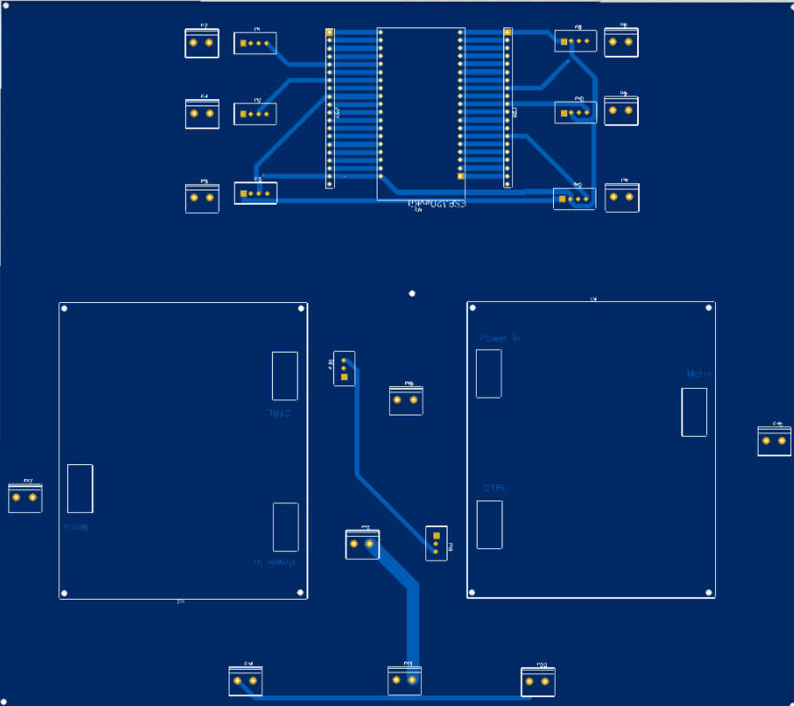
</td>
            <td>  <a href="https://www.eurocircuits.de/">US</a> | <a href="https://www.eurocircuits.de/">EU</a></td>
            <td>$10.00 | €10.00</td>
            <td>1</td>
            <td>$10.00 | €10.00</td>
        </tr>
        <tr>
            <td>O16</td>
            <td>Одноканальный драйвер щёточного DC-мотора Cytron 30 А, 5–30 В</td>
            <td>
 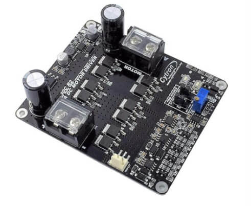
</td>
            <td>  <a href="https://www.robotshop.com/en/cytron-30a-5-30v-single-brushed-dc-motor-driver.html">US</a> | <a href="https://www.robotshop.com/eu/en/cytron-30a-5-30v-single-brushed-dc-motor-driver.html">EU </a></td>
            <td>$34.38 | €37.15</td>
            <td>2</td>
            <td>$68.76 | €74.30</td>
        </tr>
        <tr>
            <td>O17</td>
            <td>Понижающий DC-DC преобразователь LM2596S 12–36 В → 5 В | 2 А (4 шт.)</td>
            <td>
 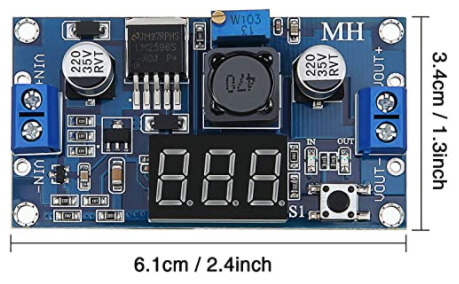
</td>
            <td>  <a href="https://www.amazon.com/Adjustable-Converter-Step-Down-Regulator-Stabilizer/dp/B081N6WWJS/ref=sr_1_3?keywords=4+pieces+adjustable+LM2596S+DC-DC+down+converter&qid=1650638822&sr=8-3">US</a> | <a href="https://www.amazon.de/-/en/adjustable-converter-regulator-stabiliser-voltmeter/dp/B081N6WWJS/ref=pd_sbs_6/262-3535180-9041508?pd_rd_w=m3EIw&pf_rd_p=7cf49d79-ae26-401a-94b7-1dec7a725ba4&pf_rd_r=KEN7A8F4YCHEBXB3ZK9B&pd_rd_r=b6829a4e-476a-48dd-8821-a64b9945da1d&pd_rd_wg=m3HQp&pd_rd_i=B081N6WWJS&psc=1">EU</a></td>
            <td>$15.99 | €16.99</td>
            <td>0.25</td>
            <td>$3.99 | €4.25</td>
        </tr>
        <tr>
            <td>O18</td>
            <td>LiPo-батарея 4500 мА·ч 3S-25C 11,1 В в жёстком корпусе</td>
            <td>
 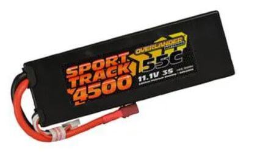
</td>
            <td>  <a href="https://www.amazon.com/HRB-50C-100C-Quadcopter-Helicopter-Airplane/dp/B06XNTHQRZ?ref_=ast_sto_dp&th=1&psc=1">US</a> | <a href="https://www.amazon.de/-/en/Roaring-Battery-Deans-Connection-Aeroplane/dp/B08Z3JYK1X/ref=sr_1_5?crid=3TW2SFFYW1BQY&keywords=4500%2Bmah%2B3s%2B11%2C1v%2B55c%2Blipo&qid=1644164015&sprefix=4500mah%2B3s%2B11.1v%2B55c%2Blipo%2Caps%2C82&sr=8-5&th=1">EU</a></td>
            <td>$46.99 | €29.97</td>
            <td>1</td>
            <td>$46.99 | €29.97</td>
        </tr>
        <tr>
            <td>O19</td>
            <td>Отладочная плата AITRIP ESP32-DevKitC (3 шт.)</td>
            <td>
 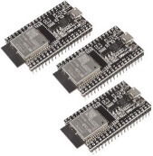
</td>
            <td>  <a href="https://www.amazon.com/Development-Microcontroller-Integrated-Antenna-Amplifiers/dp/B09GK74F7N/ref=sr_1_2?crid=2SK0PFZJXONGJ&keywords=3pcs+ESP32+DevKitC+Core&qid=1650638989&sprefix=3pcs+esp32+devkitc+core%2Caps%2C162&sr=8-2">US</a> | <a href="https://www.amazon.de/-/en/DevKitC-Development-ESP32-WROOM-32D-Bluetooth-Arduino/dp/B09LS6SCF7/ref=sr_1_2?crid=8EUG1EBFJ9AX&keywords=aitrip+esp32-devkitc&qid=1644164236&sprefix=aitrip+esp32-devkitc+core%2Caps%2C192&sr=8-2">EU</a></td>
            <td>$19.99 | €21.00</td>
            <td>0.33</td>
            <td>$6.66 | €7.00</td>
        </tr>
        <tr>
            <td>O20</td>
            <td>Клеммник для PCB 5,08 мм (11 × 2 контакта + 11 × 4 контакта)</td>
            <td>
 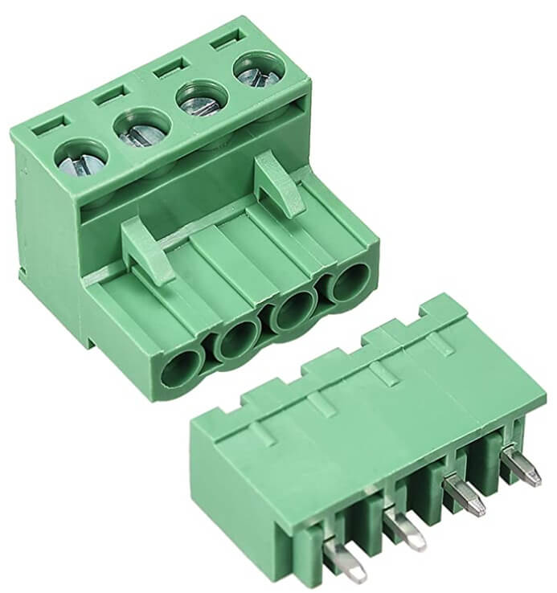
</td>
            <td>  <a href="https://www.amazon.com/LuoQiuFa10-4-Pin-5-08mm-Female-Terminal/dp/B093DNBV5D/ref=sr_1_2?crid=1W2RRUJFR1XY2&keywords=Cococity+22+Pairs+5.08+mm+2+Pins+PCB+Screw+Terminal+Connector+Pluggable+%2B+2+Pins+Plug+in+Screw+PCB+Terminal+Block+Plug+Right+Angle+%282+Pin+11+Pairs+4+Pin+11+Pairs%29+300V+10A+%28Green%29&qid=1650639050&sprefix=3pcs+esp32+devkitc+core%2Caps%2C186&sr=8-2">US</a> | <a href="https://www.amazon.de/-/en/Cococity-Pairs-Terminal-Connector-Pluggable/dp/B083GNB8BY/ref=sr_1_7?crid=SJKL0W8ANGUI&keywords=4-polige+leiterplatten-schraubklemmleiste%2C+5%2C08+mm&qid=1644165018&sprefix=4+pin+5.08mm+pitch+pcb+screw+terminal+block%2Caps%2C82&sr=8-7">EU</a></td>
            <td>$7.99 | €11.99</td>
            <td>1</td>
            <td>$7.99 | €11.99</td>
        </tr>
        <tr>
            <td>O21</td>
            <td>Резьбовая шпилька M6 × 1 м (1000 мм), цинкованое покрытие</td>
            <td>
 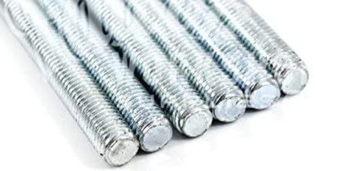
</td>
            <td>  <a href="https://www.amazon.com/Threaded-Plated-Thread-Length-Threads/dp/B00G3QM076/ref=sr_1_18?crid=1MBLSICIHE3FX&keywords=M6+x+1m+%281000mm%29+Zinc+Plated+Threaded+Rod%2FBar&qid=1650639302&sprefix=m6+x+1m+1000mm+zinc+plated+threaded+rod%2Fbar%2Caps%2C306&sr=8-18">US</a> | <a href="https://www.amazon.de/-/en/Threaded-quality-galvanised-standard-parts/dp/B07X3LX6RX/ref=sr_1_21?crid=3UFFWWONRN5FQ&keywords=gewindestange%2C%2Bverzinkt%2C%2Bm6%2Bx%2B1%2Bm%2B(1000%2Bmm)%2C%2B10%2Bst%C3%BCck&qid=1644165235&sprefix=pack%2Bof%2B10%2Bm6%2Bx%2B1m%2B1000mm%2Bzinc%2Bplated%2Bthreaded%2Brod%2Fbar%2Caps%2C170&sr=8-21&th=1">EU</a></td>
            <td>$22.73 | €4.31</td>
            <td>1</td>
            <td>$22.73 | €4.31</td>
        </tr>
        <tr>
            <td>O23</td>
            <td>Винты M4 × 50 мм (30 шт.)</td>
            <td>
 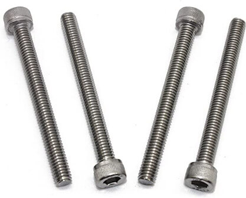
</td>
            <td>  <a href="https://www.amazon.com/MroMax-M4x50mm-Machine-Stainless-Phillips/dp/B07ZPSWW24/ref=sr_1_2?crid=6FFC31FUFZC&keywords=M4+x+50mm+screws+30pcs&qid=1650639360&sprefix=m4+x+50mm+screws+30pc%2Caps%2C175&sr=8-2">US</a> | <a href="https://www.amazon.de/-/en/M4-50-stainless-cylinder-DIN912/dp/B07YW6Q5VT/ref=sr_1_10?crid=24VLWXHS6RUKJ&keywords=m4x50%2Bmm%2Bsechskant&qid=1644166982&sprefix=m4%2Bx%2B50mm%2Bhex%2B%2Caps%2C94&sr=8-10&th=1">EU</a></td>
            <td>$11.39 | €9.83</td>
            <td>1</td>
            <td>$11.39 | €9.83</td>
        </tr>
        <tr>
            <td>O24</td>
            <td>Винты M4 × 40 мм (30 шт.)</td>
            <td>
 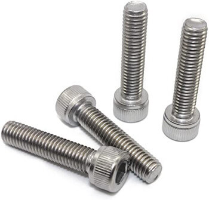
</td>
            <td>  <a href="https://www.amazon.com/Uxcell-a15111200ux1682-Cabinet-Handles-Phillips/dp/B019ZESG9I/ref=sr_1_5?crid=3FFNS1NMT4XPE&keywords=m4+x+40mm+screws+30+pcs&qid=1650639393&sprefix=m4+x+40mm+screws+30pcs%2Caps%2C163&sr=8-5">US</a> | <a href="https://www.amazon.de/-/en/M4-50-stainless-cylinder-DIN912/dp/B07YWDJS99/ref=sr_1_10?crid=24VLWXHS6RUKJ&keywords=m4x50%2Bmm%2Bsechskant&qid=1644166982&sprefix=m4%2Bx%2B50mm%2Bhex%2B%2Caps%2C94&sr=8-10&th=1">EU</a></td>
            <td>$10.56 | €9.13</td>
            <td>1</td>
            <td>$10.56 | €9.13</td>
        </tr>
        <tr>
            <td>O25</td>
            <td>Набор винтов и гаек M3 (440 шт.)</td>
            <td>
 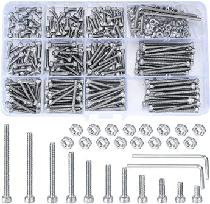
</td>
            <td>  <a href="https://www.amazon.com/Shapenty-100PCS-Stainless-Female-Fastener/dp/B071NLDW56/ref=sr_1_9?crid=I0ZQA6TBI3N9&keywords=M3+screws+and+nuts+sets+%28440+pcs%29&qid=1650639424&sprefix=m3+screws+and+nuts+sets+440+pcs+%2Caps%2C257&sr=8-9">US</a> | <a href="https://www.amazon.de/-/en/pieces-screws-stainless-hexagon-socket/dp/B093GNHWKR/ref=sr_1_3?crid=36NK6MT1K8LSC&keywords=satz+m3+innensechskant&qid=1644166735&s=diy&sprefix=set+m3+hex+socket%2Cdiy%2C87&sr=1-3">EU</a></td>
            <td>$6.49 | €11.99</td>
            <td>1</td>
            <td>$6.49 | €11.99</td>
        </tr>
        <tr>
            <td>O26</td>
            <td>Винты M4 × 120 мм (15 шт.)</td>
            <td>
 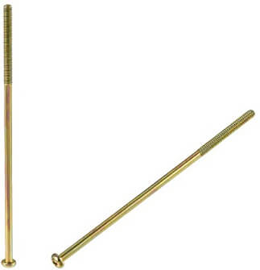
</td>
            <td> <a href="https://www.amazon.com/XunLiu-Socket-Screws-Wrench-Knurled/dp/B07CHJ7ZPP/ref=sr_1_38?crid=1U3GJUWD14XQB&keywords=screw%2BM4%2Bx%2B120mm&qid=1650753655&sprefix=screw%2Bm4%2Bx%2B120mm%2Caps%2C167&sr=8-38&th=1">US</a> | <a href="https://www.amazon.de/-/en/sourcing-Phillips-Furniture-Hanging-External/dp/B08JYCP7TD/ref=sr_1_64?crid=25999O4GLCN83&keywords=m4+x+120+mm&qid=1644165946&sprefix=m4+x+120mm+socket%2Caps%2C109&sr=8-64">EU</a></td>
            <td>$15.29 | €15.64</td>
            <td>1</td>
            <td>$15.29 | €15.64</td>
        </tr>
        <tr>
            <td>O27</td>
            <td>Винты M6 × 100 мм (2 шт.)</td>
            <td>
 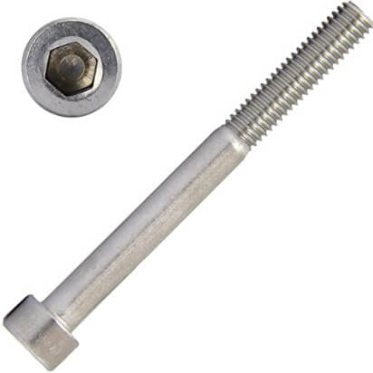
</td>
            <td>  <a href="https://www.amazon.com/MroMax-Machine-Stainless-Phillips-Cabinet/dp/B07YFMN8FP/ref=sr_1_5?crid=3GFYNNIBEO5UA&keywords=M6+x+100mm+screws&qid=1650639588&sprefix=m6+x+100mm+screws+2+pcs+%2Caps%2C161&sr=8-5">US</a> | <a href="https://www.amazon.de/-/en/AG-BOX%C2%AE-Cylinder-Screws-Stainless-Steel/dp/B09N3DNDZK/ref=sr_1_5?crid=1NROTQHUR7F2K&keywords=m6x100+mm&qid=1644171138&sprefix=m6+x+100mm%2Caps%2C90&sr=8-5">EU</a></td>
            <td>$3.84 | €4.18</td>
            <td>1</td>
            <td>$3.84 | €4.18</td>
        </tr>
        <tr>
            <td>O28</td>
            <td>Набор гаек (обычные и самоконтрящиеся) и шайб M3, M4 и M5 (45 шт.)</td>
            <td>
 
</td>
            <td> <a href="https://www.amazon.com/Assortment-AETTL-Stainless-Assorted-Wrenches/dp/B098ND1GW8/ref=sr_1_2?crid=3AFZPJ5SIBJD9&keywords=Assorted+Nuts+%28Full+and+Self+Locking%29+and+Washers+M3%2C+M4+%26+M5+%2845+pcs%29&qid=1650639662&sprefix=assorted+nuts+full+and+self+locking+and+washers+m3%2C+m4+%26+m5+45+pcs+%2Caps%2C226&sr=8-2">US</a> |  <a href="https://www.amazon.de/-/en/Assorted-Locking-Washers-Stainless-Steel/dp/B01CO9S1RI/ref=sr_1_98?crid=P8DDSVM9ZTG1&keywords=m3+m4+muttern+unterlegscheiben&qid=1644172060&sprefix=m3+m4+nuts+washers%2Caps%2C101&sr=8-98">EU</a></td>
            <td>$25.64 | €23.01</td>
            <td>1</td>
            <td>$25.64 | €23.01</td>
        </tr>
        <tr>
            <td>O29</td>
            <td>Набор гаек/шайб M6 (40 шт.)</td>
            <td>
 
</td>
            <td>  <a href="https://www.amazon.com/Stainless-Washer-Machine-Thread-Assortment/dp/B09HNJBX1G/ref=sr_1_3?crid=1N4R1D32PS8W6&keywords=40-Piece+Nuts%2FWashers+Set+for+M6&qid=1650639826&sprefix=40-piece+nuts%2Fwashers+set+for+m6+threaded+rods+a2+stainless+steel%2Caps%2C227&sr=8-3">US</a> | <a href="https://www.amazon.de/-/en/40-Piece-Washers-Threaded-Stainless-Steel/dp/B01G77C0DY/ref=sr_1_31?crid=EUR5CW3K5BLD&keywords=m6+muttern+und+unterlegscheiben&qid=1644172515&refinements=p_36%3A118557031&rnid=118555031&s=diy&sprefix=m6+nuts+and+washers%2Caps%2C87&sr=1-31">EU</a></td>
            <td>$13.99 | €8.99</td>
            <td>1</td>
            <td>€$13.99 | €8.99</td>
        </tr>
      <tr>
            <td>O30</td>
            <td>Набор плоских и пружинных шайб из нержавеющей стали</td>
            <td>
 
</td>
            <td>  <a href="https://www.amazon.com/Split-Washer-Assortment-Stainless-Silver/dp/B08QN3ZR23/ref=sr_1_35?keywords=Stainless+Steel+Flat+and+Spring+Washers+Assortment+Kit&qid=1650753391&sr=8-35">US</a> | <a href="https://www.amazon.de/-/en/300-pieces-Stainless-Washers-Assortment-M2-M3-M4-M5-M6/dp/B07CQX6NPP/ref=sr_1_15?keywords=m4+federscheibe&qid=1650753193&sr=8-15">EU</a></td>
            <td>$12.49 | €10.38</td>
            <td>1</td>
            <td>€$12.49 | €10.38</td>
        </tr>
    </tbody>
</table>

Общая стоимость закупаемых внешних компонентов оценивается примерно в **500 €**, таким образом полная стоимость MTV составляет около **600 €**.

### II.2. Механическая сборка

#### II.2.1. Обзор

В этой главе описан процесс сборки MTV. Обратите внимание, что «левый» и «правый» соответствуют левому (port) и правому (starboard) бортам робота и будут использоваться в этом документе как взаимозаменяемые. Если не указано иное, предполагается, что все болты имеют плоские шайбы для защиты 3D-печатного пластика. Кроме того, сборка...

Процесс сборки MTV можно разделить на семь основных шагов, а именно:
1. сборка 6 моторных модулей
2. сборка ног
3. сборка шасси
4. сборка основного отсека
5. сборка транспортного средства
6. сборка блока питания и блока управления, подключение различных компонентов
7. Тестирование, программирование и использование.

  

#### II.2.2. Сборка моторных модулей

Каждый моторный модуль состоит из следующих деталей:

- 1 x напечатанная на 3D-принтере <a href="cad/MotorAssembly/MotorEnclosure_Top.stl">верхняя крышка корпуса мотора</a> (A1)
- 1 x напечатанная на 3D-принтере <a href="cad/MotorAssembly/MotorEnclosure_Bottom.stl">нижняя крышка корпуса мотора</a> (A2)
- 1 x напечатанный на 3D-принтере <a href="cad/MotorAssembly/Motor_Bracket.stl">кронштейн мотора</a> (A3)
- 1 x DC-мотор JGB37-520 с энкодерами и адаптером колеса (O1)
- 1 x кабельный ввод PG7 (O5)

Чтобы собрать моторный модуль:

1. Начните с подключения идущего в комплекте кабеля управления к мотору. Настоятельно рекомендуется зафиксировать это соединение небольшим количеством горячего клея.
2. Осторожно совместите крепёжный узор мотора с узором отверстий напечатанного корпуса мотора (A1). Не прикладывайте никакого усилия к энкодеру, чтобы не повредить его. Прикрутите мотор к напечатанному корпусу мотора (A1) винтами из комплекта (O1).
3. Закрепите соединительную муфту из комплекта (O1) на валу мотора входящим в комплект шестигранным ключом. Сохраните гайку, которая крепит колесо к муфте, надёжно ввинтив её в шестигранную ступицу — она понадобится позже при установке шин (O2) на транспортное средство.
4. Вставьте кронштейн мотора (A3) поверх верхней крышки корпуса мотора (A1). Это посадка с натягом (press-fit), может потребоваться аккуратное выравнивание при надевании. Обратите внимание: буртик кронштейна мотора (как показано на рисунке ниже) должен быть направлен в сторону вала мотора для более чистой сборки. Убедитесь...
5. Добавьте кабельные вводы (O5) в нижнюю крышку корпуса мотора (A2) и протяните провод мотора через ввод.
6. Осторожно наденьте нижнюю крышку корпуса мотора (A2) на верхнюю крышку (A1), пока она не сядет до конца. Убедитесь, что кронштейн мотора (A3) заподлицо с верхней крышкой корпуса мотора (A1). Следите, чтобы провода не зажимали энкодер — энкодер...
7. Верхняя крышка корпуса мотора (A2) вместе с кронштейном мотора (A3) стягиваются болтами M4 × 60 мм (O23) и самоконтрящимися нейлоновыми гайками (O28).

  

  

#### II.2.3. Сборка ног

Левая нога MTV состоит из следующих деталей:

- 1 x напечатанный <a href="cad/Joints/90deg_Joint.stl">шарнир 90°</a> (A4)
- 1 x напечатанный <a href="cad/Joints/End_Joint.stl">концевой шарнир</a> (A7)
- 1 x напечатанная <a href="cad/BearingCover/BearingCover.stl">крышка подшипника</a> (A11)
- 1 x напечатанный <a href="cad/Joints/100deg_Joint.stl">шарнир 100°</a> (A5)
- 2 x напечатанные <a href="cad/Legs/Front_Leg.stl">передние ноги</a> (A8)
- 1 x напечатанная <a href="cad/Legs/Mid_Leg.stl">средняя нога</a> (A9)
- 1 x напечатанная <a href="cad/Legs/Rear_Leg.stl">задняя нога</a> (A10)
- 1 x кабель-канал D-Line (O4)
- 1 x 7-жильный кабель (O3)
- 1 x шарикоподшипник MR126ZZ (O6)

Правая нога MTV состоит из следующих деталей:

- 1 x напечатанный <a href="cad/Joints/90deg_Joint.stl">шарнир 90°</a> (A4)
- 1 x напечатанный <a href="cad/Joints/End_Joint.stl">концевой шарнир</a> (A7)
- 1 x напечатанная <a href="cad/BearingCover/BearingCover.stl">крышка подшипника</a> (A11)
- 1 x напечатанный <a href="cad/Joints/100deg_Joint_Mirror.stl">зеркальный шарнир 100°</a> (A6)
- 2 x напечатанные <a href="cad/Legs/Front_Leg.stl">передние ноги</a> (A8)
- 1 x напечатанная <a href="cad/Legs/Mid_Leg.stl">средняя нога</a> (A9)
- 1 x напечатанная <a href="cad/Legs/Rear_Leg.stl">задняя нога</a> (A10)
- 1 x кабель-канал D-Line (O4)
- 1 x 7-жильный кабель (O3)
- 1 x шарикоподшипник MR126ZZ (O6)

Соберите шарнир 90° (A4) и соответствующие ноги (A8) (2x передняя + средняя), чтобы сформировать узел передней ноги (правой и левой). Ноги крепятся к шарниру болтами M4 × 40 мм (O24), плоской шайбой (O30), пружинной шайбой (O30) и гайками (O28). Рассверлите предусмотренные направляющие отверстия в ногах под M4...
Прикрепите задний 100-градусный шарнир (A5) (соответственно зеркальный A6) и заднюю ногу, чтобы сформировать полные узлы ног левого и правого бортов, и закрепите ногу болтами M4 × 40 мм (O24), плоской шайбой (O30), пружинной шайбой (O30) и гайками (O28).

  

#### II.2.4. Сборка шасси

Прикрепите кронштейны моторов к свободным концам каждой ноги (2x передняя и задняя нога с обеих сторон — левой и правой) с помощью болтов M4 × 40 мм (O24), плоских и пружинных шайб (O30) и гаек (O28). Установите шины (O2) на шестигранную ступицу и закрепите их гайкой ступицы. Моторы MTV содержат встроенный...

  

Завершите сборку шасси, включая крепление кабель-канала (O4) по мере необходимости:

  

#### II.2.5. Сборка основного отсека

Основной отсек состоит из следующих деталей:

- 2 x напечатанные <a href="cad/BearingCover/BearingCover.stl">крышки подшипника</a> (A11)
- 1 x напечатанная <a href="cad/PhoneMount/Phone_Mount.stl">площадка крепления телефона</a> (A12)
- 1 x напечатанная <a href="cad/Buffer/Name_Front.stl">надпись, передняя</a> (A13)
- 1 x напечатанная <a href="cad/Buffer/Name_Back.stl">надпись, задняя</a> (A14)
- 1 x напечатанный <a href="cad/Buffer/Buffer_Left.stl">левый бампер</a> (A15)
- 1 x напечатанный <a href="cad/Buffer/Buffer_Right.stl">правый бампер</a> (A16)
- 1 x напечатанная <a href="cad/Compartment/Compartment_Rear.stl">задняя часть отсека</a> (A17)
- 1 x напечатанная <a href="cad/Compartment/Compartment_Front.stl">передняя часть отсека</a> (A18)
- 1 x напечатанная <a href="cad/Compartment/Roof_Front.stl">передняя часть крыши</a> (A19)
- 1 x напечатанная <a href="cad/Compartment/Roof_Rear.stl">задняя часть крыши</a> (A20)
- 1 x напечатанное <a href="cad/Compartment/Compartment_Battery_Mount-P1.stl">крепление батареи P1</a> (A21a)
- 1 x напечатанное <a href="cad/Compartment/Compartment_Battery_Mount-P2.stl">крепление батареи P2</a> (A21b)
- 4 x винта M4 × 120 мм (O26)
- 6 x кабельного ввода PG7 (O5)
- 1 x резьбовая шпилька M6 (O21)

Соедините заднюю часть отсека (A17) с передней (A18), чтобы сформировать узел отсека, используя винты M3 × 15 мм (O25), плоские шайбы (O28) и самоконтрящиеся гайки (O28). Используйте направляющие отверстия для рассверливания отверстий M3 с целью соединения.

  

Рассверлите отверстия под подшипниковые соединения на шасси в местах направляющих отверстий, вставьте подшипники (O6) в крышки подшипников (A11) и закрепите узел подшипника с внешней стороны узла отсека с помощью 4 болтов M3 × 30 мм (O25), пружинных шайб (O30), шайб (O28) и...

  

Установите кабельные вводы (O5) в шесть отверстий задней части отсека (A17). Шесть вводов используются для пропуска проводов моторов внутрь отсека:

  

Прикрепите левый и правый бамперы (A15 и A16) к узлу отсека с помощью 4 болтов M3 × 20 мм (O25), пружинных шайб (O30), шайб (O28) и самоконтрящихся гаек (O28).

  

Установите крепления батареи P1 и P2 (A21 a и b) на заднюю часть отсека с помощью болтов M3 × 15 мм (O25) и самоконтрящихся гаек (O28). Вставьте резьбовую шпильку M6 (O21) в узел шасси через центральное отверстие подшипников и узел креплений батареи P1 и P2. Поскольку шпилька вставляется с одной стороны,...
- Обратите внимание, что снаружи отсека находятся две гайки M6 (O29), которые служат распорками между шасси и узлом отсека.
- Также обратите внимание, что шпилька должна быть отцентрована между левой и правой сторонами, чтобы осталось место для сборки шасси.
- При ввинчивании шпильки в отсек необходимо соблюдать осторожность, чтобы не создать натяжения боковых стенок.

  

#### II.2.6. Сборка транспортного средства

Прикрепите узел шасси к резьбовой шпильке M6 с обеих сторон отсека и зафиксируйте гайками M6 (O29):

  

Установите амортизаторы (O7) между средней ногой и шасси:

  

Замените штатные пружины амортизаторов на пружины средней жёсткости из прилагаемого набора (золотые пружины), чтобы корпус робота оставался параллельным земле. Прикрепите поршневой конец к отсеку робота с помощью распорки и болта из комплекта амортизатора (O10) и контргайки M3...
- Прикрепите универсальное крепление для смартфона (O11) к площадке крепления телефона (A12).
- Прикрепите виброизоляторы (O11) к площадке крепления телефона (A12) и зафиксируйте её на передней части крыши (A19) с помощью контргаек и шайб, как показано.

  

Закрепите дисплей напряжения (O12), переключатели питания (O13) и кабель Micro USB с панельным креплением (O14) в предназначенных для них пазах задней части крыши. Вытяните головные и задние фонари (O8 и O9) через вырезы в крыше и прикрепите переднюю (A19) и заднюю (A20) части крыши к узлу отсека. Вставьте головки...

  

### II.3. Сборка электроники

Эта часть описывает только интеграцию электронных плат в транспортное средство. Дополнительные сведения об архитектуре и компонентах различных PCB читатель найдёт по [следующей ссылке](./pcb). Изготовленные опытные образцы PCB показаны на рисунках ниже:

  

#### II.3.1. Подключение батареи – PCB

Выбранная для MTV перезаряжаемая LiPo-батарея подключается к плате распределения питания набором специализированных разъёмов. Переключатель позволяет избежать повреждения контактов батареи искрами. Поскольку этот переключатель установлен на крышке MTV, для основной... можно использовать набор соединителей скрутки (splicing connectors).

  

#### II.3.2. Подключение PCB – дисплея напряжения

Специализированный дисплей напряжения предоставляет полезную информацию о состоянии батареи. Он должен быть подключён к плате распределения питания.

  

#### II.3.3. Подключение PCB – фонарей

Передние и задние фонари должны быть подключены к основной плате MTV. На крышке MTV следует разместить переключатель для их управления.

  

  

#### II.3.4. Сборка платы распределения питания

Плата распределения питания устанавливается в основной корпус MTV. Кабели моторов протягиваются через монтажные пазы после установки платы распределения питания. Затем основная PCB крепится к MTV, как показано на рисунке ниже:

  

После установки основной PCB кабели подключения моторов укорачиваются и подключаются к плате с помощью 2-контактных винтовых клемм с шагом 5,08 мм. Далее выполняются подключения освещения. Подключения напряжения 12 В и 5 В платы распределения питания присоединяются к MTV на последнем шаге.

<table>
    <thead>
        <tr>
            <th>PCB </th>
            <th>Название, напечатанное на PCB</th>
            <th>Изображение</th>
            <th>Комментарии </th>
        </tr>
    </thead>
    <tbody>
        <tr>
            <td rowspan=2>Плата распределения питания </td>
            <td>
            Mount_1
            Mount_2
            Mount_3
            Mount_4
            </td>
            <td>
 
</td>
            <td>Эти крепёжные отверстия типа M3 предназначены для соединения платы распределения питания с точками крепления на MTV с помощью винтов и гаек.  </td>
        </tr>
        <tr>
            <td>
            VC_Mount_1
            VC_Mount_2
            VC_Mount_3
            VC_Mount_4
            </td>
            <td>
 
</td>
            <td>Эти крепёжные отверстия типа M3 предназначены для установки преобразователя напряжения на плату распределения питания с помощью винтов и гаек.</td>
        </tr>
        <tr>
            <td rowspan=2>Основная PCB </td>
            <td>
            Mount_1
            Mount_2
            Mount_3
            Mount_4
            </td>
            <td>
 
</td>
            <td>Эти крепёжные отверстия типа M3 предназначены для соединения основной PCB с точками крепления на MTV с помощью винтов и гаек.</td>
        </tr>
        <tr>
            <td>
            MD_Mount_1
            MD_Mount_2
            MD_Mount_3
            MD_Mount_4
            </td>
            <td>
 
</td>
            <td>Эти крепёжные отверстия типа M3 предназначены для установки драйверов моторов на основную PCB с помощью винтов и гаек. </td>
        </tr>
    </tbody>
</table>

#### II.3.4. Сборка кабелей крыши MTV

После прикрепления основной PCB переключатели и дисплеи в крышке MTV были подключены с помощью соединителей скрутки (Splicing Connectors). Кроме того, программный порт Micro USB платы ESP32 был подключён к «угловому под углом 90° удлинительному кабелю Micro USB с панельным креплением (папа-мама)». Женская (мама) часть панельного...

  

### II.4. Предупреждение о безопасности

*Предполагается, что MTV будет собран лицами, имеющими средний или продвинутый уровень опыта в сборке механических и электронных устройств. Пожалуйста, соблюдайте личную безопасность при сборке и эксплуатации робота. Ни **Ivy Tech LTD**, ни **Intel Deutschland GmbH** не несут ответственности...*

- Внимательно прочитайте руководство перед сборкой.
- Остерегайтесь острых краёв 3D-печатных компонентов.
- Держитесь на безопасном расстоянии от робота во время работы.
- Следите, чтобы пальцы не застревали между шарнирами и колёсами робота.
- Не храните робота под прямыми солнечными лучами.
- Это изделие **не водонепроницаемо**. Мы не рекомендуем эксплуатировать MTV в дождливую или во влажной среде.
- Не используйте MTV рядом с огнём или любыми источниками тепла.
- Не роняйте MTV с высоты.
- Используйте только предназначенные/рекомендованные инструменты для сборки робота.
- Не прикладывайте чрезмерное усилие к гайкам, болтам или деталям робота.
- Не активируйте робот на высоте, чтобы предотвратить падение.
- Не повреждайте Li-Po батарею и не погружайте её в воду.
- Не подключайте Li-Po батарею и не допускайте её контакта с другими проводниками, кроме предложенных клемм.
- Когда робот разряжен, рекомендуется извлечь батарею из робота и поместить её в защитный Li-Po мешок (Li-Po Safe Bag) перед зарядкой. Полностью заряженную батарею можно вставить обратно в робота, как показано ниже

  

  

## III: Далее

Прошейте [прошивку Arduino](../../firmware/README.ru_RU.md)
