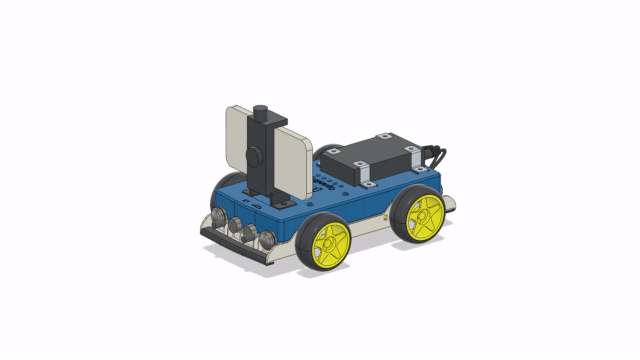

# OpenBot: готовые к использованию (RTR) машины

<p align="center">
  <a href="README.md">English</a> |
  <a href="README.zh-CN.md">简体中文</a> |
  <a href="README.de-DE.md">Deutsch</a> |
  <a href="README.fr-FR.md">Français</a> |
  <a href="README.es-ES.md">Español</a> |
  <a href="README.ko-KR.md">한국어</a> |
  <span>Русский</span>
</p>

Готовые к использованию (RTR) версии машины OpenBot ориентированы на аудиторию, у которой нет желания или времени собирать собственного робота. Машины RTR поставляются с полностью интегрированной электроникой, уже поддерживаются на уровне прошивки и были тщательно протестированы как с программной, так и с аппаратной точки зрения. Машины RTR доступны в двух вариантах, обозначаемых как "RTR_TT" и "RTR_520". Обе машины построены вокруг одного и того же брызгозащитного корпуса из ABS, но предназначены для разных целей. Если RTR_TT в первую очередь предназначен для использования в помещении, то RTR_520 оснащён более мощным процессором, лучшими двигателями, более прочными металлическими редукторами, а также комплектом внедорожных колёс, поддерживающих использование как в помещении, так и на улице.
<p align="center">
  <a>  &nbsp
  </a>
  <a> 
  </a>
</p>

### Заказ

Готовые машины OpenBot RTR можно заказать [здесь](http://www.openbot.info/).

## Сборка RTR самостоятельно

Если вы хотите собрать собственный OpenBot RTR, вам нужно будет напечатать шасси, изготовить печатные платы и купить двигатели и крепление для телефона.

### 3D-печать

Если вы всё же хотите напечатать собственный корпус OpenBot RTR, вам потребуется напечатать следующие детали.

1) ```shell_bottom``` ([STL](cad/rtr_bottom.stl), [STEP](cad/rtr_bottom.step))
2) ```shell_top``` ([STL](cad/rtr_top.stl), [STEP](cad/rtr_top.step))
3) ```phone_mount``` ([STL](cad/rtr_mount.stl), [STEP](cad/rtr_mount.step))

<p align="center">
  
</p>

### Печатные платы

Для каждой печатной платы есть три файла. Файл gerber содержит саму плату, файл BOM (ведомость материалов) содержит все компоненты, которые нужно припаять на плату, а файл центроидов содержит координаты каждого компонента для автоматической сборки плат. Базовая плата содержит большинство компонентов. Существует три варианта базовой платы. Вариант A — это «голая» плата с разъёмами для внешних плат драйверов двигателей и внешней платы микроконтроллера. Вариант B — модульная плата с штырьковым разъёмом для внешнего микроконтроллера. Вариант C — полностью интегрированная базовая плата, которую мы рекомендуем большинству пользователей. Плата переднего датчика столкновения содержит два датчика столкновения, сонар-датчик и USB-драйвер. Существует два варианта этой платы: с более дешёвым USB-драйвером CH340G и с более надёжным USB-драйвером CP2102N. В зависимости от того, какую версию (с моторами TT или 520) вы хотите собрать, вам понадобятся следующие платы.

#### Моторы TT

- 1x Базовая плата (Arduino)
- 1x Плата светодиодов состояния
- 1x Плата датчиков столкновения спереди/сверху/сзади
- 4x Плата датчика скорости (Arduino)

#### Моторы 520

- 1x Базовая плата (ESP32)
- 1x Плата светодиодов состояния
- 1x Плата датчиков столкновения спереди/сверху/сзади

#### Ссылки на платы

- Плата светодиодов состояния ([gerber](https://github.com/ob-f/OpenBot/blob/thias15/rtr/body/rtr/pcb/Gerber_Status_LED_Board_V1.zip),[bom](https://github.com/ob-f/OpenBot/blob/thias15/rtr/body/rtr/pcb/BOM_Status_LED_Board_V1.csv),[центроиды](https://github.com/ob-f/OpenBot/blob/thias15/rtr/body/rtr/pcb/PickAndPlace_Status_LED_Board_V1.csv))
- Плата верхнего датчика столкновения ([gerber](https://github.com/ob-f/OpenBot/blob/thias15/rtr/body/rtr/pcb/Gerber_BumpSensorTop_V1.zip),[bom](https://github.com/ob-f/OpenBot/blob/thias15/rtr/body/rtr/pcb/BOM_BumpSensorTop_V1.csv),[центроиды](https://github.com/ob-f/OpenBot/blob/thias15/rtr/body/rtr/pcb/PickAndPlace_BumpSensorTop_V1.csv))
- Плата заднего датчика столкновения ([gerber](https://github.com/ob-f/OpenBot/blob/thias15/rtr/body/rtr/pcb/Gerber_BumpSensorBack_V1.zip),[bom](https://github.com/ob-f/OpenBot/blob/thias15/rtr/body/rtr/pcb/BOM_BumpSensorBack_V1.csv),[центроиды](https://github.com/ob-f/OpenBot/blob/thias15/rtr/body/rtr/pcb/PickAndPlace_BumpSensorBack_V1.csv))
- Плата переднего датчика столкновения (CH340G) ([gerber](https://github.com/ob-f/OpenBot/blob/thias15/rtr/body/rtr/pcb/Gerber_SensorBoardFront_CH340G_V1.zip),[bom](https://github.com/ob-f/OpenBot/blob/thias15/rtr/body/rtr/pcb/BOM_SensorBoardFront_CH340G_V1.csv),[центроиды](https://github.com/ob-f/OpenBot/blob/thias15/rtr/body/rtr/pcb/PickAndPlace_SensorBoardFront_CH340G_V1.csv))
- Плата переднего датчика столкновения (CP2102N) ([gerber](https://github.com/ob-f/OpenBot/blob/thias15/rtr/body/rtr/pcb/Gerber_SensorBoardFront_CP2102N_V1.zip),[bom](https://github.com/ob-f/OpenBot/blob/thias15/rtr/body/rtr/pcb/BOM_SensorBoardFront_CP2102N_V1.csv),[центроиды](https://github.com/ob-f/OpenBot/blob/thias15/rtr/body/rtr/pcb/PickAndPlace_SensorBoardFront_CP2102N_V1.csv))
- Плата датчика скорости (Arduino) ([gerber](https://github.com/ob-f/OpenBot/blob/thias15/rtr/body/rtr/pcb/Gerber_SpeedSensor_Arduino_V1.zip),[bom](https://github.com/ob-f/OpenBot/blob/thias15/rtr/body/rtr/pcb/BOM_SpeedSensor_Arduino_V1.csv),[центроиды](https://github.com/ob-f/OpenBot/blob/thias15/rtr/body/rtr/pcb/PickAndPlace_SpeedSensor_Arduino_V1.csv))
- Интегрированная базовая плата C (Arduino) ([gerber](https://github.com/ob-f/OpenBot/blob/thias15/rtr/body/rtr/pcb/Gerber_BaseBoard_Arduino_V1C.zip),[bom](https://github.com/ob-f/OpenBot/blob/thias15/rtr/body/rtr/pcb/BOM_BaseBoard_Arduino_V1C.csv),[центроиды](https://github.com/ob-f/OpenBot/blob/thias15/rtr/body/rtr/pcb/PickAndPlace_BaseBoard_Arduino_V1C.csv))
- Интегрированная базовая плата C (ESP32) ([gerber](https://github.com/ob-f/OpenBot/blob/thias15/rtr/body/rtr/pcb/Gerber_BaseBoard_ESP32_V1C.zip),[bom](https://github.com/ob-f/OpenBot/blob/thias15/rtr/body/rtr/pcb/BOM_BaseBoard_ESP32_V1C.csv),[центроиды](https://github.com/ob-f/OpenBot/blob/thias15/rtr/body/rtr/pcb/PickAndPlace_BaseBoard_ESP32_V1C.csv))
- Модульная базовая плата B (Arduino) ([gerber](https://github.com/ob-f/OpenBot/blob/thias15/rtr/body/rtr/pcb/Gerber_BaseBoard_Arduino_V1B.zip),[bom](https://github.com/ob-f/OpenBot/blob/thias15/rtr/body/rtr/pcb/BOM_BaseBoard_Arduino_V1B.csv),[центроиды](https://github.com/ob-f/OpenBot/blob/thias15/rtr/body/rtr/pcb/PickAndPlace_BaseBoard_Arduino_V1B.csv))
- Модульная базовая плата B (ESP32) ([gerber](https://github.com/ob-f/OpenBot/blob/thias15/rtr/body/rtr/pcb/Gerber_BaseBoard_ESP32_V1B.zip),[bom](https://github.com/ob-f/OpenBot/blob/thias15/rtr/body/rtr/pcb/BOM_BaseBoard_ESP32_V1B.csv),[центроиды](https://github.com/ob-f/OpenBot/blob/thias15/rtr/body/rtr/pcb/PickAndPlace_BaseBoard_ESP32_V1B.csv))
- «Голая» базовая плата A (Arduino) ([gerber](https://github.com/ob-f/OpenBot/blob/thias15/rtr/body/rtr/pcb/Gerber_BaseBoard_Arduino_V1A.zip),[bom](https://github.com/ob-f/OpenBot/blob/thias15/rtr/body/rtr/pcb/BOM_BaseBoard_Arduino_V1A.csv),[центроиды](https://github.com/ob-f/OpenBot/blob/thias15/rtr/body/rtr/pcb/PickAndPlace_BaseBoard_Arduino_V1A.csv))
- Плата драйвера двигателя DRV8870 (Arduino) ([gerber](https://github.com/ob-f/OpenBot/blob/thias15/rtr/body/rtr/pcb/Gerber_MotorBoard_Arduino_V1_DRV8870.zip),[bom](https://github.com/ob-f/OpenBot/blob/thias15/rtr/body/rtr/pcb/BOM_MotorBoard_Arduino_V1_DRV8870.csv),[центроиды](https://github.com/ob-f/OpenBot/blob/thias15/rtr/body/rtr/pcb/PickAndPlace_MotorBoard_Arduino_V1_DRV8870.csv))
- «Голая» базовая плата A (ESP32) ([gerber](https://github.com/ob-f/OpenBot/blob/thias15/rtr/body/rtr/pcb/Gerber_BaseBoard_ESP32_V1A.zip),[bom](https://github.com/ob-f/OpenBot/blob/thias15/rtr/body/rtr/pcb/BOM_BaseBoard_ESP32_V1A.csv),[центроиды](https://github.com/ob-f/OpenBot/blob/thias15/rtr/body/rtr/pcb/PickAndPlace_BaseBoard_ESP32_V1A.csv))
- Плата драйвера двигателя DRV8870 (ESP32) ([gerber](https://github.com/ob-f/OpenBot/blob/thias15/rtr/body/rtr/pcb/Gerber_MotorBoard_ESP32_V1_DRV8870.zip),[bom](https://github.com/ob-f/OpenBot/blob/thias15/rtr/body/rtr/pcb/BOM_MotorBoard_ESP32_V1_DRV8870.csv),[центроиды](https://github.com/ob-f/OpenBot/blob/thias15/rtr/body/rtr/pcb/PickAndPlace_MotorBoard_ESP32_V1_DRV8870.csv))

## Далее

Прошейте [прошивку Arduino](../../firmware/README.ru_RU.md)
