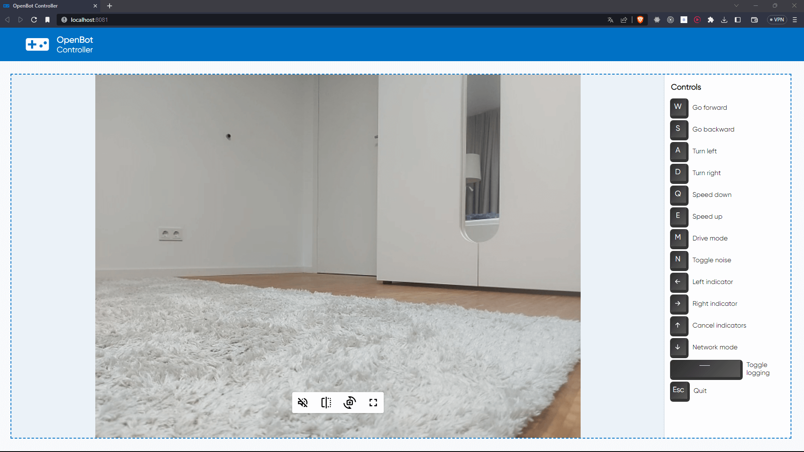
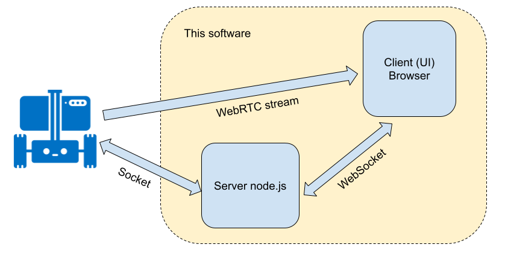

# OpenBot Nodejs Controller / Node.js-контроллер OpenBot

<p align="center">
  <a href="README.md">English</a> |
  <a href="README.zh-CN.md">简体中文</a> |
  <a href="README.de-DE.md">Deutsch</a> |
  <a href="README.fr-FR.md">Français</a> |
  <a href="README.es-ES.md">Español</a> |
  <a href="README.ko-KR.md">한국어</a> |
  <span>Русский</span>
</p>

## Терминология

Некоторые термины, которые мы будем использовать в этом документе:

* ```Robot, bot``` — это программное обеспечение Android, работающее на телефоне, установленном на машине [OpenBot](https://www.openbot.org/).
* ```Server``` — node-сервер, серверная часть этого проекта
* ```Client, UI``` — клиентская часть этого проекта. Она работает в браузере.

## Введение

Это проект на базе [Node.js](https://nodejs.org/), выступающий в роли контроллера для машины [OpenBot](https://www.openbot.org/). Программное обеспечение состоит из двух частей — сервера и клиента. Сервер — это приложение Node.js, работающее на компьютере в той же сети, что и робот. Клиентская часть работает в браузере.

Вот скриншот браузера:



## Начало работы

Вы можете запускать это ПО на ПК, устройстве типа RaspberryPi или даже на устройствах [Pi Zero](https://www.raspberrypi.com/products/raspberry-pi-zero/), поддерживающих окружение ```Node.js```. Сначала убедитесь, что вы установили [Node.js](https://nodejs.org/) версии 10 или новее. Проверьте версию:

    node --version

Программное обеспечение находится в каталоге ```/controller/node-js``` проекта OpenBot. После получения кода с [github](https://github.com/ob-f/OpenBot) перейдите в этот каталог и выполните следующие команды:

    npm install
    npm start

Последняя команда запустит сервер. Если вы хотите запустить сервер в фоне без терминала, на ```Linux/MacOS``` можно выполнить:

    npm run start-nohup

или просто:

    nohup npm start

Укажите в браузере IP-адрес сервера с портом 8081, например [http://localhost:8081](http://localhost:8081) или [http://192.168.1.100:8081](http://192.168.1.100:8081). Обратите внимание: вы можете обращаться к серверу с другого компьютера, но робот, сервер и компьютер с браузером должны находиться в одной сети. В будущем мы можем добавить возможность удалённого доступа к серверу.

Убедитесь, что ваш робот подключён к той же сети. В Android-приложении робота перейдите на панель ```General``` и выберите ```Phone``` в качестве контроллера. Это подключит Android-приложение к Node-серверу, и в интерфейсе появится видео.

## Как это работает

1. Node-сервер создаёт и публикует DNS-сервис типа ```openbot.tcp``` с именем ```OPEN_BOT_CONTROLLER``` на порту 19400. Это позволяет роботу автоматически находить сервер, не зная его IP-адрес. Робот ищет этот сервис и устанавливает Socket-соединение при переходе в режим контроллера ```Phone```.

2. Node-сервер создаёт HTTP-сервер на порту 8081 и начинает обслуживать запросы браузера.

3. Кроме того, node-сервер создаёт WebSocket-сервер на порту 7071. Он используется для прямой связи с браузером. Итак, если подвести итог, сервер создал два сокетных соединения: одно с роботом и одно с браузером.

4. Пользователь вводит команды клавиатуры из браузера. Нажатия клавиш отправляются на сервер через WebSocket. Сервер преобразует их в команды, понятные роботу, например ```{driveCmd: {r:0.4, l:0.34}}``` (список всех команд можно найти в документации Android-контроллера [здесь](https://github.com/ob-f/OpenBot/blob/master/docs/technical/OpenBotController.pdf)). Эти команды отправляются роботу через socket-соединение.

5. Робот отправляет обратно на сервер информацию о состоянии по socket-соединению, а сервер передаёт её в интерфейс. Интерфейс может использовать эту информацию для улучшения внешнего вида (например, мигающие указатели и т.п.), но в настоящее время этот статус игнорируется.

6. Node-сервер также выступает в роли сигнального прокси WebRTC. Он пересылает команды согласования WebRTC между роботом и браузером. Для этого он переиспользует уже открытые socket-соединения, поэтому дополнительные соединения или конфигурация не требуются.



## Разработка

В этом коде используется [snowpack](https://www.snowpack.dev/) — быстрый и лёгкий инструмент сборки.

Мы используем [eslint](https://eslint.org/) для линтинга и автоматического форматирования кода. Рекомендуется запускать линтер и исправлять все ошибки перед коммитом нового кода. Если вы используете Visual Code, плагин можно взять [здесь](https://marketplace.visualstudio.com/items?itemName=dbaeumer.vscode-eslint). Запустите линтер так:

    npm run lint

## Продакшен

Чтобы собрать продакшен-версию ```клиента```, выполните:

    npm run build

Это оптимизирует код клиента в каталог ```build```, который можно развернуть на сервере. Дополнительно нужно настроить менеджер процессов для перезапуска сервера и, возможно, обратный прокси, такой как [nginx](https://docs.nginx.com/nginx/admin-guide/web-server/reverse-proxy/), что пока не сделано.

## Устранение неполадок

* Иногда браузер не показывает меню команд, только заголовок. Это означает, что WebSocket-соединение не могло быть установлено. Обычно это происходит сразу после запуска сервера. Если вы откроете консоль браузера, вы найдёте сообщение о невозможности подключения, вроде ```WebSocket connection to 'ws://localhost:7071/ws' failed```. Завершите все процессы node (pkill -9 node) и перезапустите его. Перезагрузите страницу — соединение должно установиться.
* Если вы не можете подключить телефон к приложению, убедитесь, что другой экземпляр этого приложения не запущен на этой или другой машине в той же сети.

## Известные ошибки

Отсутствуют.

## Что нужно сделать/попробовать

* Нужно исследовать, можно ли подключаться к серверу удалённо и будет ли при этом работать WebRTC. Следует задокументировать настройку межсетевых экранов для такой возможности.
* Нужно создать ```production```-конфигурацию, возможно, с использованием [менеджера процессов pm2](https://www.npmjs.com/package/pm2) и [nginx](https://docs.nginx.com/nginx/admin-guide/web-server/reverse-proxy/).
