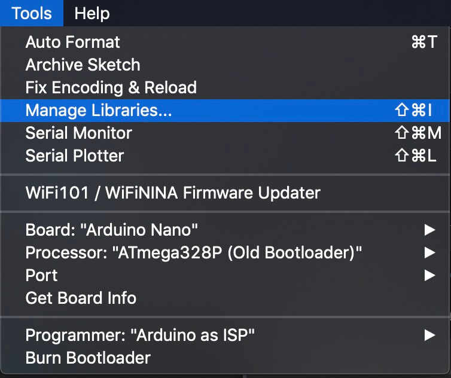
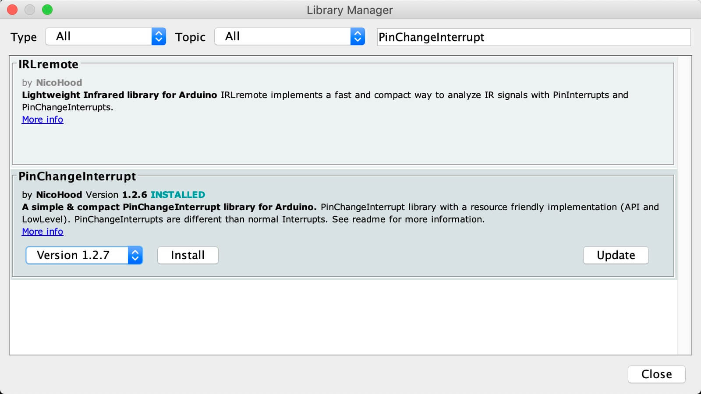
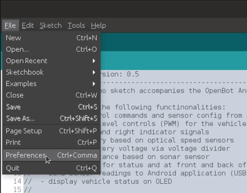
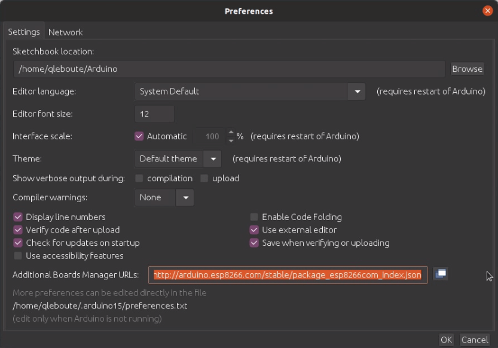
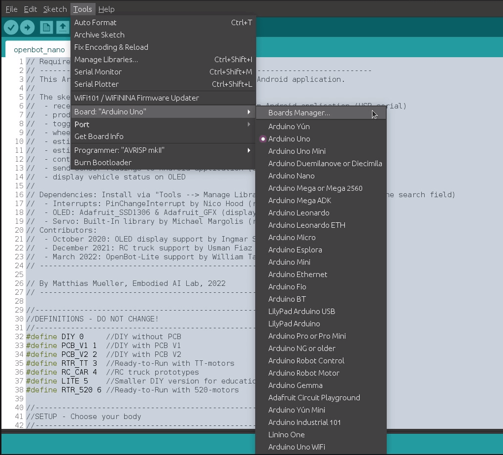
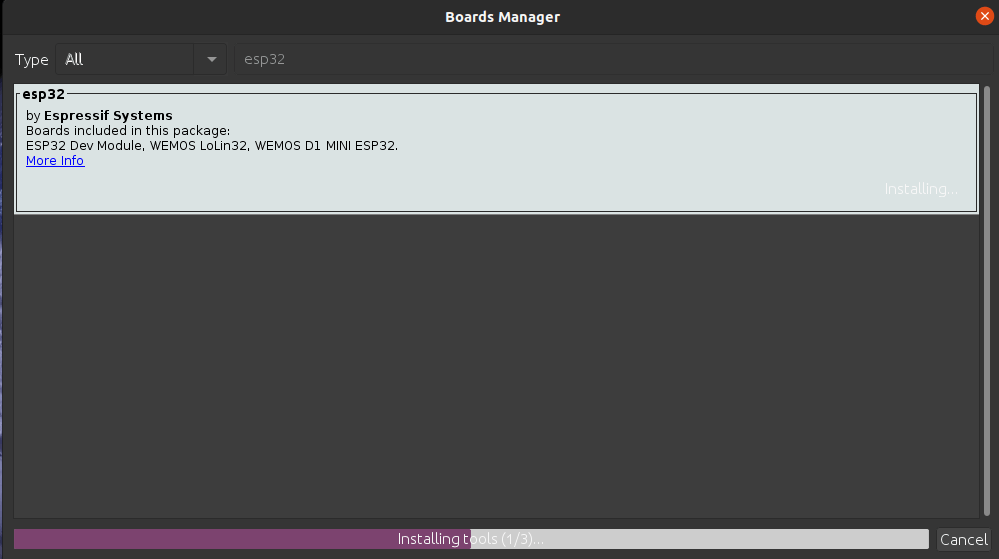
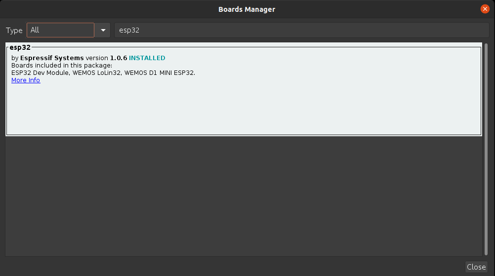
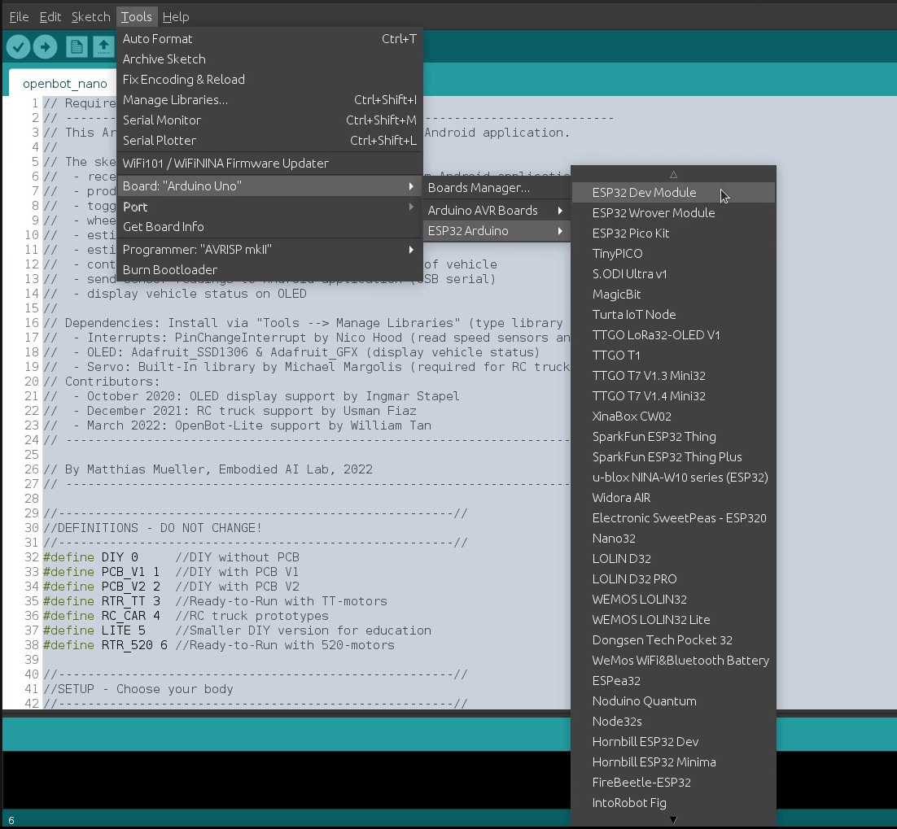
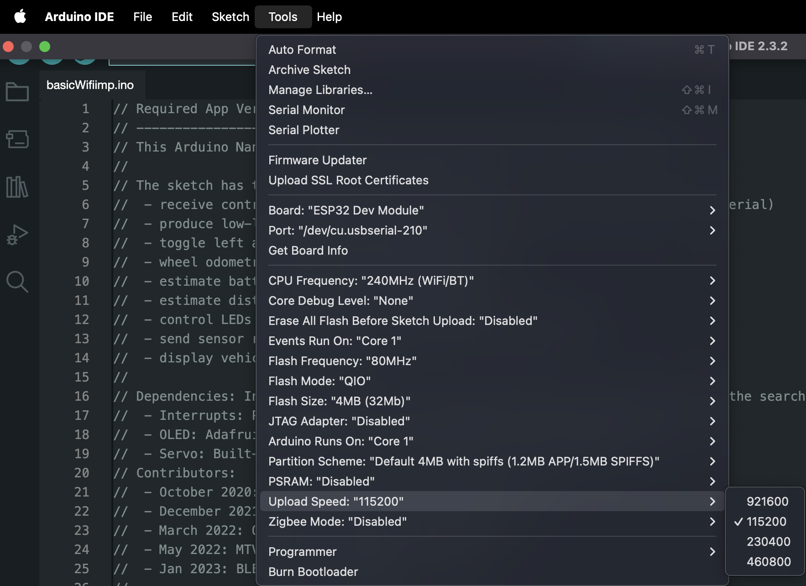
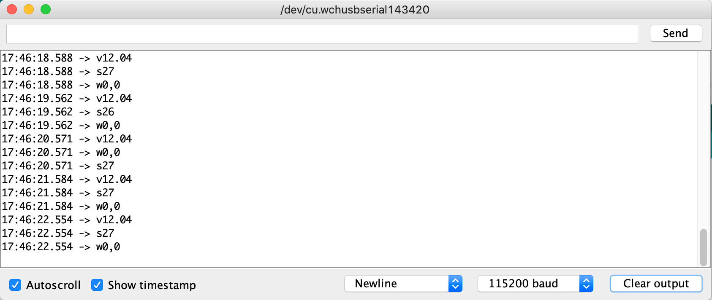

# Прошивка (Firmware)

<p align="center">
  <a href="README.md">English</a> |
  <span>Русский</span> |
  <a href="README.zh-CN.md">简体中文</a> |
  <a href="README.de-DE.md">Deutsch</a> |
  <a href="README.fr-FR.md">Français</a> |
  <a href="README.es-ES.md">Español</a> |
  <a href="README.ko-KR.md">한국어</a>
</p>

Мы используем микроконтроллер (MCU) в качестве «моста» между корпусом робота и смартфоном. Мы предоставляем нашу [прошивку](openbot/openbot.ino) для Arduino Nano с микроконтроллером ATmega328P, а также для отладочной платы ESP32.

## Возможности

Основная задача MCU — низкоуровневое управление транспортным средством и предоставление показаний с низкоуровневых бортовых датчиков. MCU получает команды управления и сигналы указателей поворота через последовательное соединение. Он преобразует команды в ШИМ-сигналы (PWM) для контроллера двигателей и переключает светодиоды в соответствии с сигналом указателя. Программа для Arduino также отслеживает обороты колёс, подсчитывая прерывания от оптических датчиков на левом и правом передних колёсах. Она вычисляет напряжение батареи с помощью масштабированного скользящего среднего измерений на делителе напряжения. Кроме того, с помощью дополнительного ультразвукового датчика можно измерять расстояние до препятствий перед автомобилем. Эти показания отправляются обратно в приложение Android через последовательное соединение.

## Настройка

Все параметры находятся в разделе **SETTINGS (НАСТРОЙКИ)** в начале файла `openbot.ino`. Ничто из того, что находится ниже, менять не нужно.

Чтобы сохранить ваши настройки при обновлении прошивки, скопируйте строки раздела SETTINGS между `#else` и `#endif` в новый файл `openbot_settings.h`, расположенный рядом с `openbot.ino`, и изменяйте их там. Если файл `openbot_settings.h` существует, прошивка использует его вместо раздела в `openbot.ino`, а git игнорирует этот файл, поэтому он не будет случайно отправлен в репозиторий.

### Корпус робота

Установите `OPENBOT` равным вашему корпусу робота и выберите поддерживаемую им плату в Arduino IDE. Прошивка определяет плату; с любой другой платой сборка завершится ошибкой.

| Корпус | `OPENBOT` | Arduino Nano | ESP32 Dev Module |
|---|---|:---:|:---:|
| Самодельная сборка DIY (драйвер двигателей L298N) | `DIY` | ✓ | ✓ |
| Готовая печатная плата V1 / V2 | `PCB_V1` / `PCB_V2` | ✓ | |
| Готовый комплект (RTR), двигатели TT | `RTR_TT` | ✓ | |
| Готовый комплект (RTR), двигатели TT, ESP32 | `RTR_TT2` | | ✓ |
| Готовый комплект (RTR), двигатели 520 | `RTR_520` | | ✓ |
| RC-грузовик | `RC_CAR` | ✓ | |
| OpenBot Lite | `LITE` | ✓ | |
| Вездеход Multi-Terrain Vehicle (MTV) | `MTV` | | ✓ |

Вариант `DIY_ESP32` заменён на `DIY` с выбором платы ESP32.

### Управление

По умолчанию робот управляется через приложение на телефоне. Для [режима без телефона](#режим-без-телефона) установите `NO_PHONE_MODE 1`; при использовании ESP32 вы также сможете управлять роботом с помощью [геймпада](#управление-с-геймпада) (`HAS_GAMEPAD 1`). Параметр `COAST_MODE` задаёт, будут ли двигатели свободно вращаться (1) или тормозить (0) при отсутствии управления, а `DEBUG 1` включает вывод отладочной информации в мониторе последовательного порта (Serial Monitor).

### Компоненты

Каждый корпус включает те компоненты, которые обычно в нём есть:

| `OPENBOT` | Включаемые компоненты |
|---|---|
| `DIY`, `PCB_V1`, `PCB_V2` | Делитель напряжения, указатели поворота, сонар, передние датчики скорости |
| `RTR_TT`, `RTR_TT2`, `RTR_520` | Делитель напряжения, указатели поворота, сонар, бампер, передние и задние датчики скорости, передние, задние и статусные светодиоды |
| `LITE` | Указатели поворота |
| `RC_CAR` | Нет |
| `MTV` | Передний, средний и задний датчики скорости |

На ESP32 также включается Bluetooth-соединение с телефоном.

В настройках каждый компонент установлен по умолчанию для соответствующего корпуса, например `#define HAS_SONAR DEFAULT_HAS_SONAR`, а таблица над ними показывает значения по умолчанию для каждого корпуса. Чтобы изменить компонент, установите вместо этого `1` (включён) или `0` (выключен), например `#define HAS_SONAR 0`, если вы не устанавливали ультразвуковой датчик. Включённый, но не установленный компонент не причиняет вреда, но приложение будет показывать бессмысленные показания для него, например расстояние до сонара 300 см.

| Параметр | Компонент |
|---|---|
| `HAS_VOLTAGE_DIVIDER` | Измерение напряжения батареи |
| `HAS_INDICATORS` | Огни указателей поворота |
| `HAS_SONAR`, `SONAR_MEDIAN` | Ультразвуковой датчик и медианный фильтр для его показаний |
| `HAS_BUMPER` | Бампер для обнаружения столкновений |
| `HAS_SPEED_SENSORS_FRONT`, `_BACK`, `_MIDDLE` | Датчики скорости колёс |
| `HAS_LEDS_FRONT`, `HAS_LEDS_BACK`, `HAS_LEDS_STATUS` | Передние огни, задние огни и статусные светодиоды |
| `HAS_OLED` | OLED-дисплей |
| `HAS_BLUETOOTH` | Bluetooth-соединение с телефоном (ESP32) |

### Батарея

Индикатор заряда батареи в приложении работает от `VOLTAGE_LOW` (пусто) до `VOLTAGE_MAX` (полно). Они установлены в значения по умолчанию для корпуса; для другой батареи установите их в настройках, например `#define VOLTAGE_LOW 6.8f`:

| Батарея | `VOLTAGE_LOW` | `VOLTAGE_MAX` |
|---|---:|---:|
| 2S Li-ion / LiPo | 6.8f | 8.4f |
| 3S Li-ion / LiPo | 10.2f | 12.6f |
| 6 × AA | 6.0f | 9.0f |
| 8 × AA | 8.0f | 12.0f |

Если ваш делитель напряжения отличается от штатного для корпуса, также установите `VOLTAGE_DIVIDER_FACTOR` равным (R1 + R2) / R2. `VOLTAGE_MIN` — минимальное напряжение, при котором двигатели ещё вращаются; прошивка использует его только в режиме без телефона.

### Проверка конфигурации

При запуске робота в мониторе последовательного порта (115200 бод) отображается корпус и включённые компоненты, например:

```
OpenBot DIY (ESP32): voltage, indicators, sonar, speed sensors front, Bluetooth
OpenBot settings: openbot_settings.h
```

Вторая строка показывает, откуда взялись настройки: из `openbot_settings.h` или из `openbot.ino`, если файл настроек отсутствует.

Если два компонента используют один и тот же вывод, сборка останавливается с ошибкой "Two parts use the same pin".

### Зависимости

На Arduino Nano датчикам скорости и ультразвуковому датчику требуется библиотека [PinChangeInterrupt](https://github.com/NicoHood/PinChangeInterrupt); в большинстве корпусов они включены по умолчанию. У Arduino Nano есть только два вывода внешних прерываний (D2 и D3), причём D3 — один из лишь шести выводов, поддерживающих ШИМ. К счастью, у него также есть три прерывания по изменению состояния порта, покрывающие все выводы Arduino. Эта библиотека обрабатывает эти прерывания порта, позволяя использовать все выводы Arduino как источники прерываний.

Если вы включили OLED, необходимо установить библиотеки [Adafruit_SSD1306](https://github.com/adafruit/Adafruit_SSD1306) и [Adafruit_GFX Library](https://github.com/adafruit/Adafruit-GFX-Library).

Библиотеки можно установить, выполнив следующие шаги:

1. Откройте менеджер библиотек: `Tools` :arrow_right: `Manage Libraries`
2. Введите название библиотеки в строке поиска.
3. Выберите последнюю версию и нажмите «Установить». Если библиотека уже установлена, это будет показано, и вы, возможно, сможете её обновить.

<p float="left">
  
   
</p>

### Китайские клоны Nano (например, US-версия)

Возможно, вам потребуется скачать драйверы [WCH340](http://www.wch.cn/product/CH340.html) у производителя чипа (китайский сайт):

- [Windows](http://www.wch.cn/downloads/CH341SER_EXE.html)
- [Linux](http://www.wch.cn/download/CH341SER_LINUX_ZIP.html)
- [Mac](http://www.wch.cn/download/CH341SER_MAC_ZIP.html)

### Отладочная плата ESP32

Чтобы установить поддержку плат ESP32 в вашей Arduino IDE, выполните следующие инструкции:

1. В Arduino IDE откройте **File > Preferences**:
<p align="center">
  
</p>

2. Введите *https://dl.espressif.com/dl/package_esp32_index.json* в поле «_Additional Board Manager URLs_», как показано на рисунке ниже. Затем нажмите кнопку «OK»:
<p align="center">
  
</p>

**Примечание:** если у вас уже указан URL для плат ESP8266, вы можете разделить URL запятой следующим образом:

    https://dl.espressif.com/dl/package_esp32_index.json,
    http://arduino.esp8266.com/stable/package_esp8266com_index.json

3. Откройте менеджер плат: **Tools > Board > Boards Manager**:
<p align="center">
  
</p>

4. Выполните поиск ESP32. Найдите «ESP32 by Espressif Systems» и обязательно выберите версию 2.0.17 в выпадающем списке. Любая версия 3.x.x работать не будет! Нажмите «Установить»:
<p align="center">
  
</p>

5. Теперь у вас есть всё необходимое для успешной прошивки платы ESP32 вашего OpenBot средствами среды разработки Arduino.
<p align="center">
  
</p>

6. Чтобы прошить OpenBot вашим новым кодом, просто выберите **ESP32 Dev Module** в меню **Tools > Board > ESP32 Arduino**. Дополнительную информацию, а также решение проблем при прошивке ESP32 можно найти по этой [ссылке](https://randomnerdtutorials.com/installing-the-esp32-board-in-arduino-ide-windows-instructions/).
<p align="center">
  
</p>

Если возникают проблемы с загрузкой, попробуйте уменьшить скорость передачи. Перейдите в Tools и выберите скорость загрузки 115200.
<p align="center">

</p>

## Загрузка прошивки

### Настройки (Arduino Nano)

- `Tools` :arrow_right: `Board` :arrow_right: `Arduino AVR Boards` :arrow_right: `Arduino Nano`
- `Tools` :arrow_right: `Processor` :arrow_right: `ATmega328P (Old Bootloader)`
- `Tools` :arrow_right: `Port` :arrow_right: `*Выберите USB-порт*`

:memo: ПРИМЕЧАНИЕ: в настоящее время большинство дешёвых плат Arduino Nano поставляются со _старым загрузчиком (Old Bootloader)_. Однако в зависимости от продавца вам может достаться плата и с новым загрузчиком. Поэтому, если вам не удаётся загрузить прошивку, скорее всего, вам нужно изменить процессор на _ATmega328P_.

### Настройки (ESP32)

- `Tools` :arrow_right: `Board` :arrow_right: `ESP32 Arduino` :arrow_right: `ESP32 Dev Module`
- `Tools` :arrow_right: `Port` :arrow_right: `*Выберите USB-порт*`

### Загрузка прошивки

Теперь прошивку можно загрузить через `Sketch` :arrow_right: `Upload` или нажатием кнопки загрузки (стрелка вправо).


### Тестирование

В этом разделе описано, как проверить все функции автомобиля после успешной прошивки.

1. Убедитесь, что:
   1. колёса не установлены на автомобиль
   2. Arduino подключена к компьютеру
   3. выбран правильный USB-порт
2. Откройте монитор последовательного порта: `Tools` :arrow_right: `Serial Monitor`

#### Отправка сообщений на OpenBot

Вы также можете отправлять сообщения на Arduino, введя команду в поле ввода сверху и нажав Send. Доступны следующие команды (при условии, что необходимые функции поддерживаются роботом):

- `c<левое>,<правое>`, где `<левое>` и `<правое>` находятся в диапазоне [-255,255]. Значение `0` останавливает двигатели. Значение `255` подаёт максимальное напряжение, вращающее двигатели на полной скорости вперёд. Меньшие значения приводят к пропорционально меньшему напряжению и скорости. Отрицательные значения подают соответствующее напряжение в обратной полярности, вращая двигатели назад.
- `i<левое>,<правое>`, где `<левое>` и `<правое>` находятся в диапазоне [0,1] и соответствуют левому и правому светодиодам указателей поворота. Например, `i1,0` включает левый указатель, `i0,1` — правый, а `i1,1` — оба. Включённые огни указателей мигают раз в секунду. Значение `i0,0` выключает указатели. Одновременно возможно только одно состояние.
- `l<перед>,<зад>`, где `<перед>` и `<зад>` находятся в диапазоне [0,255] и соответствуют яркости передних и задних светодиодов.
- `s<time_ms>`, где `<time_ms>` — время в мс между запусками измерений сонара (по умолчанию = 1000). После получения показания сонара сообщение отправляется роботу. По истечении таймаута отправляется значение `MAX_SONAR_DISTANCE`.
- `w<time_ms>`, где `<time_ms>` — время в мс между отправками роботом измерений одометрии колёс (по умолчанию = 1000). Скорость колеса отслеживается непрерывно, а обороты в минуту (rpm) вычисляются как среднее за указанный интервал времени.
- `v<time_ms>`, где `<time_ms>` — время в мс между отправками роботом измерений напряжения (по умолчанию = 1000). Напряжение отслеживается непрерывно и фильтруется скользящим средним размером 10. Помимо задания интервала для показаний напряжения, отправка этой команды также вызывает сообщения, сообщающие минимальное напряжение для вращения двигателей (`vmin:<значение>`), минимальное напряжение батареи (`vlow:<значение>`) и максимальное напряжение батареи (`vmax:<значение>`).
- `h<time_ms>`, где `<time_ms>` — время в мс, по истечении которого робот остановится, если не было получено новое сообщение «heartbeat» (по умолчанию = -1).
- `b<time_ms>`, где `<time_ms>` — время в мс, по истечении которого срабатывание бампера будет сброшено (по умолчанию = 750).
- `n<цвет>,<состояние>`, где `<цвет>` соответствует статусному светодиоду (`b` = синий, `g` = зелёный, `y` = жёлтый), а `<состояние>` — его значению (`0` = выкл., `1` = вкл.).
- `f` отправляет на OpenBot запрос вернуть сообщение с типом робота и его возможностями, например измерение напряжения (`v`), указатели (`i`), сонар (`s`), датчики бампера (`b`), одометрия колёс (`wf`, `wb`), светодиоды (`lf`, `lb`, `ls`) и т.д. Например, для версии OpenBot `RTR_V1` сообщение выглядело бы так: `fRTR_V1:v:i:s:b:wf:wb:lf:lb:ls:`.

#### Получение сообщений от OpenBot

В зависимости от конфигурации вы можете видеть разные сообщения.



- Сообщения, начинающиеся с `v`, сообщают напряжение батареи. Если подключить батарею к автомобилю (т.е. включить тумблер), должно отображаться напряжение батареи. Если отключить батарею (выключить тумблер), должно отображаться малое значение.
- Сообщения, начинающиеся с `w`, сообщают показания датчиков скорости в оборотах в минуту (rpm). Каждая прорезь на кодирующем диске увеличивает или уменьшает счётчик на единицу в зависимости от направления. Количество прорезей задаётся параметром `DISK_HOLES`. При использовании стандартного диска с 20 прорезями на каждый оборот колеса будет 20 счётов.
- Сообщения, начинающиеся с `s`, сообщают оценку свободного пространства перед ультразвуковым датчиком в см.
- Сообщения, начинающиеся с `b`, сообщают о столкновениях. Коды `lf` (левый передний), `rf` (правый передний), `cf` (центральный передний), `lb` (левый задний), `rb` (правый задний) указывают, какой датчик зафиксировал столкновение.

#### Процедура тестирования

Прежде чем продолжать, убедитесь, что шины сняты. Вам понадобится открытый монитор последовательного порта для отправки команд — вы будете видеть сообщения, получаемые от вашего OpenBot. Если у вас установлен OLED-дисплей, состояние транспортного средства также будет отображаться на нём в более удобочитаемом виде. Следующая процедура тестирования позволяет проверить все функции автомобиля:

1. Включите автомобиль и наблюдайте напряжение батареи (число после `v`). Вы можете сверить показание с мультиметром и при необходимости подстроить `VOLTAGE_DIVIDER_FACTOR`.
2. Если у вас установлен ультразвуковой датчик:
   1. Поднесите руку к датчику и поводите ею туда-сюда. Вы должны увидеть, что показания (число после `s`) соответствующим образом меняются.
   2. Мы заметили, что ультразвуковой датчик очень чувствителен к вибрациям! Поэтому рекомендуется убедиться, что вы получите надёжные показания во время работы, выполнив следующий тест:
      1. Разместите OpenBot с установленным ультразвуковым датчиком так, чтобы перед ним было не менее 200 см свободного пространства. Вы должны увидеть показание `200` или больше.
      2. Некоторое время наблюдайте за показаниями в мониторе последовательного порта, затем введите команду `c128,128`.
      3. Если показания датчика значительно меняются, вам нужно заглушить вибрации, передаваемые на ультразвуковой датчик от шасси (например, добавить силикон, отрегулировать положение крепления).
3. Если у вас установлены датчики скорости:
   1. Убедитесь, что перед ультразвуковым датчиком достаточно свободного пространства. Показание (число после `s`) должно быть как минимум выше `STOP_DISTANCE`, которая по умолчанию равна `10`.
   2. Отправьте команду `c128,128`. Двигатели начнут вращаться на _медленной скорости_ (50% ШИМ). Показания датчиков скорости (значения после `w`) сообщаются в rpm и для версии RTR_TT должны быть между 250 и 300 в зависимости от уровня заряда (SOC) батареи. При использовании версии DIY или более слабой батареи значения могут быть ниже. Проверьте, что все двигатели вращаются вперёд и что показания датчиков скорости положительны.
   3. Попробуйте отправлять разные команды управления и наблюдайте показания датчиков скорости. Например, команда `c-128,-128` вращает все двигатели назад на _медленной скорости_ (50% ШИМ). Команда `c255,-255` вращает левые двигатели вперёд, а правые — назад на _быстрой скорости_ (100% ШИМ). Команда `c-192,192` вращает левые двигатели назад, а правые — вперёд на _обычной скорости_ (75% ШИМ).
4. Остановите двигатели, отправив команду `c0,0`, или подержав руку перед ультразвуковым датчиком.
5. Если у вас установлены светодиоды указателей поворота, отправьте команду `i1,0` и понаблюдайте за миганием левого указателя. Затем отправьте команду `i0,1` и понаблюдайте за миганием правого указателя. Наконец, выключите указатели, отправив команду `i0,0`.

### Режим без телефона

Прежде чем тестировать автомобиль со смартфоном, на котором установлено приложение OpenBot, вы можете сначала протестировать его без телефона. Просто установите `NO_PHONE_MODE 1` в настройках. Теперь автомобиль будет ехать на _обычной скорости_ (75% ШИМ) и замедляться, когда ультразвуковой датчик обнаруживает препятствия. Когда расстояние до препятствия станет меньше `TURN_THRESHOLD` (по умолчанию: 50 см), автомобиль начнёт поворачивать в случайном направлении и включать светодиод с этой стороны. Если оценка свободного пространства перед автомобилем падает ниже `TURN_THRESHOLD`, он медленно поедет назад, и оба светодиода включатся. Обратите внимание, что и автомобиль, и Arduino должны быть запитаны. Arduino можно запитать, подключив вывод 5V к выходу 5V драйвера двигателей L298N, либо подключив USB-кабель к источнику питания (например, к телефону).

Перед запуском автомобиля мы рекомендуем снять шины, подключить Arduino к компьютеру и наблюдать монитор последовательного порта, как в разделе [Тестирование](#тестирование). Вывод в мониторе последовательного порта немного проще для анализа (как на OLED) и показывает напряжение батареи, обороты левого и правого двигателей и оценку свободного пространства перед автомобилем. Вы можете водить крупным объектом туда-сюда перед ультразвуковым датчиком и наблюдать, как меняется скорость двигателей.

:warning: ПРЕДУПРЕЖДЕНИЕ: Если у вас не установлен ультразвуковой датчик или он отключён, автомобиль будет просто ехать вперёд на _обычной скорости_ (75% ШИМ) и в конце концов врежется. Даже с установленным датчиком автомобиль может иногда врезаться из-за шумных показаний.

### Управление с геймпада

В режиме без телефона вы можете управлять корпусом на ESP32 с помощью Bluetooth-геймпада вместо того, чтобы позволять ему ехать самостоятельно.

#### Настройка

1. В Arduino IDE добавьте этот URL в **Preferences > Additional boards manager URLs**:
   `https://raw.githubusercontent.com/ricardoquesada/esp32-arduino-lib-builder/master/bluepad32_files/package_esp32_bluepad32_index.json`
2. В менеджере плат установите **esp32_bluepad32** (4.1.0). Он основан на том же ядре esp32 (2.0.17), что и обычная прошивка.
3. Выберите **ESP32 Dev Module** из плат esp32_bluepad32.
4. В настройках установите `NO_PHONE_MODE 1` и `HAS_GAMEPAD 1`, затем загрузите прошивку.

Геймпад использует Bluetooth ESP32, поэтому Bluetooth-соединение с телефоном в этом режиме отключено. Чтобы управлять через приложение на телефоне, оставьте `HAS_GAMEPAD 0` и вместо этого сопрягите геймпад с телефоном.

#### Сопряжение

Включите робота и переведите геймпад в режим сопряжения. Он подключится в течение нескольких секунд, и после этого будет переподключаться каждый раз при включении. Чтобы сопрячь другой геймпад, сначала выключите подключённый: одновременно управлять может только один геймпад.

| Геймпад | Режим сопряжения |
|---|---|
| PS5 DualSense | Удерживайте **Create**, затем удерживайте **PS**, пока световая панель не начнёт мигать. |
| PS4 DualShock 4 | Удерживайте **Share**, затем удерживайте **PS**, пока световая панель не начнёт быстро мигать. |
| Xbox Wireless (модель 1708 или новее) | Включите его, затем удерживайте кнопку сопряжения 3 с. Сначала обновите прошивку контроллера до версии 5.15 или новее (например, через приложение Xbox Accessories). |
| Switch Pro, Joy-Con, 8BitDo и другие | Используйте режим сопряжения Bluetooth вашего геймпада (см. инструкцию). |

[Список поддерживаемых геймпадов Bluepad32](https://bluepad32.readthedocs.io/en/latest/supported_gamepads/) содержит больше моделей, включая PS3 DualShock 3, который требует дополнительной настройки. При `DEBUG 1` монитор последовательного порта показывает имя каждого подключаемого геймпада.

Если ранее сопряжённый геймпад не перехватывает управление — например, контроллер PS4 или PS5, световая панель которого остаётся синей вместо зелёного, оранжевого или красного цвета, — переведите его снова в режим сопряжения и перезапустите робота.

#### Управление

Кнопки названы в формате PlayStation / Xbox.

| Элемент управления | Действие |
|---|---|
| **R2 / L2** | Вперёд / назад (игровой режим) |
| **Левый стик** | Рулевое управление (игровой режим), движение и поворот (джойстик-режим) или левая сторона (режим танка) |
| **Правый стик** | Правая сторона (режим танка) |
| **L1** | Следующий режим движения: game → joystick → dual. Геймпад вибрирует один раз: коротко — game, дольше — joystick, длиннее всего — dual. |
| **Крестовина вверх / R3** | Быстрее |
| **Крестовина вниз / L3** | Медленнее |
| **Квадрат / X** | Левый указатель поворота вкл/выкл |
| **Круг / B** | Правый указатель поворота вкл/выкл |
| **Треугольник / Y** | Выключить указатели |
| **Крестик / A** | Фары вкл/выкл |
| **Start** | Режим исследования (Explore) вкл/выкл |
| **Select / Back** | Остановка перед препятствием вкл/выкл |

Для Start и Select длинная вибрация означает «включено», короткая — «выключено».

**Режимы движения.** Геймпад начинается в режиме, заданном параметром `GAMEPAD_DRIVE_MODE` (по умолчанию: game).
- **Game (игровой):** R2 — вперёд, L2 — назад, левый стик — рулевое управление. При движении назад руление инвертируется, как у автомобиля.
- **Joystick (джойстик):** левый стик управляет движением и поворотом. Робот всегда поворачивает в направлении, куда направлен стик, в том числе при движении назад.
- **Dual (танк):** каждый стик управляет одной стороной, как у танка.

**Скорости.** Есть три скорости: медленная (50%), обычная (75%, стартовая) и быстрая (100%). Геймпад показывает скорость с помощью светодиодов игрока (один-три) или световой панели (зелёный, оранжевый, красный).

**Режим исследования (Explore).** Это описанный выше режим автономной езды без телефона: робот ездит сам и объезжает препятствия. При запуске робота он выключен; нажмите **Start**, чтобы включить. Пока режим исследования включён, движение стика или курка перехватывает управление. Когда вы отпускаете, робот кратко останавливается и исследование продолжается. Для режима исследования нужен подключённый сонар с `HAS_SONAR 1`; без него робот будет просто ехать прямо (см. предупреждение выше).

**Остановка перед препятствием.** При управлении с геймпада робот не поедет вперёд, если сонар видит препятствие ближе `STOP_DISTANCE`. При запуске робота эта функция включена; нажмите **Select**, чтобы выключить её, например чтобы что-то толкнуть. Она работает только с подключённым сонаром и `HAS_SONAR 1`; иначе робот никогда не будет останавливаться перед препятствиями.

**Безопасность.** Робот останавливается, когда геймпад отключается. Большинство геймпадов также передают данные непрерывно, и если такой геймпад замолчит на 0,5 с (вне зоны действия, разряженная батарея), робот остановится сразу, не дожидаясь отключения.

## Использование других MCU (требования)

Вы можете использовать любой другой микроконтроллер со следующими характеристиками:

- 1x USB-TTL последовательный порт (связь со смартфоном)
- 4x ШИМ-выход (управление двигателями)
- 1x аналоговый вывод для контроля батареи
- 2x цифровых вывода для датчиков скорости
- 1x цифровой вывод для ультразвукового датчика (опционально)
- 2x цифровых вывода для светодиодов указателей поворота (опционально)

## Далее

Скомпилируйте и запустите [приложение Android](../robot/android/README.ru_RU.md)
