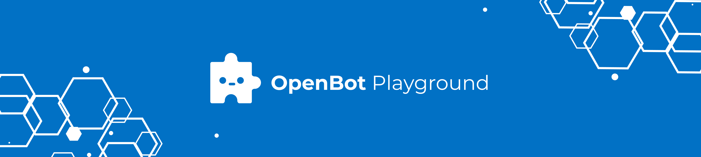

# OpenBot Playground (Площадка OpenBot)

<p align="center">
  <a href="README.md">English</a> |
  <span>Русский</span> |
  <a href="README.zh-CN.md">简体中文</a> |
  <a href="README.de-DE.md">Deutsch</a> |
  <a href="README.fr-FR.md">Français</a> |
  <a href="README.es-ES.md">Español</a> |
  <a href="README.ko-KR.md">한국어</a>
</p>

OpenBot Playground — это платформа программирования методом перетаскивания (drag and drop) в поддержку приложения OpenBot, где любой желающий может составлять инструкции для робота.

## Начало работы

Вы можете запустить это приложение прямо по [ссылке](https://www.playground.openbot.org/ "Link").

Также можно запустить его локально, создав локальную копию проекта. Для этого перейдите в папку
`openBot/open-code`, [настройте проект firebase](src/services/README.md) и запустите приложение.
После [настройки firebase](src/services/README.md) выполните следующие команды:

Если вы используете npm

```bash
npm install
```

В случае yarn

```bash
yarn install
```

Запуск приложения

```bash
npm start
```

### Возможности приложения

1. Синхронизируйте ваш Google Drive с OpenBot, и данные будут автоматически сохраняться там.
2. Сохраняйте данные в локальное хранилище.
3. Считывайте выходной QR-код напрямую из приложения OpenBot, чтобы запустить программу.
4. В мобильных приложениях OpenBot после входа в систему вы можете получить сохранённые файлы из Google Drive и загрузить их
   одним нажатием.
5. Составляйте инструкции для OpenBot без единой строки кода.
6. Полностью адаптивный дизайн, оптимизированный для просмотра с телефонов и планшетов.
7. Блоки OpenBot Playground, которые можно [изучить](https://www.youtube.com/watch?v=8oPbCGZmwTU&list=PLXGqaCYqUFZDK6CWP1bP3J6upNOFDbvkA).

### Хранение проектов

Этот проект позволяет пользователям хранить данные как локально, так и в `Google Drive`. При создании проект
автоматически сохраняется в `локальном хранилище` устройства пользователя. По мере внесения изменений в проект локальное
хранилище обновляется в реальном времени.

Кроме того, пользователи могут загрузить свой проект в Google Drive, нажав на [кнопку загрузки](#генерация-кода). Это
позволяет пользователям получать доступ к проекту с любого устройства с подключением к интернету, что упрощает работу
над проектом из разных мест.

- #### Локальное хранилище
  Локальное хранилище — встроенная веб-технология, позволяющая веб-приложениям хранить данные локально в браузере
  пользователя. Это означает, что проект хранится на устройстве пользователя и доступен без подключения к интернету.

  В этом проекте локальное хранилище используется для сохранения проекта при каждом его изменении. Проект хранится
  в кэше браузера, а значит, он сохранится даже если пользователь закроет вкладку или браузер.

- #### Хранение в Google Drive
  Google Drive — облачное хранилище от Google. Оно позволяет пользователям хранить и публиковать файлы в сети,
  а также получать к ним доступ с любого устройства с подключением к интернету.

  В этом проекте пользователи могут загрузить свой проект в Google Drive, нажав на значок загрузки, когда они вошли
  на сайт. После этого проект хранится в аккаунте Google Drive пользователя, а значит, к нему можно получить доступ
  с любого устройства с подключением к интернету.

  Чтобы получить доступ к проекту из Google Drive, пользователю достаточно войти в свой аккаунт Google и перейти
  в раздел [мои проекты](#раздел-проектов), где будут отображены все сохранённые проекты.

## Экраны OpenBot Playground

### Главная страница

`OpenBot Playground` начинается с главной страницы, содержащей следующие компоненты:

- [Шапка](#шапка): шапка содержит два раздела — смену темы и вход пользователя.
- [Карусель](#карусель): содержимое карусели объясняет, как работает Playground.
- [Раздел проектов](#раздел-проектов): раздел проектов содержит список проектов и кнопку создания нового проекта.

### Страница Playground

Страница `Playground` — ключевая возможность платформы `OpenBot Playground`, предоставляющая множество блоков кода для
создания различных типов функциональности: управление, циклы, движение, операторы, датчики и многие другие.

- [Шапка](#шапка): шапка содержит название проекта, центр помощи, AutoSync, смену темы и раздел входа пользователя.
- [Рабочая область](#рабочая-область): пространство, где пользователи могут перетаскивать блоки кода для генерации программы, которую можно
  преобразовать как в JavaScript, так и в Python.
- [Нижняя панель Playground](#нижняя-панель-playground): нижняя панель содержит кнопки генерации кода, загрузки проекта в
  диск, увеличения и уменьшения масштаба блоков, добавления модели, отмены и повтора изменений в рабочей области.

### Шапка

В шапке сайта `Openbot-Playground` слева вверху расположен логотип. Справа в шапке находятся
две кнопки.

- #### Смена темы
  Значок темы позволяет переключаться между светлым и тёмным режимами и наоборот.

  <p align="left">
  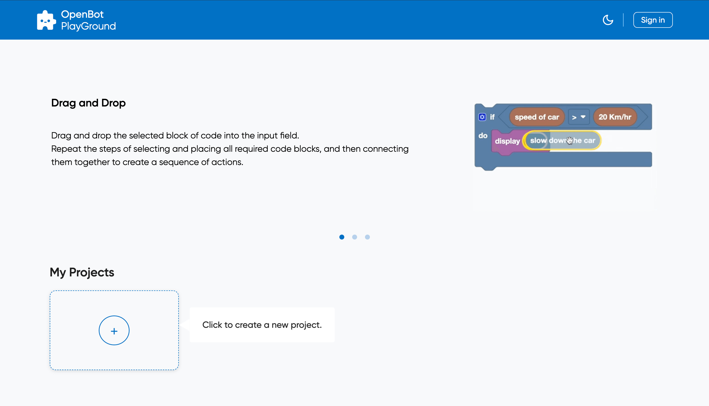
  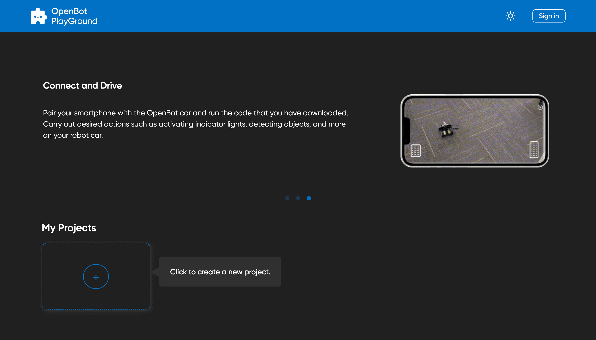
  </p>

- #### Вход

  Кнопка «Sign-in» («Войти») открывает на экране всплывающее окно входа через Google и предлагает ввести ваш email для входа
  со всеми необходимыми разрешениями, включая изменение ***Google Drive***.
  <p align="left">
  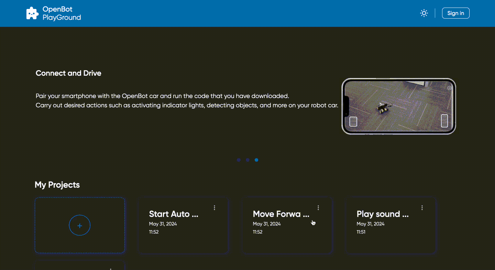
  </p>

- #### Опции профиля
  После успешного входа у вас появятся возможности редактировать профиль и выйти из системы. Кнопка «Edit Profile»
  («Редактировать профиль») открывает всплывающее окно, где можно обновить изображение профиля, отображаемое имя и дату рождения.
  <p align="left">
  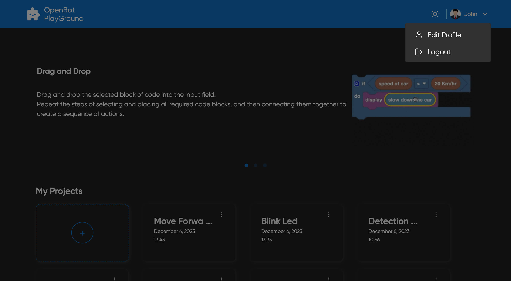
  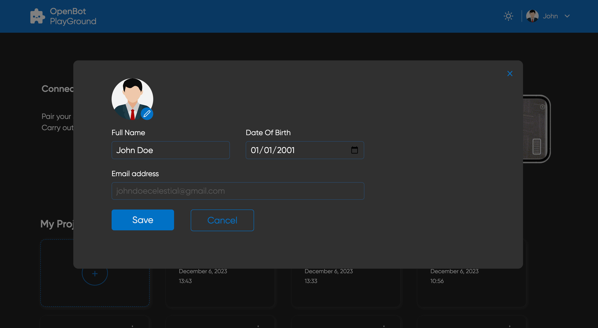
  </p>

- #### AutoSync:
    - AutoSync позволяет пользователям бесшовно синхронизировать все модели машинного обучения (модели Tflite)
      из приложения робота OpenBot и удобно отображать их в соответствующих блоках ``Artificial Intelligence`` («Искусственный интеллект»). Кроме того,
      пользователи могут выбрать нужную ИИ-модель прямо в интерфейсе блока при составлении
      кода.
    - #### Как это работает
        - Приложение робота загружает обновлённый файл config.json в Google Drive пользователя, включая все вновь добавленные
          модели. Этот файл перечисляет все модели вместе с их конфигурациями в формате JSON.
        - Когда пользователь нажимает ``Auto Sync``, все загруженные модели, включая модели обнаружения, автопилота и
          навигации к точке, фильтруются и отображаются в соответствующих ИИ-блоках.
        - После этого процесса модель появится в блоках OpenBot playground. С помощью
          Google Drive вы сможете удобно выбрать эту модель прямо из соответствующих ИИ-блоков.

- #### Дополнительные элементы страницы Playground

    - Шапка страницы Playground сохраняет тот же дизайн, что и шапка главной страницы, но с дополнительными
      возможностями. В центре отображается название проекта со стрелкой вниз, предоставляющей варианты для
      переименования и удаления проекта.
       <p align="left">
       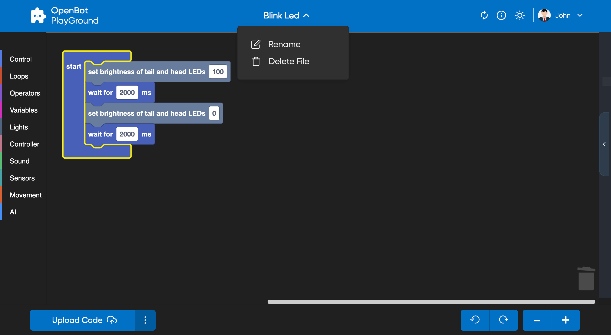
       </p>

    - Справа добавлена кнопка помощи с тремя разделами, объясняющими, как эффективно перетаскивать блоки,
      сохранять и скачивать прогресс проекта и загружать его на диск для удобной совместной работы.

        <p align="left">
        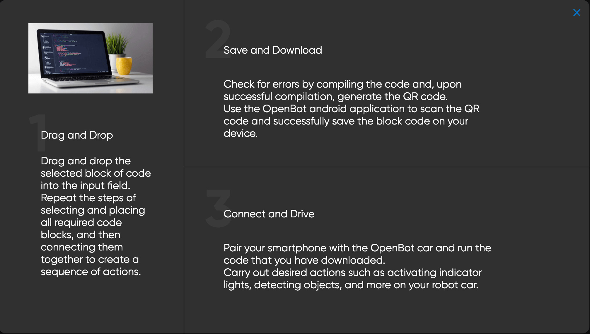
        </p>

### Карусель

Контейнер карусели объясняет, как работает приложение.
<p>
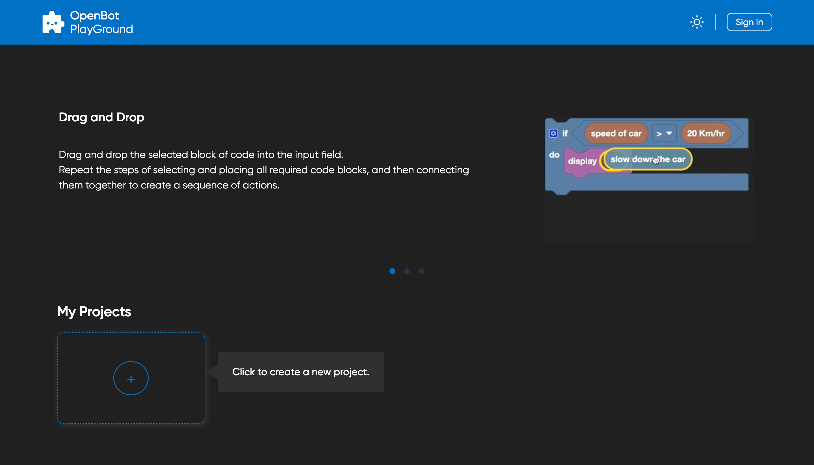
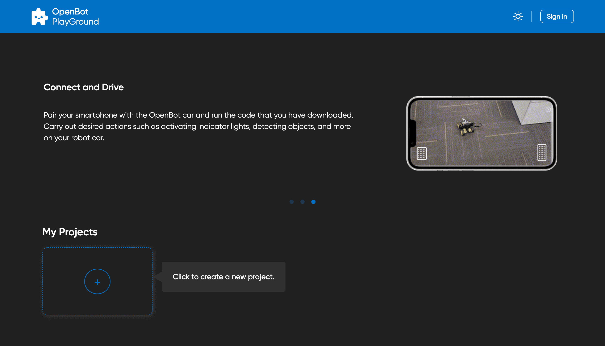
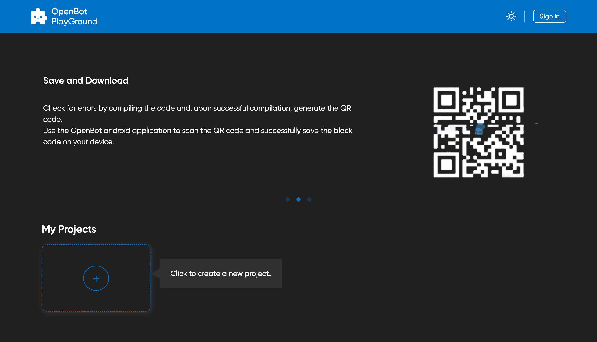
</p>

### Раздел проектов

Раздел «My Projects» («Мои проекты») отображает проекты, хранящиеся в локальном хранилище и в Google Drive (если пользователь вошёл), причём
для каждого проекта показаны его название, дата создания/редактирования и предыдущие версии блоков. Нажатие на проект перенаправляет пользователя
на его страницу playground. Чтобы создать новый проект, просто нажмите на `значок создания`.

Нажатие на значок «Create» открывает всплывающее окно «Create New Project» с полем ввода названия проекта и кнопкой «Create».
После ввода подходящего названия и нажатия кнопки «Create» или Enter откроется экран playground проекта.
Если пользователь введёт имя, уже присвоенное другому проекту, система автоматически сгенерирует уникальное имя,
добавив целое число в конец названия.

<p align="left">
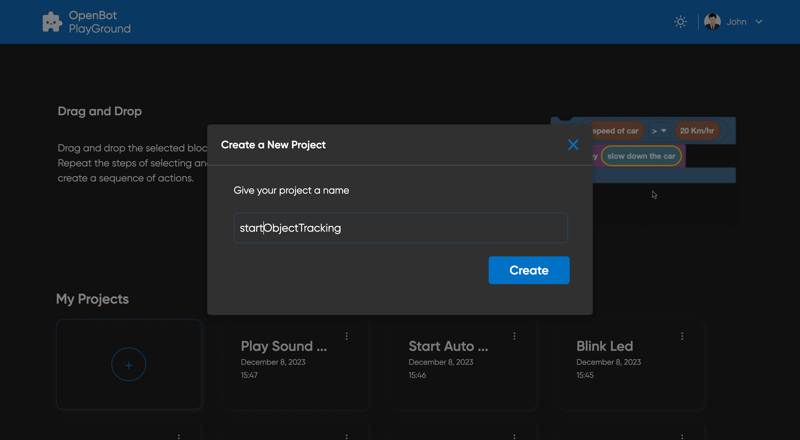
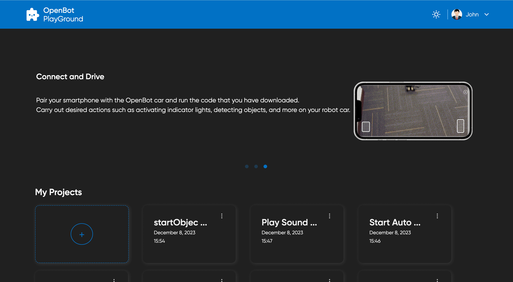
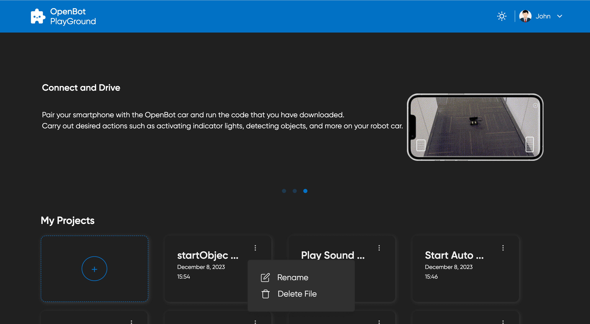
</p>

### Рабочая область

Для генерации кода пользователи могут перетаскивать блоки кода в рабочую область. Код может быть преобразован как
в JavaScript, так и в Python.

- Блоки можно выбирать в левой секции и перетаскивать в рабочую область по мере необходимости.
- Чтобы удалить блок, его достаточно перетащить на значок корзины в правом нижнем углу.
- Если блок не подходит к блоку «Start» или «Forever», он будет отключён, чтобы предотвратить ошибки в генерируемом
  коде.
- Пользователи могут восстановить удалённый блок из корзины, нажав на неё — отобразится список удалённых блоков.
  Затем нужный блок можно перетащить из корзины обратно в рабочую область.
- Подробнее о блоках: [Blocks](src/components/blockly/README.md)
  <p align="left">
  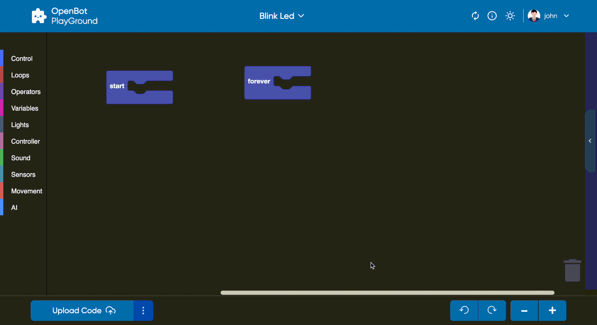
  </p>

### Нижняя панель Playground

- Для успешной работы openBot-PlayGround в вебе с использованием Google Drive пользователи должны выполнить следующие
  условия:
    - У пользователя не должно быть в Google Drive другой папки с тем же именем, что и созданная сайтом папка
      openBot-PlayGround.
    - Пользователь не должен создавать файл с таким же именем внутри папки openBot-PlayGround.
  <p align="left">
  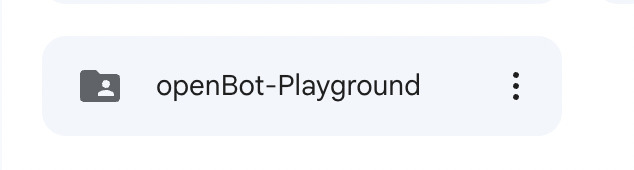
    <p></p>
  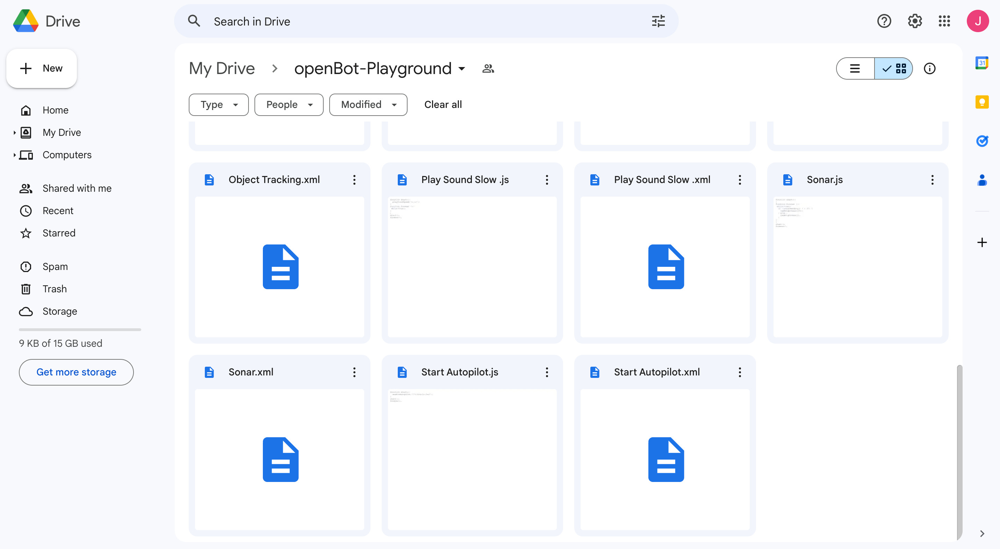

- #### Генерация кода
  Кнопка Generate Code («Сгенерировать код») на нижней панели Playground выполняет три важные функции. Во-первых, она генерирует QR-код,
  представляющий ссылку на файл JavaScript/Python, загруженный в Google Drive пользователя в составе проекта. Этот QR-код
  отображается в боковом окне для удобного доступа и публикации. Во-вторых, кнопка загружает файл JavaScript/Python
  с кодом проекта в Google Drive пользователя. И наконец, загружается XML-файл,
  представляющий текущую конфигурацию блоков проекта. Этот XML-файл содержит структуру и расположение блоков, использованных в
  проекте.

    - `Удобная публикация` -
      QR-код, сгенерированный кнопкой, предоставляет публичную ссылку на файл JavaScript/Python в Google
      Drive.
      По этой ссылке можно получить доступ, считав QR-код с помощью приложения OpenBot для IOS/Android. Это позволяет пользователям запускать
      автомобиль на основе кода, сгенерированного с помощью блоков кода, прямо с мобильного устройства. Возможность поделиться QR-
      кодом и получить доступ к коду на мобильных устройствах добавляет ещё один уровень удобства и доступности
      openBot playground. Интеграция с Google Drive обеспечивает полную резервную копию вашего проекта. Включение XML-
      файла сохраняет точную структуру и логику блоков, использованных в проекте. Это полезно для публикации,
      совместной работы и повторного посещения проектов в будущем.

  <br></br>
  Вот демонстрация загрузки на Drive и генерации кода:
  <p align="left">
  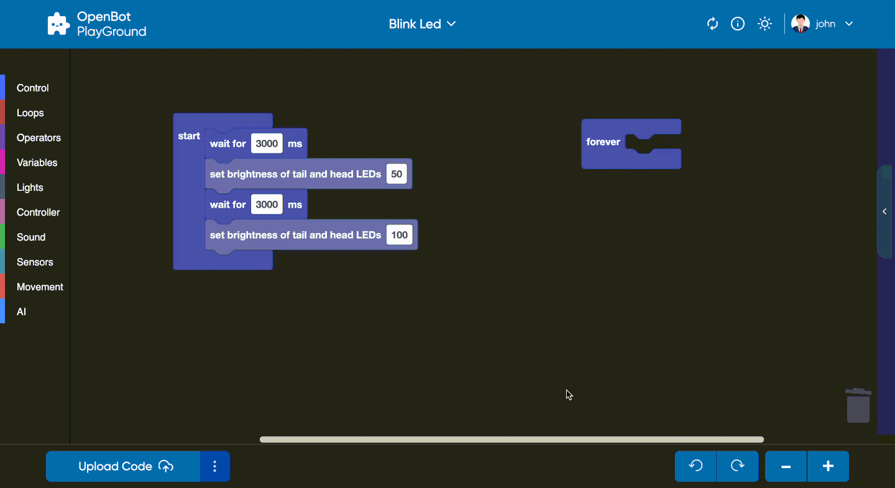
  </p>

- #### Редактор кода
  Кнопка редактора кода справа от кнопки генерации QR-кода открывает боковое окно, отображающее код блоков на скриптовом
  языке. Кнопка предоставляет выбор между двумя языками — JavaScript или Python; после выбора
  пользователи могут только просматривать фрагменты кода в боковом окне. Можно переключаться между JavaScript и Python, чтобы одновременно видеть
  соответствующий код в боковом окне. Возможность выбора языка позволяет проверять и
  оценивать корректность блоков.
  <p align="left">
  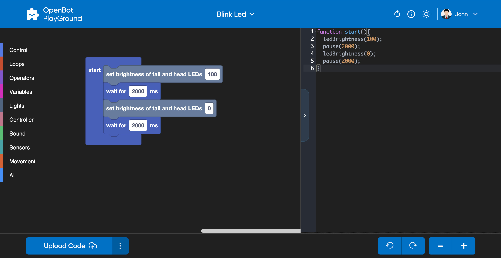
  </p>

- #### Добавление модели
  OpenBot playground предоставляет возможность внешне добавить ИИ-модель (.tflite) в приложение робота. Всплывающее окно модели
  позволяет пользователю редактировать конфигурацию модели, включая её название, тип, класс и размер входа. Обратите внимание, что
  модель будет автоматически сохранена в Google Drive пользователя вместе с обновлённым файлом config.json.
  <p align="left">
  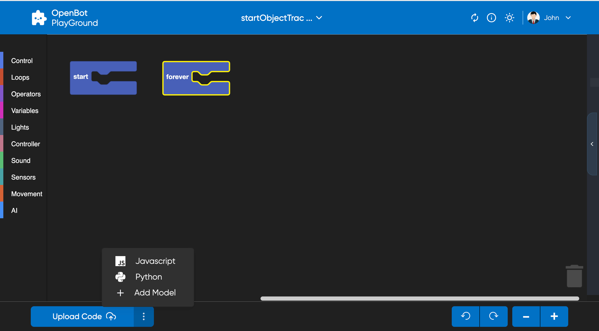
  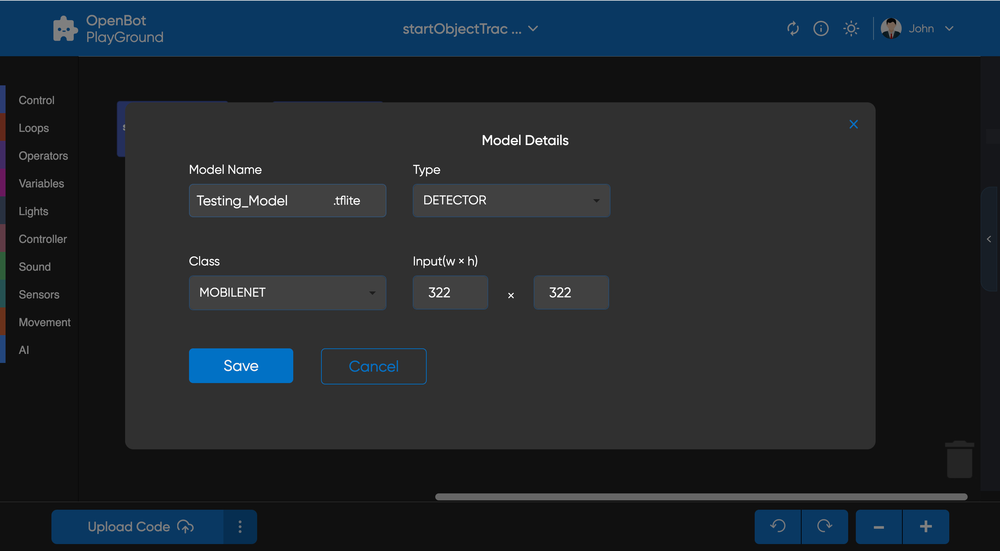
  </p>


- #### Управление рабочей областью
  Кнопки undo и redo обеспечивают функции отмены и повтора в playground. Значок плюс предназначен для увеличения масштаба, а
  значок минус — для уменьшения.

## Далее (опционально)

Устранение проблем с Firebase Authentication — см. [Firebase](src/services/README.md#troubleshooting)
