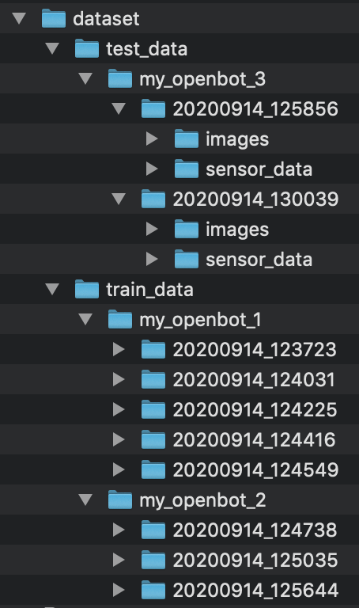
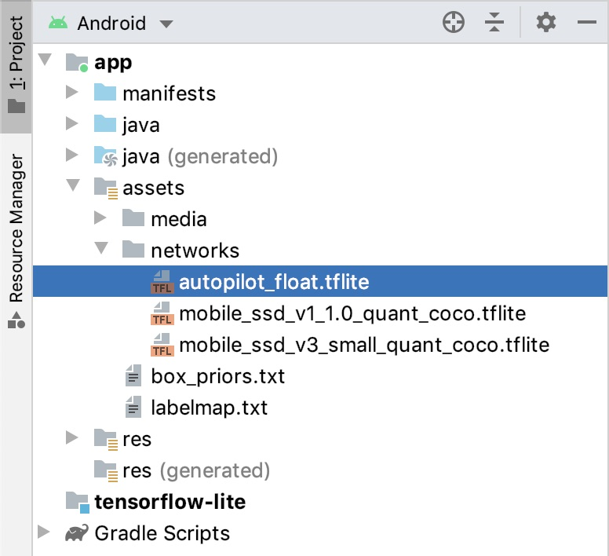
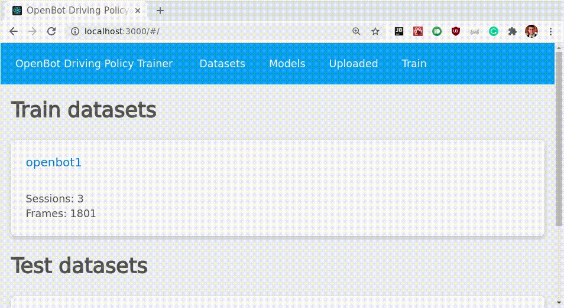

# Политика вождения (продвинутый уровень)

<p align="center">
  <a href="README.md">English</a> |
  <span>Русский</span> |
  <a href="README.zh-CN.md">简体中文</a> |
  <a href="README.de-DE.md">Deutsch</a> |
  <a href="README.fr-FR.md">Français</a> |
  <a href="README.es-ES.md">Español</a> |
  <a href="README.ko-KR.md">한국어</a>
</p>

## ОТКАЗЫ ОТ ОТВЕТСТВЕННОСТИ

1. **Безопасность:** политики вождения несовершенны и могут привести к аварии робота. Всегда убедитесь, что вы работаете в безопасной среде! Помните, что ваш телефон может быть повреждён при столкновении! Убедитесь, что у вас всегда подключён игровой контроллер и вы знакомы с назначением кнопок, чтобы иметь возможность остановить транспортное средство в любой момент. Используйте на свой страх и риск!
2. **Вычислительное оборудование:** обучение политики вождения требует много ресурсов и может замедлить или даже «заморозить» вашу машину. Рекомендуется использовать мощный ноутбук или рабочую станцию с большим объёмом ОЗУ и выделенным GPU, особенно при обучении с большими размерами батча. Документация также пока не очень подробная. Используйте на свой страх и риск!
3. **Требуется терпение:** чтобы получить хорошую политику вождения для вашего собственного набора данных, потребуется некоторое терпение. Это не просто: включает сбор данных, настройку гиперпараметров и т.д. Если вы никогда раньше не обучали модели машинного обучения, это будет сложно и может даже вызвать разочарование.

Сначала вам нужно настроить среду обучения.

## Зависимости

Мы рекомендуем создать conda-окружение для OpenBot. Инструкции по установке conda можно найти [здесь](https://docs.conda.io/projects/conda/en/latest/user-guide/install/). Самый простой способ создать новое окружение со всеми зависимостями — использовать один из предоставленных файлов окружения. На Windows вам также потребуется установить [Microsoft C++ Build Tools](https://visualstudio.microsoft.com/visual-cpp-build-tools/). Убедитесь, что вы находитесь в папке `policy` внутри вашего локального репозитория OpenBot. В зависимости от операционной системы выполните соответствующую команду:

- **MacOS**: `conda env create -f environment_mac.yml`
- **Windows**: `conda env create -f environment_win.yml`
- **Linux**: `conda env create -f environment_linux.yml`

Для поддержки GPU убедитесь, что у вас также установлены подходящие драйверы. На Mac и Windows всё должно работать «из коробки». На Linux драйверы можно установить следующей командой:
```
sudo apt-get install nvidia-driver-510
```
На Linux вам, вероятно, также нужно выполнить следующее, чтобы добавить cuda и cudnn в ваш path:
```
echo 'export LD_LIBRARY_PATH=$LD_LIBRARY_PATH:$CONDA_PREFIX/lib/' >> ~/.bashrc
source ~/.bashrc
```

Готово! Вы можете обучать собственные модели. Если этот способ вам не подошёл, ниже приведены инструкции по ручной настройке такого окружения. 

### Ручная настройка окружения

Сначала создайте новое conda-окружение следующей командой:

```bash
conda create -n openbot pip python=3.9 -y
```

Затем нужно активировать ваше conda-окружение:

```bash
conda activate openbot
```

Если это не работает (например, на Windows), возможно, вам нужно активировать окружение командой `activate openbot`.

После активации окружения нужно установить tensorflow. Обратите внимание, что обучение на ноутбуке будет очень медленным. Поэтому, если у вас есть доступ к компьютеру с выделенным GPU, мы настоятельно рекомендуем использовать его, установив необходимые библиотеки; убедитесь, что у вас установлены свежие драйверы GPU. Ниже приведены команды установки tensorflow для разных операционных систем.

#### **Mac OS**
```
conda install -c apple tensorflow-deps -y
pip install tensorflow-macos~=2.9.0
```
Поддержка GPU
```
pip install tensorflow-metal~=0.5.0
```
[Устранение неполадок](https://developer.apple.com/metal/tensorflow-plugin/)

#### **Linux**
```
pip install tensorflow~=2.9.0
```
Поддержка GPU
```
sudo apt-get install nvidia-driver-510
conda install -c conda-forge cudatoolkit=11.2 cudnn=8.1 -y
echo 'export LD_LIBRARY_PATH=$LD_LIBRARY_PATH:$CONDA_PREFIX/lib/' >> ~/.bashrc
source ~/.bashrc
```
[Устранение неполадок](https://www.tensorflow.org/install/pip#linux)

#### **Windows**
```
pip install tensorflow~=2.9.0
```
Поддержка GPU
```
conda install cudatoolkit=11.3 cudnn=8.2 -y
```

#### **Дополнительные требования**

Убедитесь, что вы находитесь в папке `policy` внутри вашего локального репозитория OpenBot. Теперь вы можете установить все оставшиеся зависимости следующей командой:

```bash
pip install -r requirements.txt
```

Вы также можете установить pydot (`pip install pydot`) и graphviz ([инструкции](https://graphviz.gitlab.io/download/)), если хотите визуализировать архитектуру сети.

Если вы хотите использовать [веб-приложение](#веб-приложение) для сбора данных и обучения, дополнительно нужно установить следующие зависимости. (На Mac пакет `brotlipy` в настоящее время сломан в pip, поэтому сначала установите его через conda: `conda install brotlipy=0.7`)

```bash
pip install -r requirements_web.txt
```

### Основные пакеты

Для справки и устранения неполадок ниже приведён список основных пакетов.

Обучение:

- [tensorflow](https://pypi.org/project/tensorflow/)
- [jupyter notebook](https://pypi.org/project/notebook/)
- [matplotlib](https://pypi.org/project/matplotlib/)
- [numpy](https://pypi.org/project/numpy/)
- [PIL](https://pypi.org/project/Pillow/)
- [black[jupyter]](https://pypi.org/project/black/)

Веб-интерфейс:

- [aiohttp](https://pypi.org/project/aiohttp/)
- [aiozeroconf](https://pypi.org/project/aiozeroconf/)
- [imageio](https://pypi.org/project/imageio/)

### Примечания

- Не забывайте активировать окружение перед выполнением команд в терминале: `conda activate openbot`
- Если импорт tensorflow не работает, попробуйте установить через `pip install tensorflow --user`. (См. этот [issue](https://github.com/ob-f/OpenBot/issues/98).)

## Набор данных

### Сбор данных

Для обучения автономной политики вождения вам сначала нужно собрать набор данных. Чем больше данных вы соберёте, тем лучше получится политика вождения. Для экспериментов в нашей статье мы собрали около 30 минут данных. Учтите, что сеть будет имитировать ваш стиль вождения. Чем лучше и последовательнее вы водите, тем лучше сеть научится водить.

1. Подключите Bluetooth-игровой контроллер к телефону (например, контроллер PS4: для перехода в режим сопряжения нажмите и удерживайте кнопки PS и Share, пока светодиод не начнёт быстро мигать).
2. Выберите модель `CIL-Mobile-Cmd` в приложении.
3. Теперь управляйте автомобилем с помощью игрового контроллера и записывайте набор данных. На контроллере PS4 запись (логирование) переключается кнопкой **X**.

Вы найдёте папку *Documents/OpenBot* во внутреннем хранилище вашего смартфона. Для каждой записи будет создан zip-файл. Имя zip-файла будет в формате *yyyymmdd_hhmmss.zip*, соответствующем отметке времени начала записи.

Jupyter Notebook ожидает наличие папки `dataset` в той же папке. В этой папке должны быть две подпапки: `train_data` и `test_data`. Данные для обучения используются для изучения политики вождения. Тестовые данные используются для валидации изученной политики вождения на невиданных данных в процессе обучения. Это даёт некоторое представление о том, насколько хорошо эта политика будет работать на роботе. Даже если робот едет по тому же маршруту, что и при обучении, точные наблюдаемые изображения будут немного отличаться при каждом запуске. Обычно данные делятся так: 80% — обучающие, 20% — тестовые. Внутри папок `train_data` и `test_data` нужно создать папку для каждой сессии записи и дать ей имя вида `my_openbot_1`, `my_openbot_2` и т.д. Идея в том, что каждая сессия записи может иметь разные условия освещения, другой робот, другой маршрут. В Jupyter Notebook вы затем можете обучаться только на подмножестве этих наборов данных или на всех сразу. Внутри каждой папки сессии записи поместите все записи из этой сессии. Каждая запись соответствует распакованному zip-файлу, который вы перенесли из папки *Openbot* на телефоне. Ваша папка с набором данных должна выглядеть так:



Вместо ручного копирования всех файлов с телефона вы можете также автоматически загружать журналы на [Python-сервер](#веб-приложение) на вашем компьютере. В этом случае zip-файлы будут загружены и распакованы в папку `dataset/uploaded`. Вам всё равно нужно будет переместить их в структуру папок для обучения. Можно просто рассматривать папку `uploaded` как сессию записи и переместить её в `train_data`. Записи тогда будут распознаны как обучающие данные в Jupyter Notebook. Если у вас ещё нет сессии записи в папке `test_data`, вам также нужно переместить хотя бы одну запись из `train_data/uploaded` в `test_data/uploaded`.

### Преобразование данных (опционально)

Для лучшей производительности обучения вы можете преобразовать собранный набор данных в специальный формат. Вы можете создать tfrecord для обучающего и тестового наборов данных следующими командами:

```bash
conda activate openbot
python -m openbot.tfrecord -i dataset/train_data -o dataset/tfrecords -n train.tfrec
python -m openbot.tfrecord -i dataset/test_data -o dataset/tfrecords -n test.tfrec
```

По умолчанию это преобразование выполняется автоматически в начале обучения.

## Обучение политики

Убедитесь, что ваше conda-окружение openbot активно, выполнив следующую команду:

```bash
conda activate openbot
```

### Jupyter Notebook

Мы предоставляем [Jupyter Notebook](policy_learning.ipynb), который проведёт вас по шагам обучения автономной политики вождения. Откройте notebook следующей командой.

```bash
jupyter notebook policy_learning.ipynb
```

Теперь окно веб-браузера откроется автоматически и загрузит Jupyter notebook. Следуйте шагам, чтобы обучить модель на ваших собственных данных.

### Командная оболочка

Этот метод предполагает, что данные находятся в правильном месте. Для настройки гиперпараметров можно передавать следующие аргументы.

```bash
'--no_tf_record', action='store_true', help='do not load a tfrecord but a directory of files'
'--create_tf_record', action='store_true', help='create a new tfrecord'
'--model', type=str, default='pilot_net', choices=['cil_mobile', 'cil_mobile_fast', 'cil', 'pilot_net'], help='network architecture (default: cil_mobile)'
'--batch_size', type=int, default=16, help='number of training epochs (default: 16)'
'--learning_rate', type=float, default=0.0001, help='learning rate (default: 0.0001)'
'--num_epochs', type=int, default=10, help='number of epochs (default: 10)'
'--batch_norm', action='store_true', help='use batch norm'
'--flip_aug', action='store_true', help='randomly flip images and controls for augmentation'
'--cmd_aug', action='store_true', help='add noise to command input for augmentation'
'--resume', action='store_true', help='resume previous training'
```

Если ваш набор данных уже преобразован в tfrecord, вы можете обучить политику из командной оболочки командой:

```bash
python -m openbot.train
```

Если вы хотите преобразовать набор данных в tfrecord перед обучением, нужно добавить следующий флаг:

```bash
python -m openbot.train --create_tf_record
```

Если вы не хотите преобразовывать набор данных в tfrecord и хотите обучаться, используя файлы напрямую, нужно добавить следующий флаг:

```bash
python -m openbot.train --no_tf_record
```

Для обучения модели к финальному развёртыванию используйте большой размер батча и большое число эпох. Включение batch norm обычно тоже улучшает обучение. Модель `pilot_net` больше, чем стандартная `cil_mobile`, но может достигать лучшей производительности на некоторых задачах, при этом оставаясь работающей в реальном времени на большинстве смартфонов.

```bash
python -m openbot.train --model pilot_net --batch_size 128 --num_epochs 100 --batch_norm
```

### Развёртывание

В конце процесса обучения генерируются два файла tflite: один соответствует лучшей контрольной точке по метрикам валидации, а другой — последней контрольной точке. Выберите один из них и переименуйте его в autopilot_float.tflite. Замените существующую модель в Android Studio и пересоберите приложение.

<p align="center">
  
</p>

Если вы ищете эту папку в локальном каталоге, она находится по пути: `robot/android/app/src/main/assets/networks`.

## Веб-приложение

Мы предоставляем веб-приложение и Python-веб-сервер для простого обучения политики. (Бета)

### Возможности

- Автоматическая загрузка журналов (сессий)
  - подробности см. в разделе «Устранение неполадок»
- Список загруженных сессий с GIF-превью
- Список наборов данных с основной информацией
- Перемещение сессии в набор данных
- Удаление сессии
- Список обученных моделей с графиками об обучении
- Обучение модели с базовыми параметрами, отображение прогресса

### Превью



### Быстрый старт

```bash
conda activate openbot
python -m openbot.server
```

Теперь вы можете открыть браузер, чтобы визуализировать набор данных и просматривать поступающие загрузки по адресу:
[http://localhost:8000/#/uploaded](http://localhost:8000/#/uploaded)

### Запуск сервера

Сервер Python можно запустить командой:

```bash
python -m openbot.server
```

Также есть режим разработчика:

```bash
adev runserver openbot/server
```

Для разработки фронтенда (react-приложение):

```
FE_DEV=1 adev runserver openbot/server
```

При запуске сервера вы должны увидеть что-то вроде:

```
Skip address 127.0.0.1 @ interface lo
Found address 192.168.x.x @ interface wlp2s0
Registration of a service, press Ctrl-C to exit...
Running frontend: 0.7.0
Frontend path: /home/USERNAME/miniconda3/envs/openbot/lib/python3.7/site-packages/openbot_frontend
======== Running on http://0.0.0.0:8000 ========
(Press CTRL+C to quit)
```

### Устранение неполадок

Если загрузка на сервер не работает, вот несколько советов по устранению неполадок:

- Попробуйте перезапустить сервер (компьютер) и приложение OpenBot (смартфон)
- Убедитесь, что смартфон и компьютер подключены к одной WiFi-сети
- Если ваш роутер раздаёт сети 2,4 ГГц и 5 ГГц с одинаковым именем, отключите сеть 5 ГГц
- При запуске приложения держите телефон подключённым к Android Studio. На вкладке Logcat выберите Debug в выпадающем списке. Введите `NSD` в поле фильтра, чтобы увидеть отладочные сообщения о соединении с сервером. Введите `Upload` в поле фильтра для отладочных сообщений о загрузке файлов записи.
- Если опубликованная модель непрерывно скачивается, убедитесь, что время на вашем телефоне и ноутбуке / рабочей станции установлено правильно
