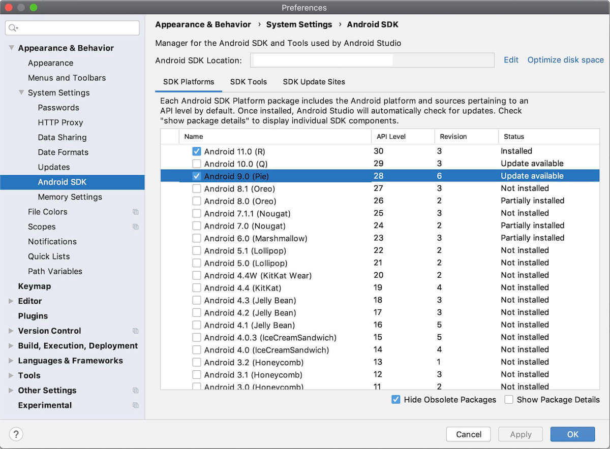
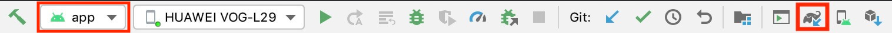
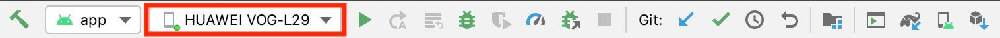

# Приложения для Android

  <a href="README.md">English</a> |
  Русский |
  <a href="README.zh-CN.md">简体中文</a> |
  <a href="README.de-DE.md">Deutsch</a> |
  <a href="README.fr-FR.md">Français</a> |
  <a href="README.es-ES.md">Español</a> |
  <a href="README.ko-KR.md">한국어</a>

## Возможности

Нажмите на ссылки ниже, чтобы прочитать о возможностях приложений.

- [Приложение Robot](app/README.md)
- [Приложение Controller](../../controller/flutter/README.md) (Flutter)

## Установка приложений

Самый простой способ получить любое из приложений — скачать его прямо на телефон с помощью соответствующего QR-кода. Если вы открыли страницу в браузере телефона, можно просто нажать на QR-код. Затем откройте APK-файл на телефоне и [установите](https://www.lifewire.com/install-apk-on-android-4177185) его. Обратите внимание, что APK подписан только отладочным ключом.

<table style="width:100%;border:none;text-align:center">
  <tr>
    <td>  
    </td>
    <td>
  
      </td>
  </tr>
  <tr>
    <td>🤖 App</td>
    <td>🎮 App</td>
  </tr>
</table>

Кроме того, вы можете скачать APK-файлы из ресурсов любого [релиза](https://github.com/ob-f/OpenBot/releases). Если вам нужна последняя версия приложения из ветки master, её также можно скачать из результатов сборки [здесь](https://github.com/ob-f/OpenBot/actions?query=workflow%3A%22Java+CI+with+Gradle%22). Обратите внимание, что она может быть нестабильной. Если вы впоследствии захотите вносить изменения в приложение, выполните описанные ниже шаги, чтобы скомпилировать приложение и развернуть его на телефоне.

> **Примечание:** приложение controller — это [Flutter Controller App](../../controller/flutter/README.md); старое Android-приложение контроллера, которое ранее находилось в этой папке, удалено. Flutter-контроллер использует другой идентификатор пакета (`org.openbot.app.controller` вместо `org.openbot.controller`), поэтому он **не** обновит существующую установку старого контроллера. Если у вас всё ещё установлен старый контроллер, установите новый контроллер отдельно и удалите старое приложение.

## Сборка приложений

### Предварительные требования

- [Android Studio Electric Eel | 2022.1.1 или новее](https://developer.android.com/studio/index.html) для сборки и установки APK-файлов.
- Устройство Android и среда разработки Android с минимальным API 21.
- В настоящее время мы используем API 33 в качестве compile SDK и API 32 в качестве target SDK. Они должны установиться автоматически, но если этого не произошло, вы можете установить SDK вручную. Перейдите в Android Studio -> Preferences -> Appearance & Behaviour -> System Settings -> Android SDK. Убедитесь, что API 33 отмечен, и нажмите Apply.

### Процесс сборки

1. Откройте Android Studio и выберите *Open an existing Android Studio project*.
2. Выберите каталог OpenBot/robot/android и нажмите OK.
3. Если вы хотите установить [приложение OpenBot](app/README.md), убедитесь, что выбрана конфигурация *robot*. При необходимости подтвердите Gradle Sync. Чтобы выполнить Gradle Sync вручную, нажмите на значок gradle.
  
4. Подключите ваше Android-устройство и убедитесь, что отладка по USB включена в [параметрах разработчика](https://developer.android.com/studio/debug/dev-options). В зависимости от вашей среды разработки могут потребоваться [дополнительные шаги](https://developer.android.com/studio/run/device). Теперь ваше устройство должно отображаться в верхней панели навигации.
  
5. Нажмите кнопку Run (зелёная стрелка) или выберите Run > Run 'android' в верхнем меню. Возможно, потребуется пересобрать проект через Build > Rebuild Project.
  
6. Если вас спросят об использовании Instant Run, нажмите *Proceed Without Instant Run*.

### Устранение неполадок

#### Версии

Если вы получаете сообщение вида `The project is using an incompatible version (AGP 7.4.0) of the Android Gradle plugin. Latest supported version is AGP 7.3.0`, вам нужно обновить Android Studio или понизить версию gradle-плагина. Подробнее о совместимости версий Android Studio и gradle-плагина можно прочитать [здесь](https://developer.android.com/studio/releases/gradle-plugin#android_gradle_plugin_and_android_studio_compatibility).
