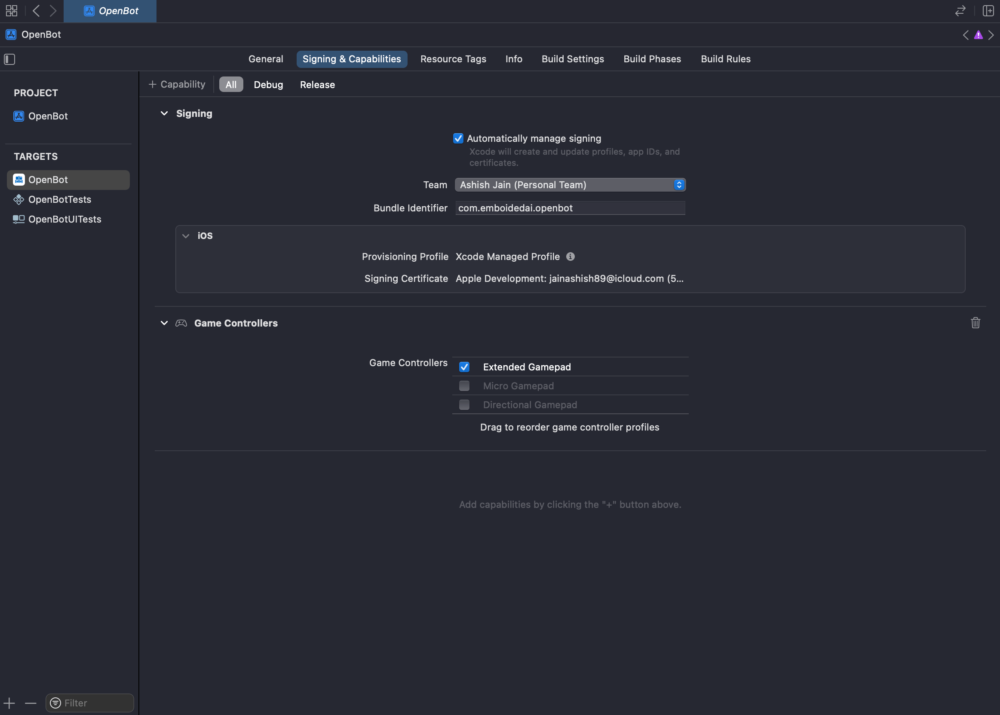
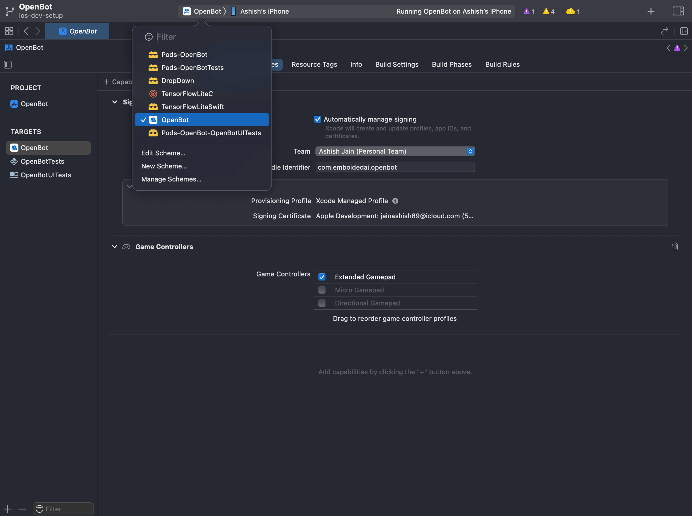
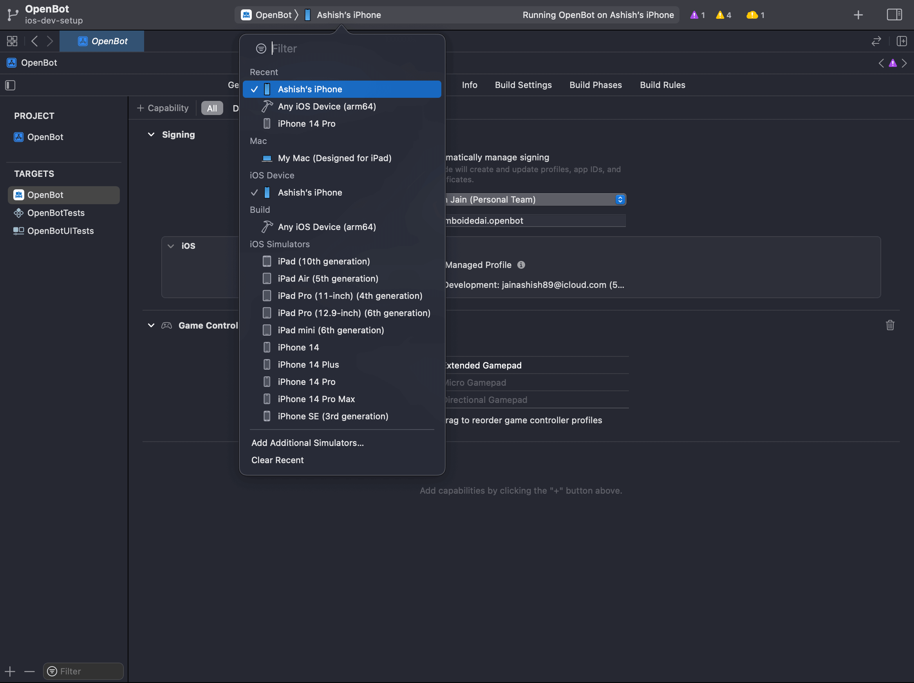

# Приложения iOS — бета-версия

  <a href="README.md">English</a> |
  <a href="README.zh-CN.md">简体中文</a> |
  <a href="README.de-DE.md">Deutsch</a> |
  <a href="README.fr-FR.md">Français</a> |
  <a href="README.es-ES.md">Español</a> |
  <a href="README.ko-KR.md">한국어</a> |
  Русский

## Возможности

Нажмите на ссылки ниже, чтобы прочитать о возможностях приложений.

- [Приложение робота](./OpenBot/README.ru_RU.md)
- [Приложение контроллера](../../controller/flutter/README.ru_RU.md)

## Установка приложений

В настоящее время единственный способ запускать приложения iOS на ваших телефонах — сборки разработчика, как описано в разделе ниже.

## Сборка приложений

### Предварительные требования

- [Xcode iOS 13 или новее](https://developer.apple.com/xcode/) для сборки и установки приложений.
- Установленный в системе [Cocoapods](https://cocoapods.org/).
- Настроенный [проект firebase](./OpenBot/OpenBot/Authentication/README.ru_RU.md).
- В настоящее время мы используем целевую версию развёртывания iOS 15.5.
- Проект настроен как "Automatically manage signing", поэтому вы можете настроить свою собственную независимую учётную запись для сборки приложения -
  
- Чтобы настроить свою команду, добавьте вашу учётную запись iCloud через XCode > Settings > Accounts или напрямую из меню Team выше.
- Устройство iOS как минимум с iOS 13 или новее. [Список поддерживаемых устройств](https://support.apple.com/en-in/guide/iphone/iphe3fa5df43/ios).
- Активированный [режим разработчика](https://developer.apple.com/documentation/xcode/enabling-developer-mode-on-a-device) на вашем устройстве iOS.
- Добавленная учётная запись iCloud должна быть [доверена вашим устройством iOS](https://developer.apple.com/forums/thread/685271).

### Процесс сборки

1. Откройте XCODE и выберите *open a project or file*.
2. Для установки [приложения OpenBot](OpenBot/README.ru_RU.md) убедитесь, что выбрана конфигурация *OpenBot*.
   
3. Выберите ваше устройство из списка доступных устройств.
   
4. Запустите приложение на устройстве, нажав на значок ▶️ в верхней левой части экрана Xcode.
